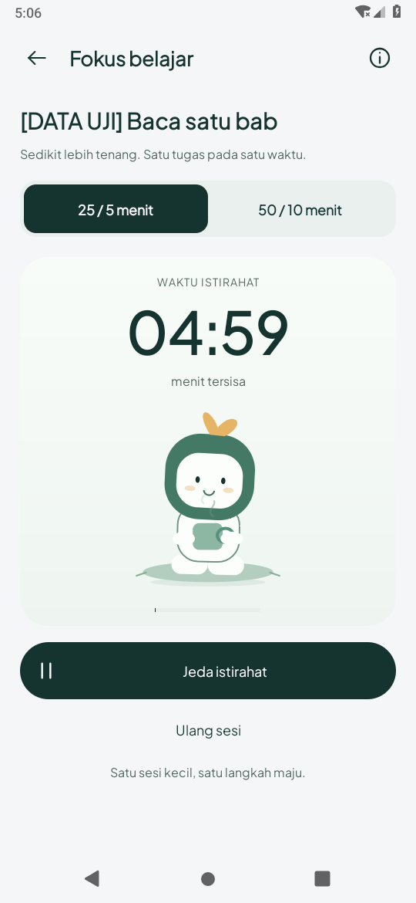

# Bukti break aktif — 21 Oktober 2026 (WIB)

Berdasarkan `87f7454`. Tidak ada perubahan kode aplikasi pada checkpoint ini.
Pengguna meminta cuplikan khusus animasi break, yang belum terlihat di GIF sebelumnya.

Pemeriksaan ulang video `focus-pause-preview.mp4` menunjukkan frame sekitar detik
17 masih **SEDANG DIJEDA**, dan frame akhir sekitar detik 21,5 kembali **WAKTU FOKUS**.
Label sebelumnya yang menyebut video tersebut menunjukkan break aktif tidak tepat:
rekaman dimulai terlalu awal dan batas 24 detik habis sebelum fase break tertangkap.
Pose cangkir pada screenshot jeda bukan bukti timer sudah memasuki break.

## Perbaikan bukti

Tes break eksplisit kini memulai screenrecord **setelah** state dikonfirmasi:
`breakPhase=true`, `running=true`, label **WAKTU ISTIRAHAT**. Rekaman khusus break
diminta delapan detik; hasil video encoder berdurasi 6,44 detik. Dua bitmap karakter berjarak satu detik harus berbeda,
dan sisa waktu break harus berkurang; sesudah itu fixture tugas/preferensi dipulihkan.
Ini memeriksa gerak aktual pada pose istirahat tanpa mengubah loop/timer aplikasi.

[Rekaman break aktif](break-active-preview.mp4) · [GIF](break-active-preview.gif).

Karakter duduk dengan gerak napas/goyangan, kedip dan uap yang naik. Jeda menampilkan
pose cangkir diam setelah transisi; break aktif menggunakan pose serupa dengan loop
bergerak. Akhir sesi fokus dipercepat lewat fixture dan tombol Mulai istirahat
benar-benar diketuk. Tugas **DATA UJI** bukan progres pengguna.

Build APK tes dan satu tes Android 9/API 28 terarah dijalankan ulang pada tahap ini.
52 tes JVM/9 tes Android dari checkpoint aplikasi sebelumnya adalah bukti historis;
tidak diklaim sebagai pengujian ulang di tahap yang hanya memperbaiki tes/rekaman ini.
Runtime API 35 dan HP fisik belum diuji.

## Hasil

Build APK tes lulus dan **1 tes Android 9/API 28 lulus**. [Build](build.txt) ·
[Log Android](device-api28.txt) · [Ringkasan](summary.json). Video/GIF berasal
dari screenrecord native pada kecepatan aslinya, bukan animasi konsep.
