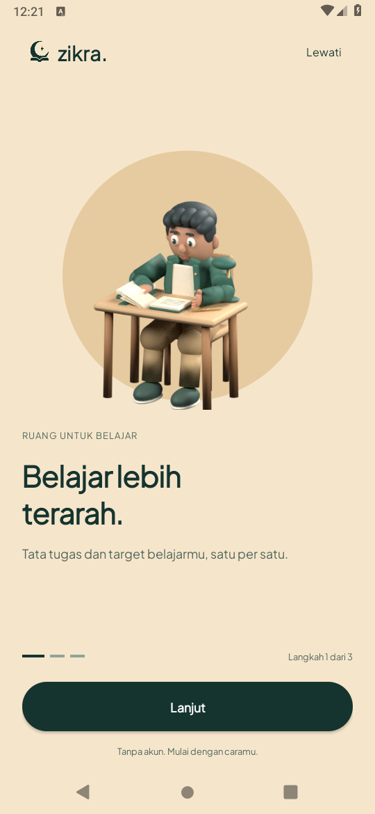
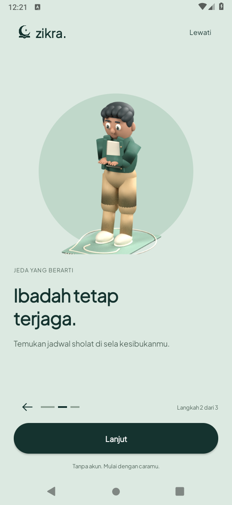
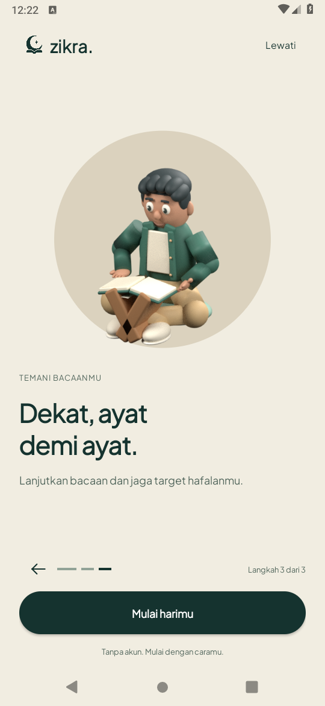
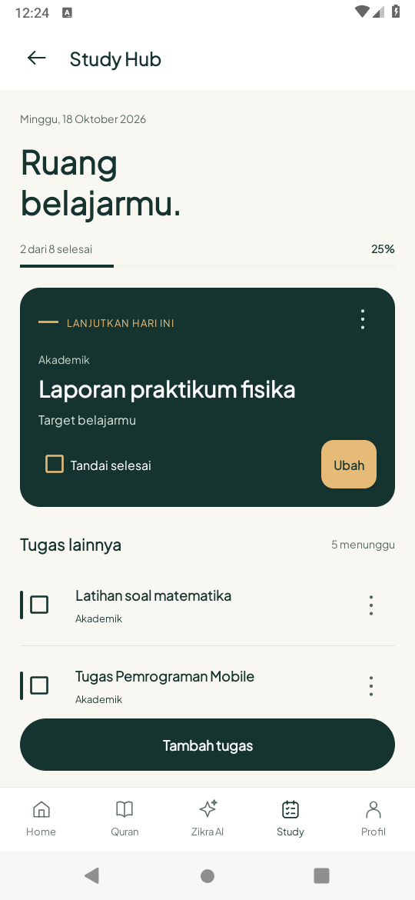
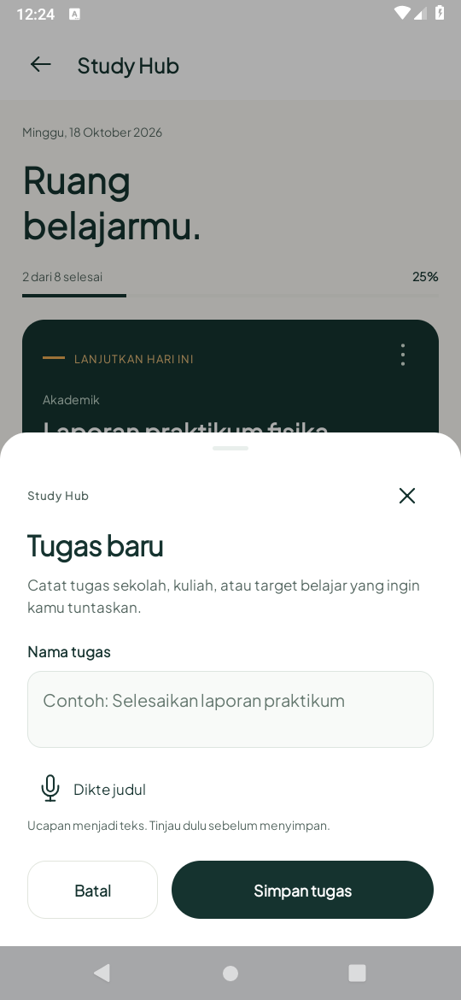
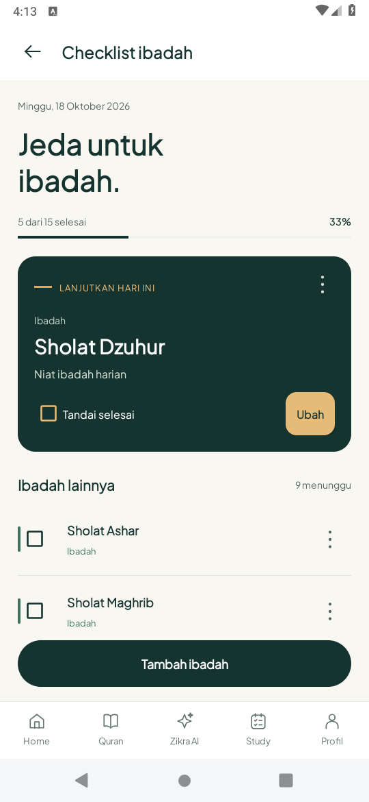
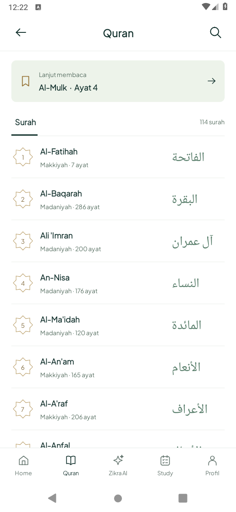
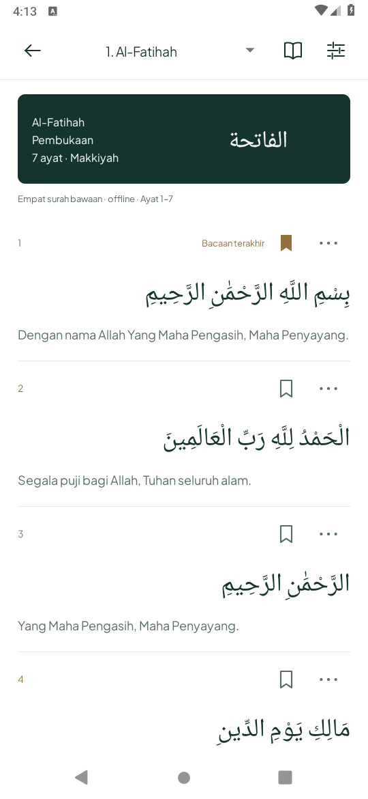
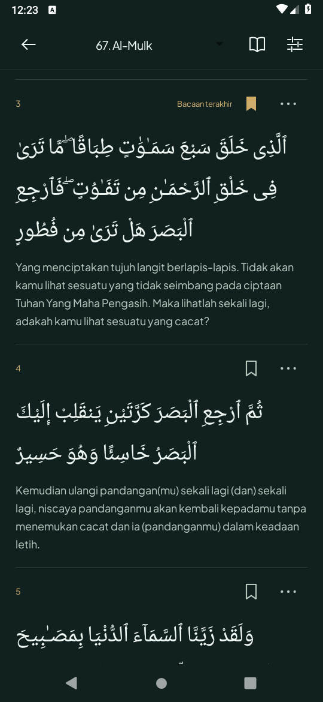

# Onboarding karakter, Study akademik dan Quran ringkas

Pembaruan 18 Oktober 2026 pada branch `recovery/study-hifz-refresh`, Java/XML native.

- **Onboarding:** satu model pelajar 3D asli dalam tiga kegiatan: membuka buku, bersiap sholat, membaca Quran. Tiga judul/deskripsi tetap ada, logo master Pine kiri atas, latar ivory/sage. Pose tangan/kepala/sampul/lembar buku berubah dalam 48 frame/24 fps, dua detik sekali saat masuk; ketuk untuk mengulang. Canvas memakai atlas hanya untuk cerita aktif, melepasnya setelah selesai dan menampilkan poster tajam. Parallax sentuh/tilt terbatas; tidak ada loop idle. Background/hilang fokus, animator scale nol dan hemat daya menghentikan gerak. [Sumber dan reproduksi aset](../../../tools/animation/README.md), [dimensi/hash/distinct frame](asset-verification.json).
- **Study Hub:** hanya kategori akademik, termasuk progres, kartu lanjutkan dan editor tugas. Tidak ada tab ibadah/hafalan atau pilihan kategori lintas fitur pada editor. Checklist ibadah dibuka dari Waktu Sholat; Diary Hifz tetap memiliki target surah/rentang sendiri. Database/ID/kategori/status lama tidak dihapus atau diklasifikasi ulang. Dikte mengisi judul untuk ditinjau sebelum disimpan.
- **Quran:** katalog terang tanpa hero promosi besar, nomor ornamen kecil, baris Latin/Arab dan pemisah tipis. Pencarian berada pada tombol header; cocok dengan nama, arti, nomor atau Arab. Reader membuka pengantar surah pada ayat pertama; lompatan ke bookmark/target lain tetap bekerja. Arab rata kanan, terjemahan terpisah, ikon bookmark dan pilihan salin/bagikan per ayat. Mode terang adalah default; malam/otomatis menjadi pilihan yang tersimpan melalui tombol pengaturan. Bismillah terpisah selain Al-Fatihah (sudah ayat pertama), At-Taubah, atau bagian lanjutan. Tidak ada tab Mushaf/Juz/Hizb yang belum berfungsi.

## Verifikasi

JDK17/SDK35, emulator API28 AOSP dengan software rendering. [Build/unit/lint](build-unit-lint.txt) lulus (24 unit test); [build/lint akhir](final-build-lint.txt) lulus.

Putaran perangkat awal menjalankan 13 metode: 12 lulus, satu menemukan lompatan parallax pada transisi frame akhir ke poster ([log lengkap](device-initial.txt)). Reset offset kini hanya dilakukan saat gerak dinonaktifkan; offset sentuh/tilt tetap stabil pada akhir playback dan perubahan sensor kecil diabaikan. [Empat pemeriksaan terfokus](device-focused.txt) kemudian lulus: gerak/diam/pause, reduced-motion, reader terang/pengaturan malam/recreation, dan pemisahan data akademik/ibadah. Total **14 skenario unik telah lulus** melalui putaran tersebut; bukan satu full-suite 14 sekaligus.

Skenario lain mencakup tiga cerita/recreation/skip/preservasi preferensi, katalog 114 surah dan pencarian, validasi respons, Al-Mulk/bookmark/cache, Al-Baqarah bagian terakhir/sebelumnya, editor/dikte/validasi/draft Hifz, completion/recreation dan routing target ke reader native. Tes memulihkan preferensi/data sementara. Screenshot label bookmark dan progres adalah contoh tes, bukan data pribadi yang dipulihkan. Alur tiga cerita juga diputar ulang untuk pengambilan media; [log capture](capture-flow.txt).

## Screenshot APK

| Belajar | Ibadah | Quran |
| --- | --- | --- |
|  |  |  |

| Study akademik | Editor tugas | Checklist ibadah |
| --- | --- | --- |
|  |  |  |

| Katalog | Reader terang | Reader malam |
| --- | --- | --- |
|  |  |  |

[Diary Hifz](screens/DiaryHifz.png) · [Al-Baqarah ayat 280](screens/RebuiltQuranBaqarah280.png) · [Ikon master aktual](screens/RebuiltAppIcon.png).

[Galeri mandiri](preview.html) · [PDF](preview.pdf) · [Preview aset 24 fps](CharacterAssetPreview.mp4) · [Rekaman APK, FPS rendah](CharacterOnboarding.mp4). Gambar asli tertanam sehingga tidak bergantung pada path cloud lama. Video aset 24 fps adalah render dari frame model asli, bukan rekaman APK; rekaman emulator terpisah hanya 4 frame/sekitar 9 detik, sehingga tidak layak menilai gerak atau performa. Rekaman diganti setelah pemeriksaan awal menemukan launcher Android terekam sebelum aplikasi selesai tampil. Capture akhir menunggu jendela dan screenshot onboarding terkonfirmasi. Preview Home/cuaca pada galeri berasal dari checkpoint pemeriksaan sebelumnya dan diberi keterangan; Home siang/malam skenario tetap berlabel DATA UJI. Tidak mengklaim data pada gambar sebagai data terbaru saat dilihat nanti.

## Batas

Atlas aktif terdekode sekitar 14,1 MiB ditambah poster; tiga atlas tidak dimuat bersamaan sebagai aset aktif. Angka 24 fps adalah laju playback yang ditargetkan, bukan hasil pengukuran HP. FPS rekaman emulator rendah (lihat [metadata](motion-metadata.json)); kelancaran/baterai dan sensor fisik belum diukur. Runtime API35 juga belum diuji.

Quran tetap public v4 dengan 50 ayat per bagian, cache terbatas delapan bagian dan empat surah bawaan. Belum ada Mushaf sesuai edisi, audio atau offline penuh; akses production Content Sync belum dimiliki. Home/lokasi Sukolilo, cuaca dan fitur lain di luar perubahan ini belum diuji ulang menyeluruh. Tidak ada klaim seluruh aplikasi sudah optimal.

[Android Studio](../../BUILDING.md) · [Status dan pemulihan](../../../RECOVERY.md) · [Checkpoint sebelumnya](../rebuilt/README.md).
