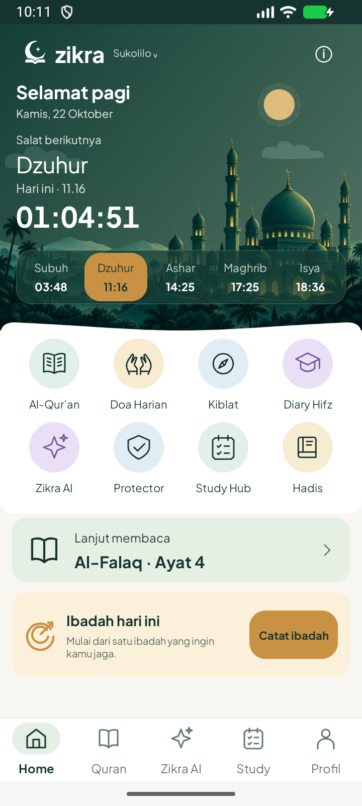
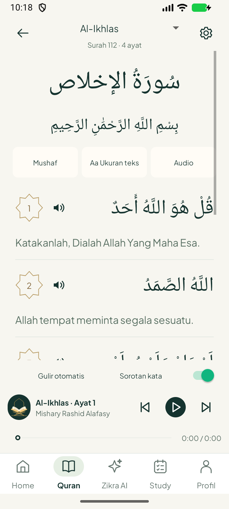
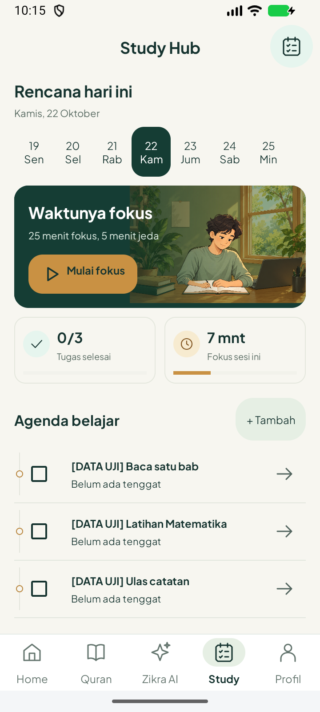

# Tata letak nyaman dipakai — 22 Oktober 2026

**Versi1.4.2 / code10**, berdasarkan `4f38985`. [Referensi dari pengguna](../../../design/approved-2026-10-21/comfortable-layout-reference.png). Perubahan layout native Home, Reader Quran dan Study; aset animasi Study/masjid sebelumnya tetap digunakan.

| Home aktual | Reader Al-Ikhlas aktual | Study (data uji) |
|---|---|---|
|  |  |  |

[Mode malam/font200%](ComfortableReaderLargeNight.png) · [Pilihan ayat](ComfortableVerseActions.png) · [Sorotan kata asli](QuranReaderLiveWordColor.png).

## Penyesuaian referensi

- Reader: judul surat Arab40sp di tengah, metadata surat di toolbar dan bismillah25sp. Latar hijau header besar serta panel alat bertingkat diganti tiga aksi ringkas: Mushaf, ukuran teks, audio. Tidak mengganti teks ayat.
- Nomor dan tombol speaker di kiri ayat, teks Arab di kanan, arti pada baris penuh di bawah. Ketuk nomor/tekan lama ayat untuk menu tandai/salin/bagikan; tombol menu lama tetap menjadi jalur internal tes. Sorotan kata dan ayat tetap memakai sumber serta posisi decoder yang sama.
- Gulir otomatis dan pilihan sorotan dipindahkan ke strip bawah; pemutar memakai gambar, judul/qari dan tiga kontrol utama. Pengaturan audio tetap melalui tombol Audio. Seek48dp dan navigasi tetap terjangkau. Metadata normal lebih ringkas; status error/mismatch tetap dijelaskan.
- Mode malam memberi permukaan gelap dan teks terang pada tiga aksi. Font200% membungkus label tanpa memotong teks dan menyusun informasi/kontrol player pada dua baris. Caption surat tidak dipaksakan menjadi gambar kaligrafi; memakai font Arab perangkat.
- Study: judul tengah, tanggal di atas nama hari pada kalender, hero132dp, statistik72dp, agenda bergaris dan menu chevron. Data tenggat sebenarnya ditampilkan; tanpa tenggat diberi label. Tidak menciptakan prioritas/durasi/statistik harian contoh.
- Home: urutan salat berikutnya → nama → waktu/hari → countdown, area ilustrasi304dp dan ikon menu50dp. Waktu, kota, hitung mundur dan catatan ibadah memakai data aplikasi.

## Validasi

[Build APK/testAPK/lint final](build.txt): lulus22detik, 1worker/heap512MiB; lint0error/fatal. Jumlah warning di [result.json](result.json); bukan klaim semua warning lama terselesaikan. JVM tidak diulang karena perubahan layout/chrome; hasil versi1.4.1 tetap historis.

[Enam metode native](six-native-tests.txt), 29.581detik, seluruhnya lulus: posisi nomor/speaker/Arab/arti dan aksi font/menu; mode malam/font200%; urutan salat Home; ilustrasi/calendar/editor Study; sorotan kata/ayat berikut rekaman Alafasy asli; kontrol mini-player katalog. Sesudah koreksi kontras dan arrow Study, [tiga tes terkait](three-targeted-tests.txt) diulang dan lulus7.079detik. Sesudah koreksi wrapping label serta padding bismillah terakhir, [dua tes Reader](final-reader-tests.txt) diulang dan lulus4.698detik. Bukan11metode unik; ada6metode dengan pengulangan terarah.

Screenshot Home dan Study berasal dari pengujian geometri. Tugas bertanda DATA UJI serta7mnt sesi adalah fixture yang dibersihkan/dikembalikan teardown. Home menampilkan waktu/lokasi aktual emulator. LiveWordColor/NextAyah memakai rekaman Alafasy asli sebelum perubahan kosmetik terakhir; CatalogMiniSynthetic tetap diberi label WAV sintetis.

[Crash buffer](crash-log.txt). Satu emulator720x1600/density320 digunakan, lalu ditutup. HP fisik, semua qari/surah, baterai dan semua kombinasi layar belum diuji. Animasi karakter tidak diubah ronde ini. APK debug disalin ke folder luar checkout; hasil kesamaan sumber index/APK dan sertifikat di result.json.

## Batas terhadap gambar konsep

Susunan mengikuti referensi, bukan salinan piksel. Logo master Zikra dan ilustrasi yang telah dipilih tetap dipakai. Tombol kecepatan audio dan label prioritas contoh pada konsep tidak ditambahkan sebagai tampilan palsu; fitur tersebut belum diterapkan. Statistik fokus adalah sesi berjalan, bukan total harian. Protector/Hadis/Doa belum didesain ulang pada ronde ini.
