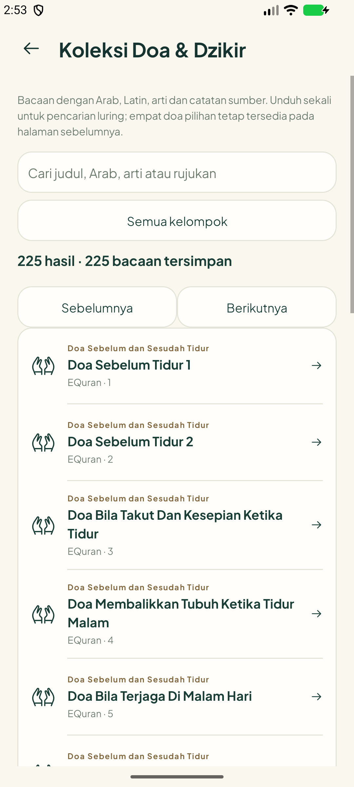
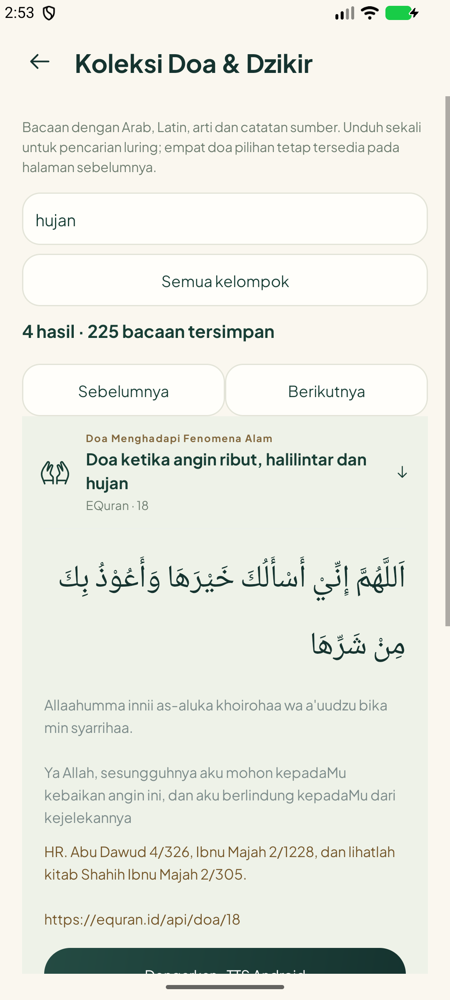

# Hadis/Doa — checkpoint beta 1.7.0

24 Oktober 2026. Source produksi **`fcaf20f`**, APK **31.413.900 byte / 31,4 MB**. Unit **104 lulus / 3 dilewati**, lint **0 error / 698 peringatan**. B02/B03 mempunyai bukti perilaku native. **B01 dan B04 belum ditutup**: integrasi kandidat tidak mengesahkan kelengkapan edisi, asal terjemahan, hak konten atau seluruh rujukan. Tidak ada hosting konten/AI produksi pada checkpoint ini.

## Yang berjalan

- Hadis: paket opsional Bukhari **6.638** dan Muslim **4.930** entri dari commit Gading/Tafsirq yang dipatok. Hanya 20 baris dimuat untuk setiap halaman; nomor sumber dicari langsung, bukan posisi array. Judul/Arab/arti dapat dicari pada **data yang sudah diunduh**, termasuk secara luring. Label cakupan, kosong, gagal, coba ulang, pembatalan dan hapus paket tersedia.
- Reader memakai ID `tafsirq-v1:kitab:nomor`. Bookmark/posisi tidak dihapus bersama paket; unduh ulang membuka ID yang sama. Tujuh kutipan lama tetap utuh dengan ID lama. Nomor tidak tersedia tidak dialihkan ke bacaan lain.
- Doa: empat pilihan bawaan tetap tersedia. Halaman koleksi tambahan mengunduh sumber EQuran setelah tindakan pengguna; **225 bacaan** lolos pemeriksaan kehadiran Arab/arti/rujukan dari 227 baris. ID 42 tanpa arti dan 144 tanpa rujukan tidak ditampilkan. Ada kategori, pencarian, halaman 20 baris, buka/tutup bacaan dan hapus unduhan. Status berujukan berarti field rujukan ada, **bukan seluruh isinya telah ditashih**.
- Pelafalan koleksi tambahan adalah **TTS Android**, bukan rekaman qari. Tanpa suara Arab tersedia, tombol menjelaskan keadaan tersebut; kualitas pelafalan tetap perlu HP.

## Keamanan, pembaruan, dan ruang

Hadis memakai HTTPS ke host tetap, tanpa redirect, batas ukuran sesuai paket dan SHA-256 sebelum impor streaming dalam transaksi SQLite. Berkas sementara dibersihkan. Data lama tidak diganti saat batal/korupsi. Database konten baru mengaktifkan `auto_vacuum=FULL`, sehingga hapus paket benar-benar mengembalikan halaman berkas; penanda disimpan terpisah dalam preferensi. Pengujian database fixture membuktikan ukuran turun, tujuh kutipan lain tetap ada. Database konten percobaan sebelum versi ini belum merupakan migrasi rilis publik.

Doa memakai endpoint HTTPS tetap, tanpa redirect, batas 1 MiB, validasi struktur/ID/teks, lalu penggantian atomik cache privat. Payload tidak lengkap tidak mengganti cache lama. Teks sumber ditampilkan sebagai teks biasa, tidak dieksekusi sebagai HTML. Pencarian memakai normalisasi salinan, tidak menulis ulang bacaan asli. SQL menggunakan parameter. Tidak ada API key pada fitur ini, tidak mengirim profil/lokasi/pesan kepada penyedia konten.

Raw JSON seluruh kitab/doa **tidak dimasukkan APK atau repo**. Hadis memerlukan unduhan sekitar 13,4 MB + 12,0 MB; penyimpanan hasil impor dapat lebih besar. Doa respons nyata 283.848 byte. Installer tetap di bawah 100 MB; ukuran cache setelah instalasi berbeda dari installer.

Pembaruan Hadis dilakukan dengan perubahan eksplisit versi/hash setelah audit; nomor yang tidak ada tidak dibuat dengan AI. Jika edisi/penomoran berubah, gunakan namespace baru serta migrasi pemetaan yang diperiksa, jangan memindahkan bookmark ke nomor dari edisi berbeda. Pembaruan EQuran divalidasi sebelum cache ditimpa; ID sumber dipertahankan.

## Pemeriksaan

1. **HadithContentTest**, sumber asli, `OK (1 test)`, 51,661 detik: kedua paket, count/halaman, nomor Arab ٣٠٠١ → nomor 3001; celah 2978 tidak menghasilkan entri; nomor 7008 tetap sah. Query injeksi tidak mengubah hasil; impor terpotong dan pembatalan mempertahankan paket lama. Reader/simpan/hapus paket/unduh ulang mempertahankan ID dan posisi. Dataset hasil tes dibersihkan, preferensi awal dipulihkan. [Log](hadith-native.txt), [reader asli](../hadith-content-2026-10-24/Hadith-Real-3001.png), [katalog asli](../hadith-content-2026-10-24/Hadith-Real-Collection.png).
2. **OptionalContentTest**, dua metode pada build akhir: unduh EQuran nyata → 225 entri → buka ulang cache tanpa fetch; respons pembaruan rusak melalui interceptor uji ditolak dan bytes cache tetap identik. UI 20 baris, halaman berikutnya, pencarian hujan/tidak ditemukan, filter kelompok, buka sumber/TTS dan buka ulang diuji. Tes lain membuktikan berkas SQLite mengecil setelah hapus paket. Cache awal dikembalikan. [Log](optional-native.txt).
3. Build debug/test, lint dan unit: rincian/hash paket pada [release.json](release.json), [log build](build.txt). Pemeriksaan Hadis lengkap dijalankan sebelum penambahan layar Doa; perubahan berikutnya pada penghapusan ruang diuji terarah, tidak mengulang unduhan besar tanpa alasan.
4. Satu emulator API 37.1 dijalankan hanya setelah build selesai; **ditutup setelah tes**. Tidak ada pengujian pada HP pengguna atau klaim aksesibilitas semua ukuran layar.

## Batas yang tetap terbuka

- **B01:** identitas edisi cetak/penerjemah Indonesia dan ketentuan konten upstream Tafsirq belum ditemukan; MIT repo telah disertakan sebagai atribusi software, tidak disalahartikan sebagai bukti hak semua terjemahan. Celah 370 nomor Bukhari/432 Muslim telah terdeteksi. Jangan menyebut dataset sebagai kitab cetak lengkap. [Audit sumber](../hadith-source-2026-10-24/README.md). Belum disahkan untuk distribusi publik.
- **B04:** [inventaris metadata](doa-source-audit.json) mencatat makan/tidur/rumah/perjalanan/hujan/ilmu. Kelompok pagi/petang belum tersedia pada sumber yang diperiksa. ID 18 memiliki judul gabungan angin/halilintar/hujan tetapi bacaan tentang angin; konteks tidak otomatis dianggap doa khusus petir. Perlu kurasi rujukan, kelengkapan konteks dan izin konten sebelum B04/G03 ditutup.
- Server produksi, rotasi key AI yang pernah dibagikan, token distribusi per instalasi, percakapan HP, alarm/adzan dan pengukuran perangkat tetap mengikuti C–G. Debug beta ini bukan rilis publik final.

## Screenshot native

