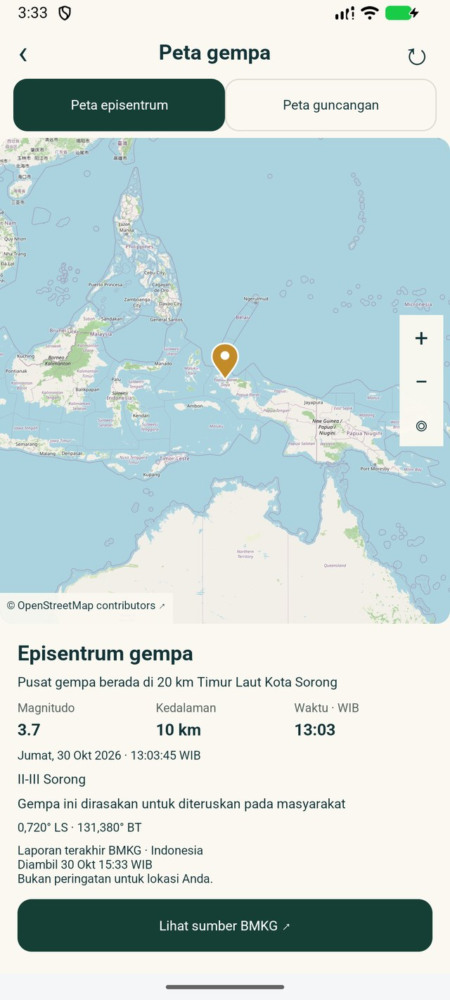
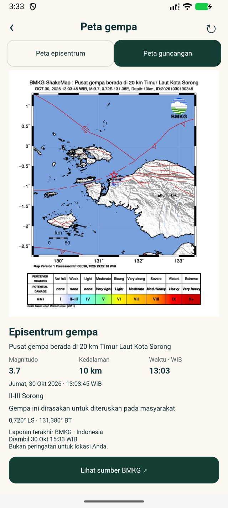
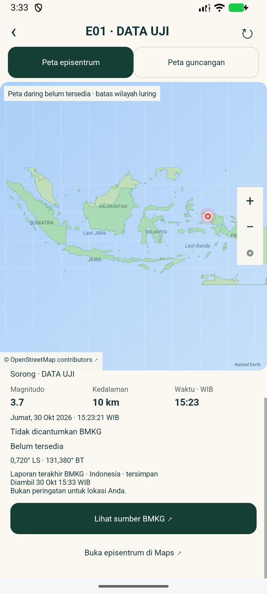
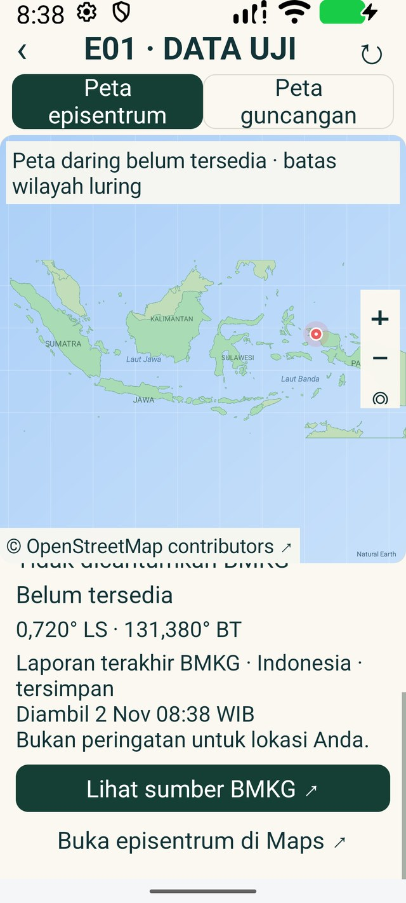

# E01 — laporan gempa, peta dan Shakemap

Selesai teknis beta terarah **2 November 2026**, APK **1.9.34 / code 61**.
Source: `1ea08ee0b68a84e9ef6d2b920c3888c5b4109e5a`.
Uji data langsung/default dilakukan 30 Oktober; uji font 200%, unit/lint akhir,
preservasi, pengemasan dan checkpoint dilanjutkan 2 November. Ini bukan klaim
bahwa feed yang direkam pada 30 Oktober adalah laporan terkini 2 November.

## Perilaku yang diperbaiki

- Satu snapshot memuat laporan BMKG beserta waktu pengambilan asli. Magnitudo,
  kedalaman, wilayah, koordinat, waktu kejadian dan nama Shakemap berasal dari
  snapshot yang sama. Tap kartu membuka laporan pilihan, walau cache sudah
  menerima kejadian lain. Refresh manual meminta laporan terakhir.
- Cache segar dipakai ulang selama 60 detik; cache tersimpan maksimal 24 jam
  dapat ditampilkan saat gagal memperbarui, dengan tanggal/jam pengambilan
  asli dan label tersimpan. Cache rusak, dari masa depan atau kedaluwarsa
  ditolak. Respons kejadian lama tidak menimpa kejadian lebih baru.
- Koordinat dibaca latitude,longitude. Koordinat invalid tidak diberi pin atau
  tautan Maps palsu. Laporan nasional di Sorong tetap ditampilkan walaupun
  kota pengguna Surabaya; layar menjelaskan bukan peringatan bagi lokasimu.
- Shakemap lama dibersihkan ketika laporan/revisi berubah. Gagal memuat gambar
  tidak meninggalkan gambar kejadian lain. Hanya HTTPS origin BMKG dan satu
  redirect ke CDN resmi dengan nama file persis sama diizinkan; tidak ada
  pengalihan umum, HTTP atau bypass TLS. Gambar dibatasi 4 MiB dan dimensinya
  diperiksa sebelum decode dengan sampling.
- Saat tile daring gagal, batas wilayah luring dan pin laporan tetap tersedia,
  dengan penjelasan kegagalan dan detail/tautan Maps yang dapat digulir.
  Uji fallback mengaktifkan cabang timeout secara terkendali; bukan pengujian
  setiap jaringan/operator atau jaminan ketersediaan tile.

## Bukti

| Pemeriksaan | Hasil |
| --- | --- |
| Unit seluruh modul | 169 lulus, 4 skip lama, 0 gagal |
| Native final | 18 metode unik; 18 default + 3 ulang font 200% = 21 eksekusi lulus |
| Lint | 0 error, 861 warning yang belum diselesaikan global |
| Feed BMKG dan Shakemap nyata | 30 Oktober: Sorong M3.7, 10 km, -0.72 / 131.38, waktu 13:03:45 WIB; bidang layar dan judul Shakemap cocok |
| Kegagalan/cache | HTTP gagal, cache segar/lama/kedaluwarsa, pembatalan, respons terlambat, gambar pengganti gagal, URL asing dan tile timeout |
| Preservasi | 32 berkas internal asli emulator pulih cocok hash, pengaturan/viewport kembali, helper dibuang, emulator ditutup; HP tidak diakses |
| APK | 45.738.506 byte, <100.000.000; signer debug sama, 0 nilai credential dikenal ditemukan; dua audio asli cocok hash |

[Hitungan dan skip](checks.json), [seluruh percobaan native](native-attempts.json),
[18 tes default](e01-regression-final.txt), [3 tes font besar](e01-font200-retry.txt),
[probe publik](bmkg-live-probe.json), [snapshot native](bmkg-native-snapshot.json),
[APK/source/hash](apk.json), [preservasi](preservation.json),
[WIP/stash/aset/konfigurasi](protected-state.json).

## Riwayat kegagalan tetap dicatat

1. Probe awal menerima feed tetapi gagal pada pengambilan gambar
   ([hasil awal tetap gagal](bmkg-initial-probe.json)). Diagnosis menunjukkan
   `static.bmkg.go.id` mengembalikan 301 ke `cdn.bmkg.go.id` dengan file sama.
   Allowlist redirect terbatas ditambahkan, unit penolakan host/path/query/HTTP
   dan pemuatan JPEG BMKG nyata kemudian lulus. Tidak mematikan TLS.
2. Build gabungan dengan emulator sempat gagal karena alokasi memori Java /
   pagefile Windows (1455). Assembly aplikasi/helper sebelumnya berhasil.
   Unit dan lint akhir dijalankan tanpa emulator, selesai 34 detik. Log mentah
   tetap lokal; kegagalan ini tidak dihitung lulus.
3. Percobaan pertama font 200% pada 2 November dihentikan Android LOW_MEMORY
   saat boot baru selesai; 0 tes selesai. Setelah boot stabil dan layar emulator
   dibangunkan, tiga metode yang sama lulus tanpa perubahan kode. Percobaan
   shell membuka Activity detail ditolak karena Activity tidak exported;
   pengujian memakai Instrumentation resmi, tanpa membuka exported permission.

## Batas dan langkah berikutnya

E01 ditutup sebatas integritas laporan dan perilaku beta yang diuji di atas.
Tidak ada push gempa/server polling, prediksi atau janji peringatan sebelum
getaran; **E02 berikutnya**, E03/E04 belum selesai. B01, C02 laptop mati,
C07 picker/grant fisik, D02/D02a hak distribusi audio dan sisa HP, F/G/publik
masih mengikuti checklist. Tidak ada update HP, deploy backend, email atau
perubahan key/model/paket di checkpoint ini. APK debug lokal belum rilis publik.

Sumber dan atribusi: [BMKG Open Data](https://data.bmkg.go.id/gempabumi/),
[feed BMKG](https://data.bmkg.go.id/DataMKG/TEWS/autogempa.json).
Tile daring © OpenStreetMap contributors; batas wilayah luring Natural Earth.
Laporan kejadian dan ShakeMap bukan prediksi gempa.
