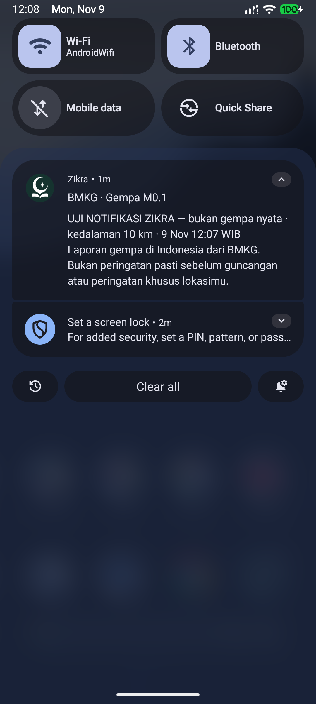
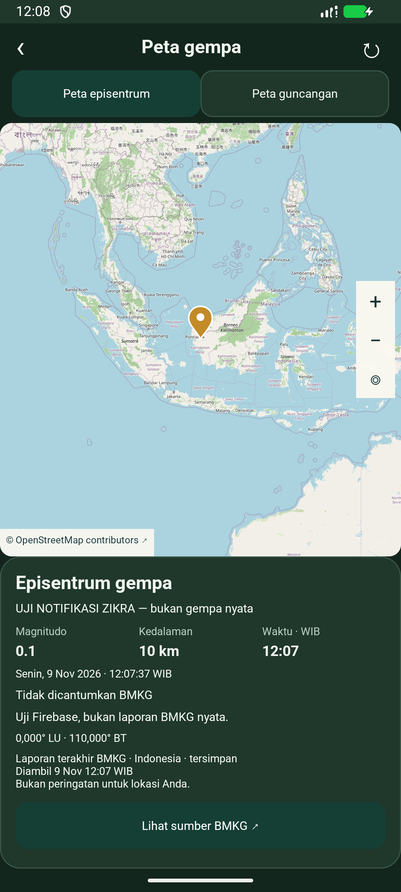
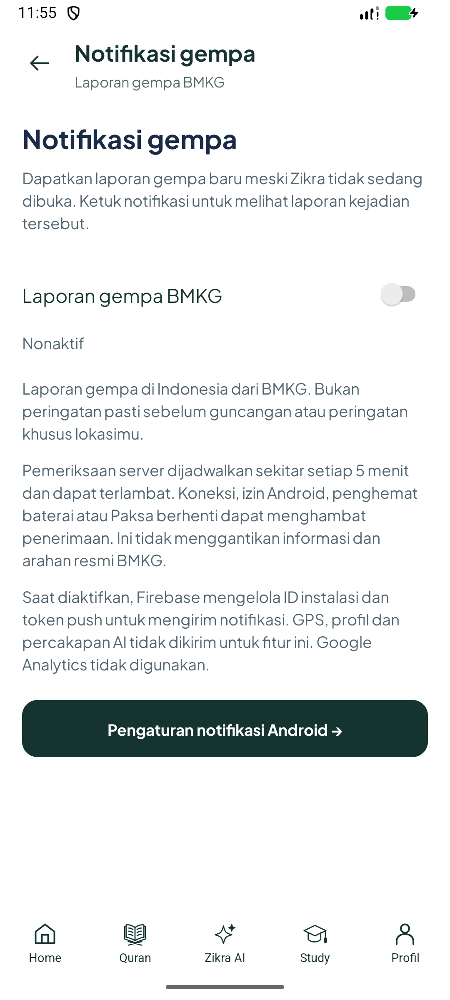
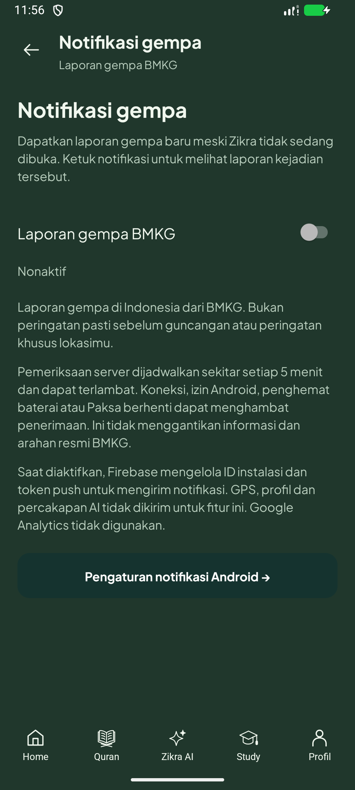
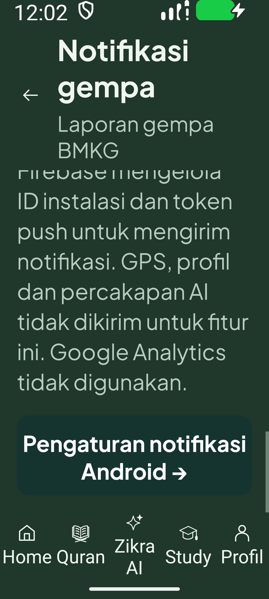

# E02 — Push gempa, beta 1.9.36, 9 November 2026

**E02 masih terbuka.** Implementasi dan uji terarah selesai; aktivasi pemeriksaan
massal, observasi jadwal nyata dan uji HP fisik belum selesai. Variable GitHub
`ZIKRA_QUAKE_PUSH_ENABLED` tetap `false`. Bukan penyelesaian seluruh A–D/E atau
persetujuan rilis publik.

## Hasil

- Endpoint privat Vercel `/v1/earthquakes/poll`, tiga feed BMKG tetap, baseline
  tanpa kirim laporan lama, ledger Redis tujuh hari, pembatasan poll dan reservasi
  sebelum kirim. Restart proses/duplikat/revisi/hasil ambigu diuji dengan Lua.
- Pengirim khusus Firebase hanya berperan **Firebase Cloud Messaging API Admin**.
  Server key ada di konfigurasi privat lokal dan Vercel, tidak di Git/APK.
  Pemicu terpisah disimpan sebagai secret terenkripsi GitHub. Tidak mengubah
  provider/key/model AI atau menaikkan paket berbayar.
- Android opt-in, penolakan izin/kanal, dedup persisten, pembatalan antrean saat
  opt-out dan tujuan notifikasi berupa snapshot kejadian. Snapshot kedaluwarsa
  tidak diganti otomatis dengan laporan terbaru. Ikon tetap simbol Zikra.
- Kontras tab/tombol sumber serta status bar detail gempa diperbaiki pada tema
  gelap; logo, ikon fitur dan artwork Home tetap.

## Bukti yang benar-benar dijalankan

| Pemeriksaan | Hasil dan batas |
| --- | --- |
| Backend | 79 lulus, 0 skip; [log](backend-tests.txt), termasuk tujuh tes push baru. |
| Android unit | 176 lulus, 4 skip; bukan 180 lulus. |
| Lint | 0 error, 878 warning; warning proyek tidak diklaim bersih seluruhnya. |
| Native akhir | 11 eksekusi / 9 metode unik lulus pada emulator API37.1; [rincian](checks.json). |
| Tampilan | Dua tema, 320dp/font200, scroll ke tombol dan sentuhan permintaan pengaturan. Tujuan Settings diintersep pada tes sentuhan; bukan bukti seluruh UI Pengaturan Android. |
| Vercel nyata | Health200, tanpa token401, metode salah405, poll pertama200/baseline/accepted0. [Bukti](hosted-probe.json), [manifest deploy](deployment.json). |
| Firebase nyata | OAuth pengirim + `validate_only`200, tanpa pengiriman pada validasi. [Bukti](firebase-validation.json). |
| Push nyata APK akhir | Operator lokal → FCM → **token emulator saja**, bukan topic massal. Sebelum kirim: proses app tidak berjalan dan layar mati, tanpa force-stop. Android menampilkan satu notifikasi; ID sama dikirim ulang tetapi waktu pembuatan/pembaruan/interupsi tidak berubah. |
| Ketukan nyata | Notifikasi FCM diketuk dari panel Android; area/magnitudo uji yang sama terbuka offline. Bukan sekadar pemanggilan receiver simulasi. |
| Pembersihan | Unsubscribe, delete token dan delete installation Firebase uji diakui SDK; 32 berkas awal dipulihkan cocok hash, pengaturan/viewport dan izin runtime diperiksa, helper/berkas uji dibersihkan, emulator ditutup. [Bukti](preservation.json). HP tidak disentuh. |

Rantai push nyata pada APK dengan SHA yang cocok:
[sebelum kirim](cloud-before.json), [FCM menerima](cloud-first.json),
[Android menerima](cloud-delivered.json), [duplikat](cloud-duplicate-proof.json),
[tujuan laporan](cloud-selected-proof.json). Pesan berlabel **UJI**, bukan gempa
nyata atau broadcast ke pengguna.

## Kegagalan dan koreksi tetap dicatat

- Tes backend pertama: interpreter venv lama hilang; kemudian adapter fakeredis
  mengembalikan `true` untuk Redis SET sementara REST produksi memakai `OK`.
  Adapter dibetulkan dan TTL fixture disesuaikan dengan waktu uji. Percobaan penuh
  berikutnya menemukan batas akses folder sementara serta assertion daftar route
  lama; akses lingkungan dan assertion diperbaiki. Hasil akhir79/0skip di atas.
- Tes native pertama menemukan notifikasi antre belum masuk daftar active saat
  opt-out; pembatalan kini juga memakai ID persisten, dengan pemeriksaan ulang
  di bawah lock. Tes final membuktikan kanal lain tidak ikut dibatalkan.
- Registrasi awal sempat `SERVICE_NOT_AVAILABLE`; registrasi ulang sesudah
  penghapusan identitas dan pergantian jaringan juga sempat gagal/timeout langganan.
  Setelah emulator dimulai ulang dan koneksi Google Play pulih, registrasi topic,
  push APK akhir serta penghapusan registrasi lulus. Ini batas layanan yang nyata,
  bukan jaminan selalu langsung tersambung; UI mempertahankan status menunggu.
- Tes tambahan yang berpindah ke Pengaturan Android macet dan dihentikan.
  Harness kemudian mengintersep intent sistem dan menguji sentuhannya tanpa
  berpindah aplikasi. Lima percobaan native gagal tetap pada
  [riwayat percobaan](native-attempts.json), tidak diubah menjadi lulus.
- Screenshot awal setelah wake-up masih hitam; bukti yang diterbitkan diambil
  setelah layar siap. Pemeriksaan UI pertama sempat null saat transisi; layar
  tujuan kemudian diverifikasi dan pengulangan APK akhir berhasil.

## Gerbang yang belum terpenuhi

1. **Aktivasi massal belum diizinkan.** Review persetujuan otomatis menolak poll
   produksi setelah baseline karena bisa mengirim laporan nyata kepada semua
   pelanggan topic, sedangkan persetujuan jelas baru untuk uji emulator terarah.
   Tidak dicoba melalui workflow atau jalan lain. Jadwal tetap nonaktif.
2. Setelah persetujuan, jalankan poll nyata, aktifkan variable jadwal dan amati
   run terjadwal berhasil. Rantai **Vercel → FCM pengiriman nyata** belum diklaim
   lulus hanya dari baseline atau uji pengirim lokal.
3. Uji HP fisik pada versi ini, termasuk aplikasi ditutup, ketukan kejadian dan
   kondisi baterai/OEM. Jangan berulang meminta USB ketika pengguna menundanya.
4. Lima menit adalah rencana pemeriksaan, bukan tenggat jaminan. GitHub, sumber,
   jaringan, Google Play, force-stop/HP mati dan batas OS bisa menunda/mencegah.
   Kejadian >1jam ditolak; TTL pesan maksimal15menit. Ini bukan prediksi gempa.
5. Kebijakan privasi/Data Safety SDK baru dan gerbang publik tetap perlu diselesaikan.
   B01, C02 laptop mati, C07 fisik, D02/D02a serta sisa E/F/G tetap menurut plan.

## APK dan preservasi

APK lokal: `Zikra-Earthquake-v1.9.36-beta-debug.apk`, code63,
**50.062.820 byte**, SHA256
`77d76f1879f75363f8c2737169206a4c371289bdeb90c341c8a4fa20512be2b5`.
[Audit APK](apk.json): di bawah100MB, signer dan kedua rekaman tetap, nol nilai
credential server dikenal/nol file konfigurasi privat ditemukan di APK.
Identitas client Firebase sengaja dibundel untuk SDK, bukan kunci pengirim.
WIP `PROJECT_HANDOFF.md`, stash/arsip audio, env Featherless, logo dan master
artwork tetap cocok hash. APK1.9.35 lama dipertahankan; HP terakhir terbukti
agen1.9.31, tidak dinaikkan oleh pengujian ini.

[Runbook, sumber resmi dan batas privasi](../../../backend/deploy/EARTHQUAKE_PUSH.md).
