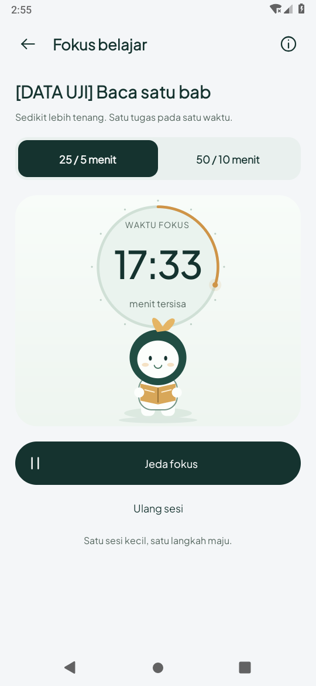
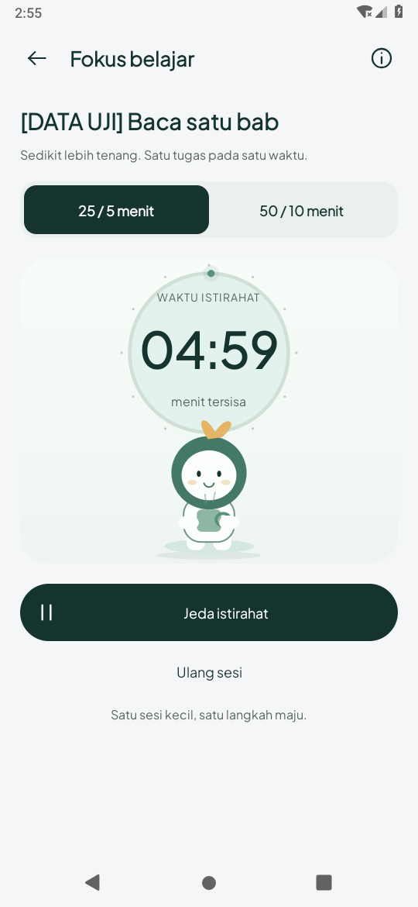

# Teman fokus / Pomodoro — 20 Oktober 2026 (WIB)

Berdasarkan `f48fd31`. Pengguna meminta timer lebih menarik dan memberi dua rekaman
referensi: butiran buah memantul, lalu satu karakter dengan pose fokus/istirahat.
Arah yang diterapkan mengikuti referensi kedua: satu teman fokus dengan gerak lembut.
Pengguna juga mengizinkan checkpoint sebelumnya dan perubahan ini langsung masuk main
setelah pemeriksaan. Periksa hash remote sebelum melanjutkan sesi berikutnya.

## Hasil

- Komposisi timer lebih ringan: cincin progres waktu berlalu, angka di dalam cincin,
  panel sage lembut, tombol utama Pine dan tindakan Ulang sesi yang ringkas.
- Karakter daun orisinal digambar dengan Canvas Java: membaca buku saat fokus,
  memegang cangkir saat istirahat. Gerak napas dan kedip berjalan ketika timer aktif.
  Warna cincin/hood berpindah halus saat berganti fase. Ini ilustrasi dekoratif;
  master logo bulan/buku/spark tidak diubah atau diganti.
- Gerak maksimal dijadwalkan sekitar 30 fps, berhenti saat timer dijeda, dialog menutup
  fokus jendela, halaman/background, animasi sistem nol atau penghemat daya aktif.
  Canvas memakai ulang Paint/Path/RectF. Tidak ada sensor, network, sprite/video asset,
  dependensi atau izin tambahan untuk animasi.
- Animasi masuk sekali dan feedback tombol singkat mengikuti `AmbientMotionPolicy`
  bersama. Perubahan dekorasi tidak menghitung atau memajukan timer.
- Hitungan tetap memakai `FocusClock` monotonic dan preferensi/alarm checkpoint
  sebelumnya. Mulai istirahat tetap tindakan eksplisit; tugas tidak otomatis selesai.
- Angka tetap TextView native; ilustrasi dikecualikan dari aksesibilitas. Font besar
  memberi stage lebih tinggi agar label dan ilustrasi terpisah; halaman dapat digulir.
  Keterangan operasional timer tersedia melalui tombol informasi di header.

## Preview Android aktual

Rekaman dan screenshot berasal dari APK pada emulator Android 9/API 28, 540×1170px,
210dpi, software rendering. Tugas **DATA UJI** dan sisa 17:40 merupakan fixture untuk
memperlihatkan progres tanpa menunggu satu sesi penuh, bukan riwayat belajar pengguna.
Klip memperlihatkan lanjut → gerak → jeda → lanjut. Pose istirahat menggunakan state
selesai terkendali dan ketukan Mulai istirahat yang nyata. Raw referensi pengguna tidak
dimasukkan ke repository.

[Rekaman Android sekitar 13 detik](focus-companion-preview.mp4).

| Fokus | Istirahat |
| --- | --- |
|  |  |

[Jeda](screens/jeda-data-uji.png) · [Font sistem 200%](screens/font-200-data-uji.png).

## Cakupan dan batas

Uji terarah memeriksa gerak dimatikan melalui setting animator sistem, jeda/lanjut,
dialog, background/recreation, pergantian pose eksplisit, font 200% dan sisa waktu yang
tetap tersimpan. Preferensi timer/setting dan satu tugas sementara dicadangkan atau
dipulihkan; tes tidak menghapus database pengguna.

Penghemat daya menggunakan policy bersama yang membaca PowerManager dan broadcast;
perilaku baterai vendor, perangkat fisik dan runtime API 35 belum diuji pada tahap ini.
Frame scheduling 30 fps adalah batas yang diminta kode, bukan klaim pengukuran performa
HP. Build tetap JDK 17, compile/target SDK 35, minimum 26. Tidak ada perubahan schema
SQLite atau sumber provider peta/audio pada tahap visual ini; batas live sebelumnya
masih berlaku pada [checkpoint peta/audio/Study](../map-audio-study-2026-10-20/README.md).

## Hasil pemeriksaan

- `assembleDebug`, APK tes, `testDebugUnitTest` dan `lintDebug` lulus.
  **52 tes JVM lulus, tanpa kegagalan/error/skip; lint nol error** (warning nonfatal
  tercatat di summary.json). [Build](build.txt) · [Ringkasan](summary.json).
- Android 9/API 28: **7 metode unik lulus**: lima `FocusMotionTest` dan dua regresi
  `AcademicFeaturesTest` (background/pause/recreation serta area sentuh font besar).
  [Log akhir](device-final-api28.txt).
- [Enam tes awal](device-initial-six-api28.txt) lulus sebelum penambahan kasus font
  sistem 200%. [Kasus font awal](font-initial-api28.txt) menemukan label berdekatan
  dengan ilustrasi; asersi pada UI thread sempat menghentikan runner. Tinggi stage dan
  baris angka diperbaiki; helper asersi kini meneruskan kegagalan ke test thread agar
  cleanup tetap berjalan. Fixture task/timer yang tertinggal dibersihkan khusus ID
  tes tersebut, lalu setting dipulihkan dan ketujuh metode akhir lulus.
- Pengaturan font/animator akhir dipulihkan ke nilai semula (1.0 pada emulator ini).
  Tidak menganggap perubahan animasi sebagai penyelesaian tugas atau sesi belajar.

APK debug sebagai artefak chat, bukan biner APK di Git. SHA-256 di summary.json.
Main diperbarui sesuai instruksi pengguna; mencakup `2b13539`, `bb2b272`, `f48fd31`
dan tahap animasi ini tanpa menulis ulang riwayat.
