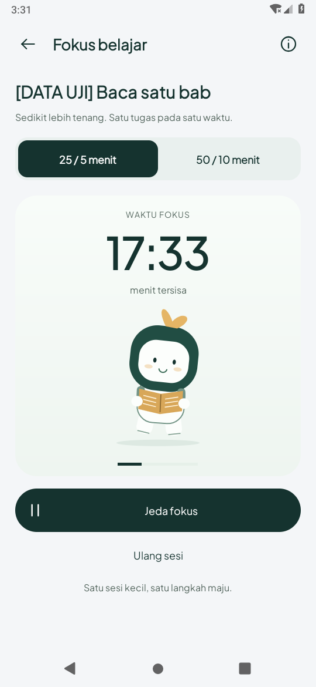
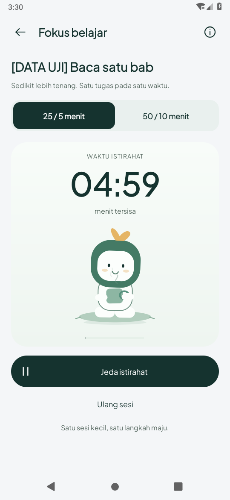

# Revisi gerak dan penempatan Fokus/Pomodoro — 20 Oktober 2026 (WIB)

Berdasarkan `7f9d60a`, setelah pengguna menilai gerak karakter kurang terlihat dan
posisinya tidak sesuai referensi video Pomato yang diberikan. Checkpoint pertama
adalah hasil implementasi sebelumnya, bukan desain yang telah disetujui pengguna.

## Perubahan

- Susunan mengikuti arah referensi: fase dan angka di atas, karakter lebih besar di
  tengah, kontrol di bawah. Cincin besar dihilangkan; progres waktu berlalu menjadi
  indikator tipis. Angka dan ilustrasi kini elemen vertikal terpisah, tanpa overlay.
- Ukuran karakter bertambah dan diberi ruang 194dp sendiri. Panel mengikuti tinggi
  isi; teks besar tidak memerlukan tinggi stage yang ditebak. Scroll tetap tersedia.
- Badan berayun dan naik/turun, kepala mengangguk, daun bergoyang, kaki bergantian,
  tangan/buku ikut bergerak dan halaman buku dibalik berkala. Pose istirahat duduk
  di bantalan dengan cangkir dan uap yang naik. Ini karakter Pine orisinal berdasarkan
  arah gerak referensi; bukan salinan persis ilustrasi merah Pomato atau logo baru.
- Waktu animasi menggunakan selisih uptime sebenarnya saat frame terlambat. Batas
  delta 50ms sebelumnya dihapus agar motion tidak melambat mengikuti frame lambat.
- Animasi tetap berhenti ketika dijeda, halaman di background, jendela tertutup dialog,
  animasi sistem dimatikan atau penghemat daya aktif. Tidak mengubah FocusClock,
  alarm, schema, tugas, logo, sumber peta/audio, dependensi atau izin aplikasi.

## Preview aktual

Rekaman berasal dari APK native pada emulator Android 9/API 28, layar 540×1170,
210dpi. Tugas **DATA UJI** dan sisa sekitar 17 menit merupakan fixture tes. Selesai
fokus dipercepat melalui fixture untuk memperlihatkan tombol **Mulai istirahat**
dan pose duduk tanpa menunggu 25 menit. Tugas tetap tidak ditandai selesai.

[Rekaman fokus → jeda → lanjut → istirahat](focus-placement-preview.mp4).

| Fokus | Istirahat |
| --- | --- |
|  |  |

[Font sistem 200%](screens/font-200-data-uji.png) · [Jeda](screens/jeda-data-uji.png).
Dua frame area karakter yang berjarak satu detik tersedia untuk memeriksa perubahan
piksel aktual: [A](screens/character-motion-a.png), [B](screens/character-motion-b.png).

## Validasi dan batas

Hasil build, lint dan tes dicatat pada summary.json serta log yang menyertai laporan.
Tes gerak membandingkan piksel karakter pada dua waktu saat aktif dan memastikan
hasilnya identik setelah dijeda; tidak hanya memeriksa callback animasi terjadwal.
Tes font 200% memeriksa jarak label terhadap view karakter serta akses tombol utama.
Preferensi dan setting sistem disimpan/dipulihkan; hanya satu tugas fixture tes
per metode yang dibuat dan dihapus.

API 35 hanya compile/target, belum runtime. HP fisik, baterai vendor dan performa
frame pada perangkat pengguna belum diuji. Batas provider live peta/audio dari
[checkpoint sebelumnya](../map-audio-study-2026-10-20/README.md) tidak berubah.
Pengguna telah mengizinkan push langsung ke main setelah pemeriksaan.

## Hasil akhir

- Build APK aplikasi/tes, tes JVM dan lint selesai: **52 tes JVM lulus;
  lint nol error** (545 warning nonfatal). [Build](build.txt).
- **8 metode Android 9 lulus**: enam tes motion dan dua regresi timer/background/
  recreation/font. [Log Android](device-api28.txt) · [Ringkasan](summary.json).
- Dua frame karakter berjarak satu detik berbeda pada **14,436 dari
  124,440 piksel**. Saat dijeda, dua frame identik dan sisa waktu tetap.
- Rekaman native berdurasi 22.57 detik.
  [GIF fokus enam detik](focus-placement-motion.gif) berasal dari potongan rekaman
  yang sama, tanpa mengubah kecepatannya.
- APK debug disediakan sebagai artefak chat; SHA-256 ada di summary.json.
