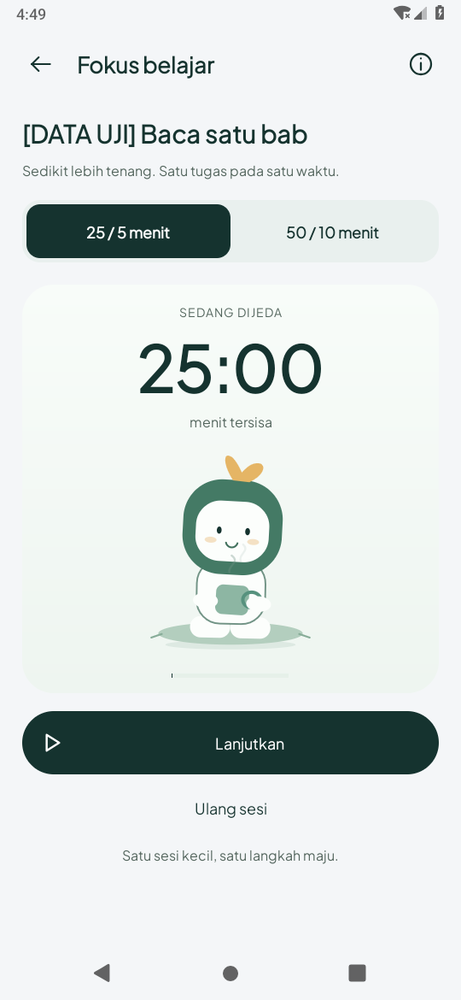

# Pose karakter saat jeda — 20 Oktober 2026 (WIB)

Berdasarkan `b8f3a04`. Pengguna meminta karakter juga berganti ke pose istirahat
ketika menekan Jeda, seperti referensi. Pada checkpoint sebelumnya pose cangkir
hanya digunakan untuk fase break; jeda fokus menghentikan pose membaca.

## Perubahan dan perbedaan state

| Keadaan timer | Pose | Hitungan |
| --- | --- | --- |
| Siap mulai fokus | Membaca | Belum berjalan |
| Fokus aktif | Membaca dan bergerak | Sisa waktu fokus berkurang |
| Jeda fokus | Duduk membawa cangkir, diam setelah transisi | Sisa waktu fokus tersimpan |
| Lanjut fokus | Kembali membaca dan bergerak | Melanjutkan sisa fokus |
| Break aktif | Duduk membawa cangkir, napas/uap bergerak | Sisa waktu break berkurang |
| Jeda break | Pose cangkir, diam | Sisa waktu break tersimpan |

Pose visual memakai fase break atau status paused. `FocusClock.breakPhase`, durasi,
session/alarm dan data tugas tidak diubah oleh pemilihan pose. Mulai fase break
setelah sesi fokus selesai tetap tindakan eksplisit. Jeda/lanjut tidak menandai
tugas selesai. Transisi singkat mengikuti policy animasi; loop berhenti saat dijeda.
Animasi sistem nol/penghemat daya memakai pose akhir tanpa transisi.

## Pemeriksaan aktual

Tes tambahan memeriksa siap → fokus → jeda, pose cangkir tanpa memulai break,
sisa waktu fokus tetap, recreation tetap paused/cangkir dan lanjut kembali membaca.
Tes piksel sebelumnya kini menunggu transisi pose selesai sebelum membandingkan
dua frame paused, sehingga tidak menganggap transisi awal sebagai loop yang bocor.
Kasus break eksplisit, gerak aktual, pengaturan motion, background/dialog dan font
200% tetap diperiksa.

[Screenshot break](screens/break-data-uji.png) · [Preview fokus/jeda/lanjut](focus-pause-preview.mp4).

**Koreksi 21 Oktober:** rekaman lama berakhir sebelum break aktif tertangkap.
[Bukti break aktif khusus](../break-animation-2026-10-21/README.md) menggantikan klaim
bahwa video lama memperlihatkan break. Screenshot break di atas tetap terpisah.

Tugas **DATA UJI**, sisa waktu serta akhir sesi yang dipercepat dalam preview adalah
fixture, bukan aktivitas/progres pengguna. Setting, preferensi dan tugas sementara
dipulihkan oleh tes. Rekaman berasal dari Android 9/API 28, bukan preview web.

Build tetap Java/XML, JDK 17, compile/target SDK 35. Runtime API 35, HP fisik dan
perilaku baterai vendor belum diuji. Tidak ada perubahan schema, sumber peta/audio,
logo atau implementasi reader Quran pada tahap ini.

## Acuan Quran disimpan, belum diimplementasikan

[Desain dan catatan Quran/Mushaf](../../../design/QURAN_READER_DESIGN.md) kini ada di
repository, termasuk konsep reader/panel audio yang disukai pengguna, koreksi
susunan Mushaf serta kebutuhan timing kata. Gambar konsep tidak membuktikan fitur
sudah ada di APK. Foto halaman Al-Mulk dari chat belum tersimpan sebagai file.

## Hasil akhir

- APK aplikasi/tes, `testDebugUnitTest` dan `lintDebug` lulus. **52 tes
  JVM lulus, lint nol error** (545 warning nonfatal). [Build](build.txt).
- **9 metode Android 9/API 28 lulus**: tujuh tes motion/pose dan dua regresi
  timer/font. [Log Android](device-api28.txt) · [Ringkasan](summary.json).
- Setting font/animator dipulihkan ke nilai awal 1.0; tugas fixture dibersihkan.
- [GIF fokus → jeda → lanjut](focus-pause-preview.gif) adalah potongan rekaman
  native pada kecepatan asli. Rekaman penuh 22.38 detik.
- APK debug disediakan sebagai artefak chat, bukan biner APK di Git. SHA-256 ada
  dalam summary.json. Seluruh perubahan ini ditujukan ke main sesuai izin pengguna.
