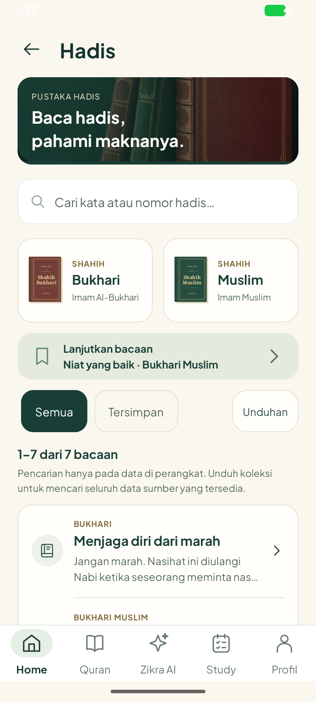
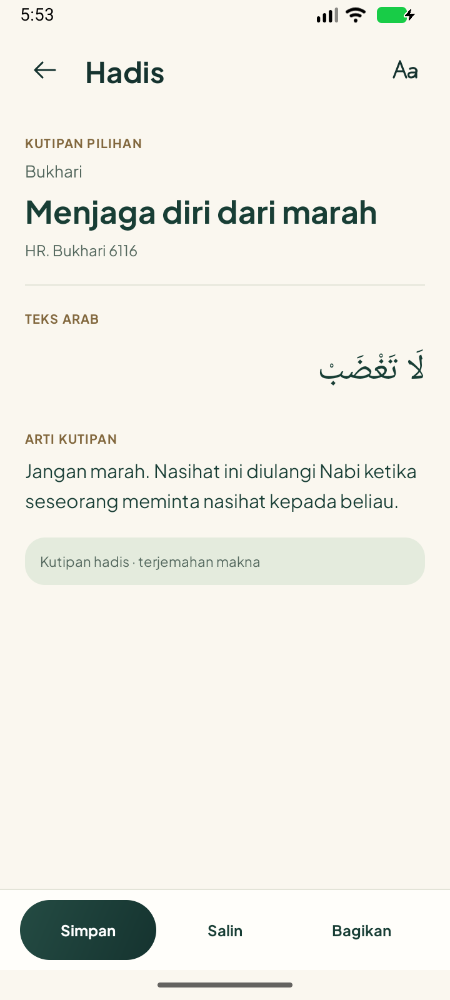

# Hadis — perapian desain 1.7.4

24 Oktober 2026. UI03 mengikuti permintaan pengguna; frontend-design digunakan untuk hierarki, warna pine/mint/emas, jarak dan tipografi. Source `0c9827daf0d7be55dfad95c478479d54a9d3be02`; [hash, ukuran dan batas](release.json). APK debug 31.280.892 byte (31,3 MB), di bawah 100 MB.

## Perubahan yang diterapkan

- Pencarian ditempatkan tepat di bawah ilustrasi pustaka; dua kitab menjadi kartu ringkas dengan sampul dan penanda pilihan. Pada font besar kartu disusun vertikal agar nama kitab tidak terpotong per suku kata.
- Filter Semua/Tersimpan tidak mengulang pemilihan kitab. Unduhan memakai gaya tombol yang seragam; paging hanya tampil jika perlu. Daftar menjadi satu bidang dengan pemisah tipis dan ikon penanda.
- Reader menampilkan kitab, judul dan rujukan sebelum teks. Arab rata kanan, arti terpisah, ukuran teks melalui Aa di toolbar. Simpan/salin/bagikan tetap tersedia; isi, ID, atribusi dan data pengguna tidak diganti.

## Screenshot APK sebenarnya

| Koleksi (font 100%) | Reader (font 100%) |
| --- | --- |
|  |  |

Font 200%: [koleksi](Hadith-Large-Overview.png), [reader](Hadith-Large-Reader.png). Font besar memerlukan gulir; teks Bagikan pada footer serta Zikra AI pada navigasi masih membungkus. Ini bukan penutupan audit F03 seluruh layar/ukuran font.

## Pemeriksaan terarah

[Build/lint](build.txt) lulus, tanpa error lint; 709 warning tetap tercatat, bukan nol warning. Tidak menjalankan ulang unit untuk perubahan presentasi ini.

Satu metode native `DailyDesignReleaseTest#testHadithCollectionsSearchReaderAndPersistence` lulus pada [font 100%](native.txt) dan [200%](large-font.txt): membuka katalog, memilih Muslim, mencari kata tanpa hasil, kembali ke Semua, membuka bacaan, mengubah ukuran teks melalui Aa, menyalin Arab beserta sumber, mengubah bookmark dan memuat lanjut bacaan. Preferensi bookmark/resume/ukuran dipulihkan sesudah tes. Pengiriman ke aplikasi lain tidak dieksekusi oleh tes ini.

Data screenshot adalah tujuh kutipan bawaan, bukan bukti seluruh paket kitab sudah diunduh. Pemeriksaan awal sempat mengasumsikan paket Muslim tersedia; fixture disesuaikan agar hasil kosong sebelum mengunduh tidak dianggap kegagalan. Pergantian konfigurasi emulator sempat menggagalkan peluncuran pengujian; putaran final memasang ulang kedua APK sebelum menjalankan tes dan lulus. Tidak mengulang unduhan korpus yang tidak berubah. Emulator 720×1600 / 320 dpi ditutup setelah pemeriksaan; font dikembalikan ke 100%.

## Jawaban pemeriksaan isi Doa

Resource 14 pilihan bawaan tidak berubah; hash sama dengan 1.7.2/1.7.3. [Pemeriksaan awal pilihan dan sumber](../dua-selection-b04-2026-10-24/README.md) tetap berlaku, bukan sertifikasi setiap harakat/terjemahan. Koleksi tambahan 225 bacaan: 12 sampel ditelusuri, 213 belum ditelaah per entri. B01/B04 tetap terbuka; tampilan bagus atau tes UI tidak membuktikan seluruh konten benar.

Rujukan yang dicocokkan kembali: [bangun tidur — Bukhari 6312](https://sunnah.com/bukhari:6312), [pagi/petang dan variasi lafal](https://hadeethenc.com/id/browse/hadith/5490), [guruh — Al-Adab Al-Mufrad 723](https://sunnah.com/adab:723). Bacaan guruh dinyatakan sebagai atsar Abdullah bin al-Zubair; tidak diubah menjadi sabda Nabi. Arti ringkas tiga tambahan ditulis untuk Zikra, bukan diklaim terjemahan penerbit lain.

Tidak mengirim email, mengakses kredensial privat, menghapus data HP atau memasukkan data contoh ke aplikasi produksi. Batas sumber Hadis pada laporan B01 tetap berlaku.
