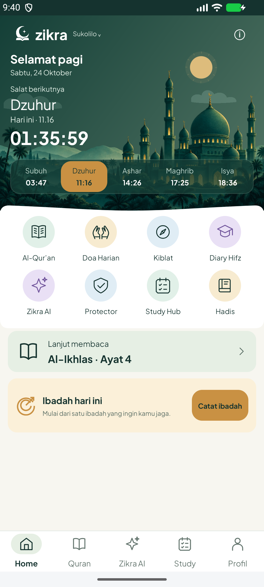
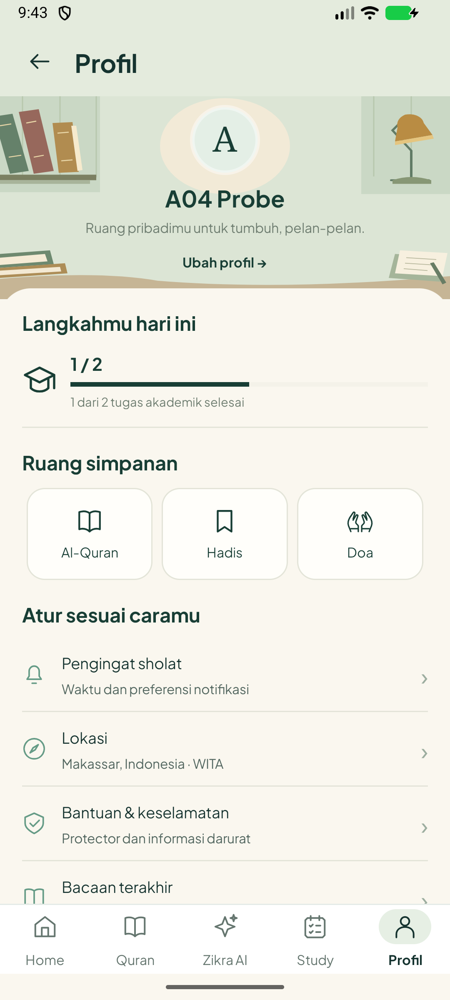

# A04 — Integrasi antarmenu, APK 1.6.3

24 Oktober 2026. Source fitur **`2b291ff72ef033f1d5b92733b18b966676ce68fc`**, versionCode **17**. **A04 selesai dalam lingkup integrasi baseline**. [A03](../baseline-a03-2026-10-24/README.md) sudah menyimpan WIP prefetch terpisah; optimasi tersebut tidak masuk APK ini. Ini bukan penyelesaian seluruh PRD atau gerbang rilis publik.

## Yang diperbaiki

- Kalender tidak lagi mematok WIB. Home, agenda Study, hari checklist SQLite serta label/editor tenggat mengikuti zona kota pilihan dari LocationStore. Pemilih tanggal/jam tenggat memakai zona yang sama dengan labelnya; nilai deadline epoch yang sudah disimpan tidak digeser atau dihapus. Pergantian hari menyembunyikan checklist hari lain tanpa menghapus riwayat; tugas Study/Hifz tetap lintas hari.
- Mushaf menyimpan `last_chapter`, `last_ayah`, `last_surah`, `last_verse_key` dan posisi Mushaf dalam satu pembaruan preferensi. Pemilihan bookmark juga memperbarui key ayat. Katalog Quran menyegarkan label ketika kembali dari layar lain, dengan pemeriksaan child yang bukan baris ayat.
- Progres Study/Profil tetap membaca database lokal yang sama. Home menampilkan progres Ibadah sesuai fungsinya, bukan menyalin persentase akademik. Tidak membuat tugas atau penyelesaian contoh di aplikasi produksi.

## Bukti terarah

| Pemeriksaan | Hasil dan batas |
| --- | --- |
| Kota pilihan pada Home, salat, Kiblat, Protector, Cuaca dan masjid; kalender dan membuka Home lagi | Native lulus: field lokasi dan label memakai Jayapura; tanggal kalender mengikuti pilihan. Tidak mengklaim presisi sensor HP atau validitas seluruh respons cuaca/peta |
| Batas tengah malam antar-zona | Native lulus dengan instant tetap `2026-10-24T16:30:00Z`: Jakarta masih tanggal 24, Jayapura tanggal 25. Checklist harian terpisah, catatan sebelumnya tidak dihapus, Study tetap ada. Label tenggat Jayapura menjadi 25 Okt pukul 01:30 |
| Mushaf → katalog yang sudah terbuka → Home → membuka Home lagi | Native lulus: handler ketuk ayat `112:4` memperbarui seluruh key/label. Memeriksa handler native; tidak menunggu unduhan font/halaman atau memutar qari pada tes ini |
| Navigasi bulan kalender dan tombol kembali hari ini | Tes regresi native lulus |
| Seed data lalu proses aplikasi dihentikan | Native lulus: dua tugas uji, satu diselesaikan melalui penyimpanan; nama, kota Makassar dan posisi Quran disimpan. Semua fixture khusus emulator |
| Verifikasi dari proses Android berbeda sesudah `am force-stop` | Native lulus: kota, bacaan Home/katalog, nama dan angka Study/Profil tetap sama. Tes memeriksa PID berubah; baris uji dihapus dan pengaturan semula dipulihkan; berkas probe privat sudah tidak ada |

**Enam metode native unik lulus.** [Antarmenu](instrumentation-menus.txt), [seed](instrumentation-seed.txt), [buka ulang](instrumentation-reopen.txt). Percobaan buka ulang pertama gagal karena tes mengasumsikan label Study berbentuk “x dari y”, sedangkan UI memakai “x/y”; assertion diperbaiki, kemudian kedua fase probe dijalankan ulang dan lulus. Angka database pada percobaan itu sudah cocok; tidak ada perbaikan data produksi yang disembunyikan sebagai hasil tes.

Build APK/instrumentasi serta lint berhasil, **0 error/fatal dan 684 warning**; warning belum seluruhnya diselesaikan. Unit: **97 lulus, 3 dilewati dari 100**; nama yang dilewati tercatat dalam metadata. [Build](build.txt), [build ulang APK tes](test-build.txt), [metadata/hash sumber](release.json).

Backend tidak diubah. Sembilan tes baseline gateway dengan provider simulasi lulus; [hasil](backend-baseline.txt). Ini bukan bukti hosting, provider langsung atau autentikasi produksi. Skill security-best-practices digunakan selama pengerjaan; source dan APK diperiksa terbatas terhadap pola credential, tanpa menyalin nilai rahasia. Nol kecocokan dua pola pada APK bukan audit menyeluruh. C01/C02/G03 tetap wajib, termasuk rotasi key yang pernah dibagikan, akses per instalasi dan pembatasan penggunaan sebelum publik.

## Paket dan sumber

- APK lokal: `D:/Download/Zikra-App-main/Zikra-Integration-v1.6.3-debug.apk`.
- Ukuran **31.085.269 byte / 31,1 MB**, di bawah batas 100 MB. SHA-256 **`e4f9d251e11a175b4f86cd9597f17f50b9befaf481eca974421f644782b99e7b`**.
- Manifest APK diperiksa: `com.zikra.app`, versionName 1.6.3, versionCode 17, minSdk 26, targetSdk 35. **Debug**, belum paket release bertanda tangan untuk publik.
- Seluruh **470 file produksi/build** cocok dengan commit fitur; hash source dan log tersimpan di [release.json](release.json). Sumber dua audio stabil ikut diperiksa; tidak ada pengecualian WIP tersembunyi.
- Build satu worker/heap 512 MB; emulator dijalankan setelah build berhenti. Satu emulator Medium_Phone API 37, RAM guest 4096 MB. Working set proses emulator sempat terukur sekitar **5.087 MB**, jadi jangan menyebut pengujian ini ringan untuk semua PC. Emulator ditutup, daftar ADB kosong setelah tes. Tidak ada HP pengguna yang disentuh.

## Batas tersisa dan langkah berikutnya

GPS/penolakan izin, presisi Kiblat, baterai/RAM HP, alarm saat layar mati, seluruh qari/timing serta data provider nyata tetap pada D01–D03/E01/G01–G02. A04 membuktikan penyimpanan/navigasi subset di atas, bukan seluruh variasi perangkat/jaringan. Akun/sinkronisasi memang di luar cakupan rilis pertama menurut A02.

Berikutnya kembali ke **B01** untuk validasi sumber Hadis; B01 belum dicentang. Tahap keamanan produksi, layanan dan uji HP tetap dalam checklist.

## Screenshot native dengan fixture uji

