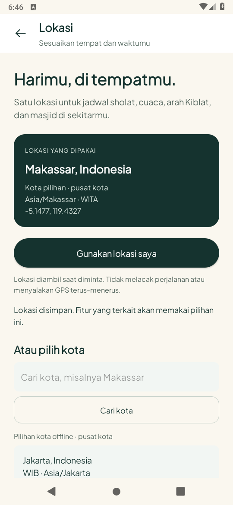
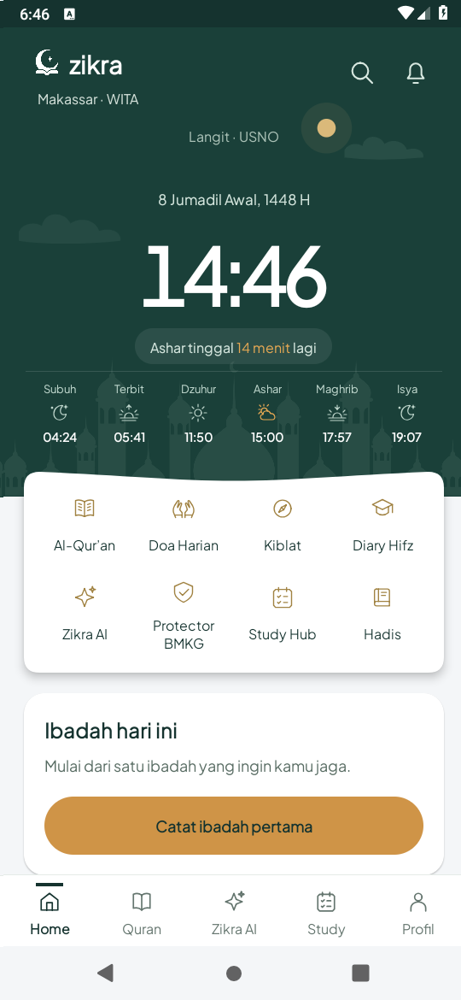
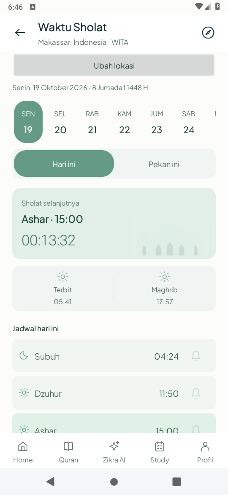
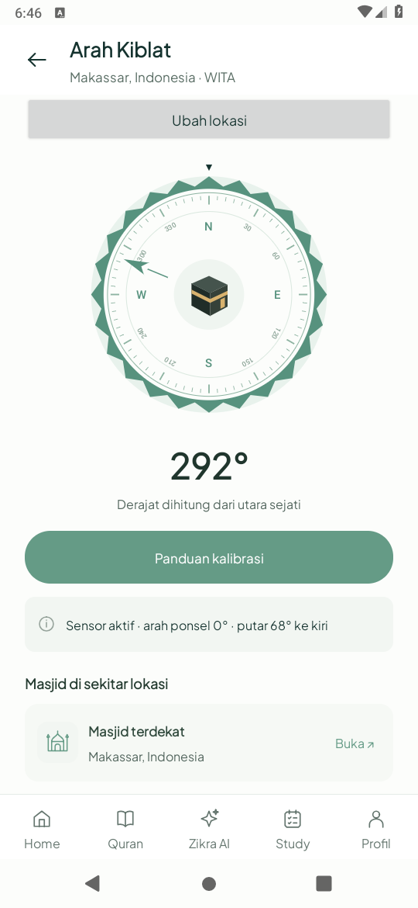
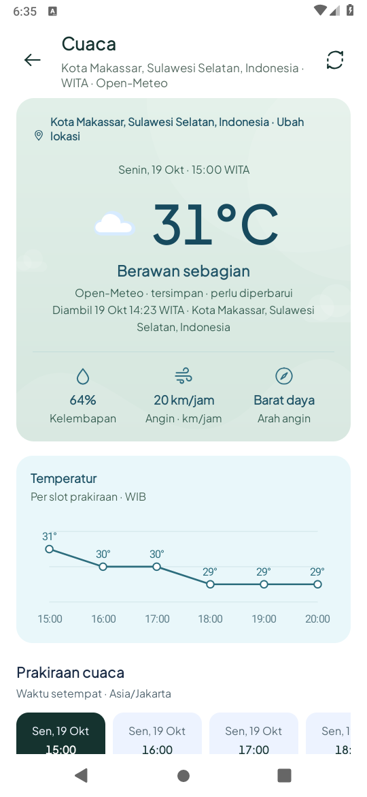
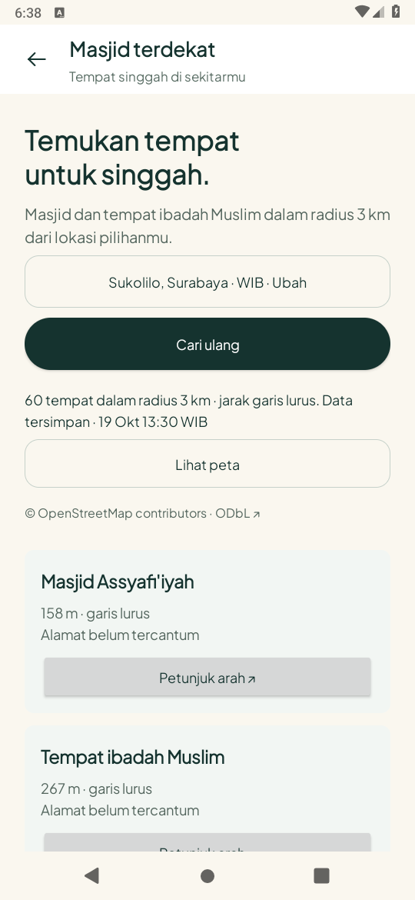
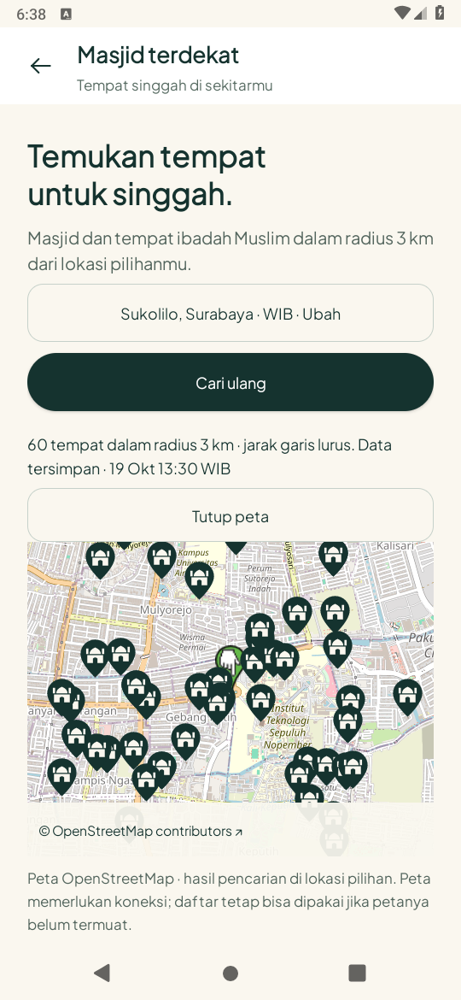
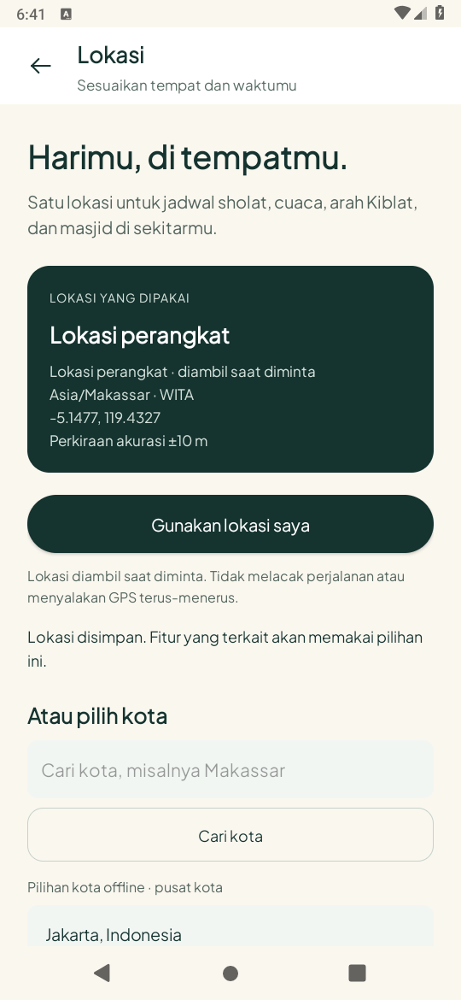

# Lokasi bersama dan masjid — 19 Oktober 2026 (WIB)

Ronde ini menghubungkan satu pilihan koordinat/zona waktu ke Home, jadwal/alarm
sholat, cuaca, langit dan Kiblat. Pengguna memilih **OpenStreetMap untuk versi awal**
karena project/billing Google belum aktif. Onboarding/parallax tidak diubah.

## Hasil yang tersedia

- Lokasi perangkat saat diminta, izin foreground/perkiraan, batas tunggu 25 detik,
  pembatalan saat meninggalkan halaman; tidak ada tracking/background location.
- Pencarian kota Open-Meteo/GeoNames, 15 kota offline berlabel pusat kota, zona IANA,
  konfirmasi pilihan dan fallback manual. Sukolilo hanya acuan awal berlabel.
- Jadwal dan notifikasi mengikuti koordinat/zona pilihan. Ganti lokasi menjadwalkan
  ulang alarm dan menolak pengiriman alarm yang mempunyai identitas lokasi lama.
- Cuaca/USNO memvalidasi lokasi/zona/tanggal; cache cuaca maksimal empat lokasi
  dipisahkan. Bearing Kiblat dan deklinasi memakai koordinat pilihan.
- Daftar hingga 60 tempat dari maksimal 100 entri Overpass dalam radius 3 km;
  deduplikasi/validasi dan pengurutan garis lurus. Cache lokasi terakhir 30 menit,
  sumber/waktu terlihat, hasil lama dipertahankan ketika refresh gagal.
- Peta OpenStreetMap **native di Zikra**, marker dan atribusi. Dimuat saat dibuka;
  koneksi tile berhenti ketika disembunyikan/keluar. Tombol arah mengirim Google Maps
  URL dengan koordinat masjid, tanpa API key, Google SDK atau billing Google.
- Endpoint Overpass publik mempunyai fallback terbatas dan jeda HTTP 429. Data
  komunitas/server publik tidak dijanjikan lengkap atau mempunyai SLA.

Masuk melalui label lokasi Home/Profil → Lokasi. Masjid dibuka dari Kiblat,
Profil atau tindakan bantuan Protector. [Kontrak provider](../../API_PLAN.md).

## Pemeriksaan terakhir

JDK 17, Gradle 8.9, AGP 8.7.3, compile/target SDK 35, minimum 26.
Runtime AOSP **API 28**, software ANGLE/SwiftShader, display fisik 540×1170.

- `assembleDebug`, `assembleDebugAndroidTest`, `testDebugUnitTest`, `lintDebug` lulus.
  **38 tes JVM, nol gagal/error. Lint nol error dan 530 peringatan nonfatal.**
  [Build](build.txt) · [Ringkasan](summary.json).
- **13 metode perangkat unik lulus**, dari rangkaian terarah berikut; uji ulang
  metode yang sama tidak dihitung sebagai tes baru dan seluruh fitur tidak diulang:

| Kelompok | Metode unik | Bukti |
| --- | ---: | --- |
| `LocationIntegrationTest` | 6 | Pilih kota offline → Prayer/Qibla/Home, recreate/denial callback, cache cuaca tidak lintas kota, metadata USNO, parser masjid dan scoped layout 320×560dp/font200% |
| `LocationLiveTest` | 3 | Kota/cuaca Makassar dari layanan aktual, daftar/peta OSM aktual dan routing intent, repository/cache aktual |
| `PrayerRemindersTest` | 2 | Alarm native aktif/nonaktif dan delivery/deduplikasi |
| `LocationAlarmTest` | 1 | Alarm beridentitas kota lama ditolak setelah pilihan berubah |
| `DeviceLocationTest` | 1 | Provider GPS simulasi Android mengirim Makassar; aplikasi menerima fix dan menyelesaikan zona waktu |

[Integrasi awal + alarm](core-tests.txt) · [Integrasi/layanan/alarm lokasi](device-tests.txt)
· [Teks besar dan peta](layout-tests.txt) · [GPS simulasi](gps-test.txt)
· [Pemeriksaan visual setelah label/metadata akhir](visual-test.txt).

## Kegagalan awal yang diselesaikan

1. Dua tes layanan awal terhambat CA proxy yang belum dipercaya emulator. Host HTTPS
   berhasil, sedangkan APK mendapat `Trust anchor ... not found`. Root CA publik sesi
   dipasang ke emulator uji; APK tetap memverifikasi TLS normal. Script setup diperbaiki
   untuk semua root publik sesi dan lulus `bash -n`; langkah import dijalankan langsung.
2. Overpass sempat timeout/HTTP 500. Endpoint publik yang berhasil diuji dipakai sebagai
   utama, dengan satu fallback terurut dan backoff. Repository, cache dan UI kemudian
   berhasil. Screenshot menampilkan data aktual/tersimpan, tidak memakai tempat rekaan.
3. `adb emu geo fix` tidak mengubah fix GPS framework yang dikirim emulator pada uji
   awal. Fixture diubah menjadi Android test GPS provider, dengan koordinat/zona yang
   sama tetap diperiksa. Provider mock, app-op, izin dan pengaturan lokasi dipulihkan.
   Ini bukan bukti GPS atau kompas ponsel fisik.

[Log TLS/layanan awal](live-initial.txt) · [Layanan setelah CA](live-retest.txt)
· [Diagnosis HTTP 500](osm-initial.txt) · [Repository berhasil](osm-retest.txt)
· [GPS fixture awal](gps-initial.txt).

## Batas yang masih berlaku

- Belum uji runtime API 35, GPS/sensor/kompas/arah fisik, konsumsi baterai, FPS atau
  seluruh kombinasi aksesibilitas HP. Denial callback/manual dan scoped font200%
  diperiksa; dialog izin approximate Android 12+ belum diuji di HP.
- Routing diverifikasi sebagai Intent/koordinat; Google Maps diblok monitor tes agar
  tidak membuka aplikasi lain. Navigasi suara/belokan eksternal belum diuji pada HP.
- Model cuaca bukan observasi BMKG. BMKG gempa tetap seluruh Indonesia. Kalkulasi
  sholat bukan publikasi resmi Kemenag; peristiwa yang tidak tersedia memakai `—`.
- Masjid tidak mempunyai data fasilitas/jam jamaah/buka kecuali sumber menyediakannya;
  versi ini tidak menampilkan asumsi tersebut. Peta memerlukan koneksi/cache tile,
  tanpa bulk download. [Ketentuan sumber](../../API_PLAN.md#openstreetmap-versi-awal).
- Mushaf, murottal/full offline dan AI generatif belum termasuk tahap ini.

## Screenshot APK aktual

Delapan PNG asli dari rangkaian tes, tanpa crop/edit. Lokasi Makassar/Sukolilo
merupakan pilihan pengujian, bukan lokasi pengguna nyata. GPS pada gambar terakhir
adalah provider simulasi Android. [Hash PNG](screens-sha256.json).

| Pemilih kota | Home |
| --- | --- |
|  |  |

| Waktu sholat | Kiblat |
| --- | --- |
|  |  |

| Cuaca | Daftar masjid |
| --- | --- |
|  |  |

| Peta native | GPS simulasi |
| --- | --- |
|  |  |
