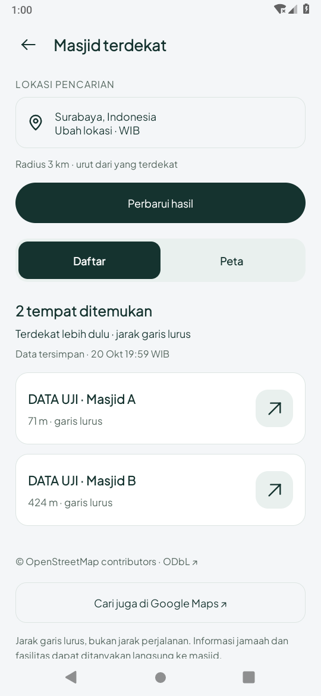
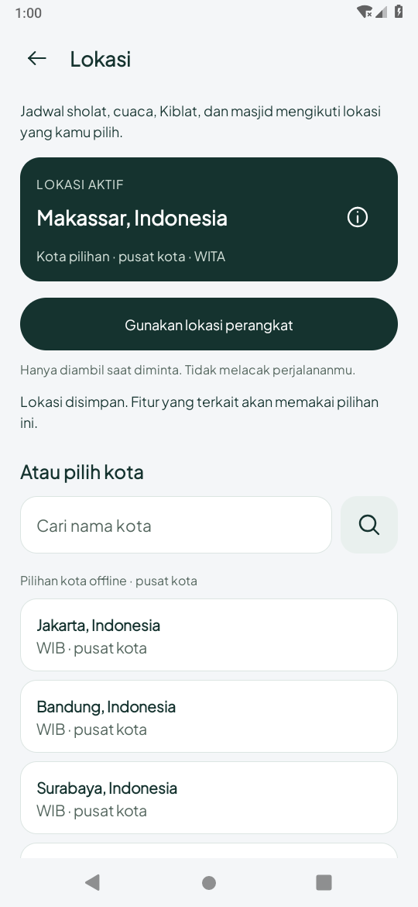
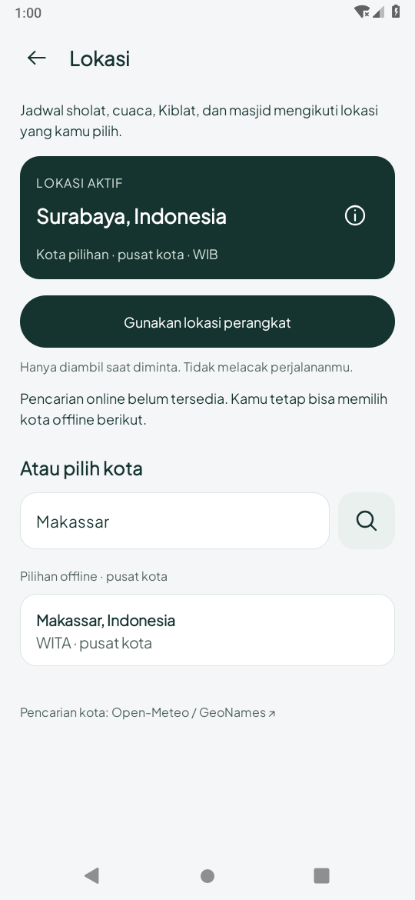
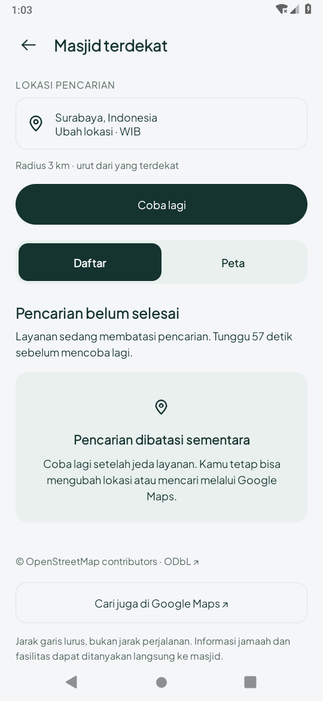

# Perapian masjid/lokasi — 20 Oktober 2026 (WIB)

Branch `feature/location-polish-2026-10-20`, berdasarkan `1045fa7`.
Saat audit, GitHub main sudah `1045fa75113a14553c3bb59b0df83e35b6f90fa0` dan recovery
masih `d9d2ed4b5fb39606b659a708300a00b92fba7126`. Checkout bersih sebelum perubahan.
Nama environment bukan penentu sumber; `prototype_zikra` tetap referensi lama.

## Perubahan

- Halaman/header/status bar/navigation bar masjid dan lokasi memakai satu surface
  netral `#F4F6F8`, menggantikan `onboarding_paper` krem khusus dua halaman ini.
  Resource panel bersama memakai sage yang lebih netral; termasuk panel pemutar yang
  sudah memakai resource tersebut. Logo master, Home dan onboarding tidak diubah.
- Kartu lokasi aktif lebih ringkas: nama dominan, sumber/zona pada baris yang dapat
  membungkus, rincian koordinat/akurasi melalui ikon informasi vektor 48dp.
- Indikator loading kota menyertai status teks; pilihan offline tetap tersedia.
  Memilih hasil manual membatalkan GPS/lookup yang masih berjalan dan mengabaikan
  callback lama. Simpan tetap melalui konfirmasi; Batal mempertahankan lokasi aktif.
- Hasil masjid kosong sekarang dipulihkan setelah Activity dibuat ulang, termasuk
  waktu pengambilan. Sebelumnya flag pemulihan hanya benar jika hasil tidak kosong.
- Loading dan kegagalan tanpa hasil memakai judul yang sesuai, tombol Coba lagi,
  serta pesan khusus pembatasan layanan. Hasil/waktu yang sudah ada tetap tampil
  setelah refresh gagal. Daftar/Peta, pilihan marker dan arah eksternal dipertahankan.
- README, RECOVERY, API_PLAN serta rencana implementasi diperbarui agar tidak lagi
  menyebut pemutar/gulir/Hifz yang sudah di main sebagai fitur yang belum ada.
  Tidak ada migrasi SQLite, penghapusan data pengguna, login/backend atau dependensi baru.

## Pemeriksaan

JDK 17, compile/target 35, minimum 26. Hasil tahap ini:

- `assembleDebug`, `assembleDebugAndroidTest`, `testDebugUnitTest`, `lintDebug`: lulus.
  **46 tes JVM, tanpa kegagalan/error/skip; lint nol error dan 527 warning nonfatal.**
  [Build/unit/lint](build-unit-lint.txt) · [Build akhir setelah pesan rate limit diperjelas](build-final.txt).
- Android 9/API 28: **10 metode unik lulus**: enam `NearbyDesignTest`, tiga
  `LocationPickerStateTest`, satu alur pemilihan Makassar → jadwal/Kiblat/Home pada
  `LocationIntegrationTest`. [Log](device-api28.txt).
- Setelah pesan pembatasan diperjelas, metode rate limit diulang dan lulus: [log](rate-limit-final-api28.txt).
- Font sistem **200%**: dua alur daftar/peta/arah dan pemilihan Makassar → jadwal/Kiblat/Home diulang, keduanya lulus. [Log](large-font-api28.txt) · [Masjid](screens/masjid-font-200-data-uji.png) · [Lokasi](screens/lokasi-font-200.png). Teks membungkus dan halaman dapat digulir; ini bukan audit TalkBack atau semua ukuran perangkat. Font emulator dipulihkan setelah pengujian.
- Skenario: cache dua masjid berlabel DATA UJI, Daftar/Peta/seleksi/arah, refresh gagal
  mempertahankan hasil/waktu, pergantian kota membersihkan hasil lama, recreation
  peta/hasil, hasil kosong/recreation, pembatasan layanan tanpa hasil, loading →
  fallback offline, memilih kota manual selama lookup, dan pencarian kota kosong.
- HTTP kota memakai interceptor lokal di APK tes; kasus rate limit disuntikkan lewat
  cache uji. Ini memeriksa state UI/callback Android, bukan server Open-Meteo/Overpass live.
  Preferensi lokasi dan pengaturan yang disentuh tes dicadangkan/dipulihkan.

## Preview Android aktual

PNG berasal dari `screencap` Android 9, tanpa penyuntingan. Perangkat emulator 540×1170px,
210dpi (sekitar 411dp). Makassar/Surabaya adalah pilihan uji, bukan posisi pengguna.
Fixture masjid bertuliskan DATA UJI; screenshot state kosong/loading/gagal menggunakan
respons uji terkontrol dan tidak membuktikan data atau koneksi live.

| Daftar masjid — DATA UJI | Lokasi Makassar — pilihan uji |
| --- | --- |
|  |  |

| Fallback kota offline — fixture | Pembatasan layanan — fixture |
| --- | --- |
|  |  |

[Loading kota](screens/lokasi-loading-fixture.png) · [Hasil masjid kosong](screens/masjid-kosong-fixture.png).

## Batas dan langkah berikutnya

Tidak mengulang verifikasi qari asli atau mengklaim audio live sudah berfungsi hanya
karena UI tampil. [Hasil audio sebelumnya](../location-quran-2026-10-19/README.md)
memakai WAV sintetis; CDN qari/full download jaringan, runtime API 35 dan perangkat fisik
masih terbuka. Pemeriksaan ini bukan uji ketepatan GPS, sensor, performa/baterai atau
kelengkapan OSM. Arah diperiksa sebagai Intent eksternal, bukan perjalanan Google Maps.

[Rencana tersimpan](../../../design/IMPROVEMENT_PLAN.md): tahap desain berikutnya
Study/Hifz/asisten. Timer fokus, pengingat akademik, Mushaf halaman dan AI generatif
belum diimplementasikan pada checkpoint ini. APK debug disimpan sebagai artefak chat,
bukan berkas biner di Git; SHA-256 dicatat dalam `summary.json`.
