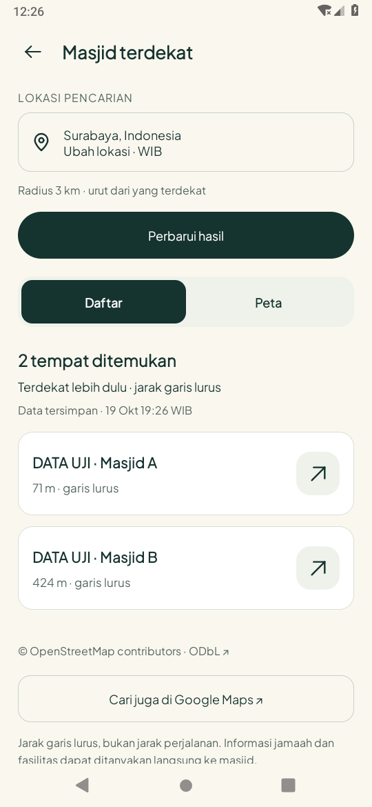
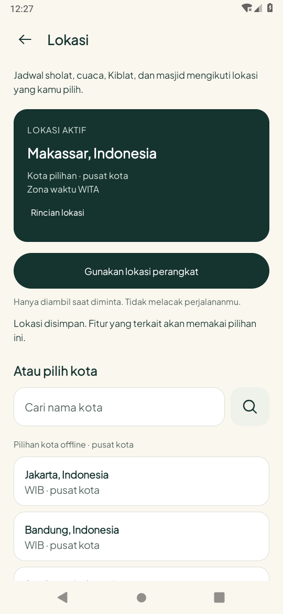

# Desain lokasi/masjid dan audio Quran — 19 Oktober 2026 (WIB)

Branch: `feature/location-quran-audio`, berdasarkan `main` pada `d9d2ed4`.

## Perubahan

- Lokasi/masjid: header ivory yang menyatu, informasi lokasi/radius ringkas, kontrol Daftar/Peta, kartu XML nama/jarak/arah, alamat lewat rincian, pilihan marker dengan kartu arah. Hasil dan waktu lama dipertahankan saat refresh gagal; mengganti kota menghapus hasil/seleksi lama.
- Reader: tombol per ayat dan pemutar bawah native; putar/jeda, ayat sebelumnya/berikutnya, seek dalam ayat, tiga qari, rentang dan pengulangan 1–10 kali/ayat, serta ulang rentang sampai dihentikan.
- Background: satu `MediaPlayer`/`MediaSession` pada foreground service `mediaPlayback`; kontrol notifikasi, audio focus, jeda ketika headset terlepas, wake lock hanya saat playback, pelepasan resource saat stop. Tidak ada autoplay saat boot atau setelah proses mati.
- Offline: pengguna memulai unduhan surah/qari secara eksplisit. Service `dataSync` terpisah mengunduh secara berurutan, memverifikasi decoder/durasi dan panjang respons, menyimpan berkas secara atomik, mengabaikan `.part` untuk playback, dan mempertahankan ayat lengkap saat terputus. Unduhan dapat dilanjutkan/dijeda; audio dapat dihapus dengan konfirmasi. Teks terjemahan/Arab per surah disimpan terpisah agar tidak tergantung cache delapan bagian. Menghapus audio tidak menghapus bookmark/tugas/hafalan/teks.
- Gulir: gulir baca 5–60dp/detik tanpa audio, dan mengikuti identitas ayat yang diputar. Keduanya terpisah; sentuhan pada bacaan menjeda gerakan, pindah halaman memuat bagian berikutnya, meninggalkan Activity menghentikan gulir tetapi tidak menghentikan audio.
- Hifz: membuka target meneruskan ayat awal/akhir ke reader. Pemutaran selesai pada batas target kecuali pengguna memilih mengulang rentang. Latihan tidak otomatis ditandai selesai dan tidak menilai ketepatan bacaan.
- Semua perubahan tetap Java/XML; tidak menambah backend, API key, dependensi Kotlin, login, atau migrasi database.

## Cara mencoba

1. Checkout branch ini, buka folder `android` di Android Studio, lalu Run. Versi dasar recovery sebelumnya sudah masuk `main`; branch ini memuat pembaruan berikutnya.
2. Lokasi: buka label lokasi Home/Profil, pilih kota atau lokasi perangkat. Masjid: buka dari Kiblat/Profil, cari hasil lalu pindah Daftar/Peta dan pilih arah.
3. Quran: buka surah, ketuk Putar di bawah atau tombol ayat. Pengaturan audio memuat qari, batas ayat, pengulangan, mengikuti murottal, kecepatan dan tombol gulir baca. Kontrol malam tetap melalui pengaturan reader.
4. Ikon unduh membuka status/jumlah/ukuran audio. Pilih Unduh untuk memakai internet, termasuk data seluler. Setelah lengkap, teks dan audio surah dapat dibuka tanpa jaringan. Unduhan yang mati bersama proses tidak melanjutkan sendiri; buka lagi dan pilih Unduh/lanjutkan.
5. Diary Hifz: buka bacaan target; rentangnya tampil pada pemutar. Pilih pengulangan sesuai kebutuhan, lalu tandai latihan sendiri setelah selesai.

## Pemeriksaan

JDK 17, SDK/target 35, min SDK 26. Hasil yang telah selesai:

- `assembleDebug`, `assembleDebugAndroidTest`, `testDebugUnitTest`, `lintDebug`: lulus. **46 tes JVM, nol kegagalan; lint nol error, 527 peringatan nonfatal.** [Build](build.txt) · [Ringkasan terstruktur](summary.json).
- Android 9 / API 28: **18 metode unik lulus**. `NearbyDesignTest` 4 + `LocationIntegrationTest` 6 memeriksa lokasi, daftar/peta, intent arah, refresh gagal, recreate, perubahan kota dan layout font 200%. `QuranAudioTest` 5 memeriksa decoder nyata, rentang/pengulangan, notifikasi, interupsi audio focus, layar mati, gulir/sentuhan, validasi rentang, berkas unduhan lengkap/parsial dan ukuran kontrol. Dua metode reader lama serta satu metode route Hifz turut lulus. [Lokasi](location-tests.txt) · [Audio/reader/Hifz API 28](audio-api28-tests.txt).
- Pemeriksaan runtime API 35 dicatat terpisah setelah selesai; build dengan SDK 35 sendiri bukan bukti runtime Android 15.

**Fixture audio adalah WAV sintetis, bukan murottal.** Fixture hanya dibuat oleh APK tes, tidak disertakan dalam APK pengguna. Tes playback memakai decoder, MediaPlayer, notifikasi dan audio focus Android yang nyata; tes unduhan menggunakan berkas lengkap yang sudah tersedia, bukan keberhasilan mengunduh dari CDN. Konfirmasi kebenaran suara qari serta unduhan jaringan penuh masih perlu dijalankan pada jaringan yang dapat mengakses sumber.

## Bukti tampilan

Screenshot layar penuh tanpa edit. Pilihan Makassar adalah kota pengujian, bukan lokasi pengguna; nama masjid pada tes diberi label `DATA UJI`.

| Daftar masjid (data uji) | Pemilih lokasi |
| --- | --- |
|  |  |

## Sumber dan batas

[Riset desain, sumber audio dan pedoman Android](../../../design/research/2026-10-19-location-quran.md).

Audio: [Al Quran Cloud](https://alquran.cloud/cdn), 128kbps, Alafasy/Al-Husary/Al-Minshawi. [Ketentuan dan atribusi](https://alquran.cloud/terms-and-conditions) tersedia dari pengaturan audio. Copyright rekaman tetap pada pemegang hak; tidak ada rekaman yang di-commit ke GitHub/APK.

[Permintaan audio live dari cloud ditolak HTTP CONNECT 403](live-audio-status.txt); tidak diakali lewat jalur lain. Pengujian rekaman asli, server live, full download/retry jaringan, telepon/headset/Bluetooth fisik, dan penghemat baterai vendor belum dilakukan. Headset ditangani oleh receiver `AUDIO_BECOMING_NOISY`, bukan klaim telah diuji pada headset nyata. Tidak mengklaim gapless, sinkron kata per kata, penilaian hafalan AI, atau mode Mushaf halaman.

APK debug tersedia sebagai artefak chat; tidak dimasukkan ke repository. SHA-256 pada `summary.json` mengidentifikasi APK yang dibangun dari checkpoint ini.
