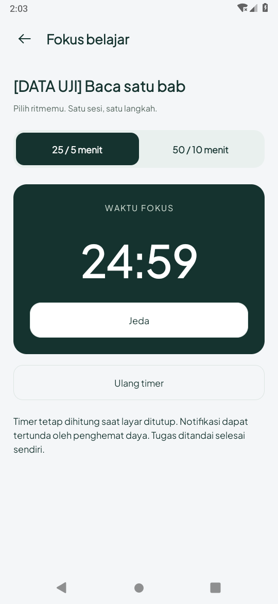
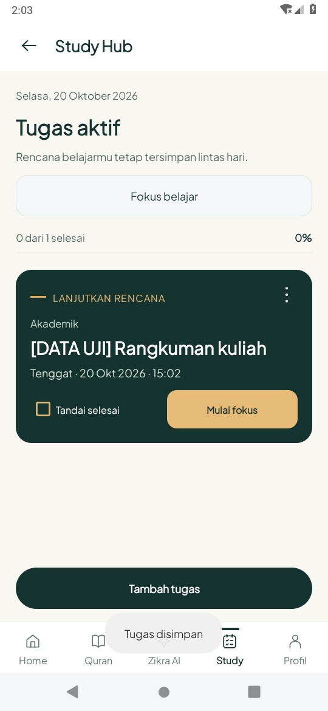

# Peta, transfer audio dan Study — 20 Oktober 2026 (WIB)

Branch `feature/map-audio-study-2026-10-20`, berdasarkan `2b13539`.
Main saat audit masih `1045fa7`; perubahan checkpoint sebelumnya dipertahankan.

## Perubahan aplikasi

- Peta: indikator memuat/belum termuat, retry manual dengan jeda 15 detik, status
  callback tile osmdroid. Warna grid placeholder disamakan dengan panel; kegagalan
  diberi penjelasan, bukan menyamarkan area kosong sebagai peta jalan yang berhasil.
  Daftar, seleksi masjid, atribusi OSM dan Intent arah eksternal tetap tersedia.
- Audio: transfer atomik dan validasi decoder dipisahkan menjadi `AudioTransfer`,
  dipakai langsung oleh service unduhan. Cache lengkap yang rusak kini diperiksa
  decoder dan diganti; ukuran berkas saja tidak membuatnya terus dilewati saat retry.
  HTTP gagal, payload rusak dan pembatalan tidak meninggalkan audio lengkap palsu.
- Reader: pembaruan kontrol yang tidak berubah tidak lagi memasang ulang ikon/listener/progress pada setiap polling; mengurangi redraw dan event aksesibilitas saat audio diam.
- Study: tugas berurutan tenggat, judul ringkas, progres kosong disembunyikan,
  tindakan Mulai fokus untuk tugas aktif. Detail rentang Hifz diperbesar; kartu Pine,
  nama surah dan bacaan rentang dipertahankan. Checkbox tetap ditandai pengguna.
- Timer native: 25 menit fokus/5 menit jeda atau 50/10, mulai/jeda/lanjut/ulang dengan
  konfirmasi, phase berikutnya dimulai eksplisit. Menggunakan elapsed realtime dan
  identitas boot, bukan hitungan frame atau jam dinding. Sisa waktu tersimpan saat
  ditinggalkan dan dipulihkan setelah recreation/proses mati; reboot menjeda sisa
  terakhir tersimpan. Notifikasi akhir memakai AlarmManager inexact tanpa foreground
  service. Tidak otomatis menandai tugas selesai atau memulai siklus berikutnya.
- Tugas akademik dapat memiliki tenggat waktu lokal perangkat dan pengingat opsional.
  DatePicker/TimePicker native, draft editor tetap tersimpan saat recreation. Tombol Simpan/Batal berada di footer tetap agar tidak terdorong keluar viewport saat formulir panjang.
  Izin notifikasi diminta setelah pengingat diaktifkan; penolakan tidak membuang tugas.
  Alarm lama diverifikasi terhadap identitas tugas/tenggat/status terbaru sebelum
  notifikasi, serta dijadwalkan ulang setelah edit/reboot/perubahan waktu.
- Migrasi SQLite v3 menambah `due_at` dan `study_reminder` dari v1/v2 tanpa reset tabel
  atau data lama. Hifz, judul, ID dan completion lama tetap dipertahankan. APK memakai versionCode 2 (1.1), sehingga instal biasa APK lama versionCode 1 ditolak sebagai downgrade; jangan memaksa downgrade ke source SQLite v2 setelah database naik ke v3.

## Status provider live

[Percobaan HTTPS](live-provider-status.txt): tile OSM, Overpass dan CDN qari semuanya
CONNECT 403 dari proxy. Policy enforced/restricted tidak mencakup host provider.
Tidak mengganti jalur/proxy untuk melewati policy dan tidak menanamkan key baru.

**Peta online lengkap, hasil masjid API live, suara qari asli dan unduhan CDN penuh
belum terverifikasi pada checkpoint ini.** Pengujian transfer menggunakan respons
HTTP yang dikontrol interceptor lokal dengan WAV sintetis. Itu memeriksa jalur baca
body/validasi/rename/cancel yang dipakai service, bukan membuktikan rekaman Quran.

## Menjalankan fitur

1. Buka Android Studio pada folder `android`, JDK 17/SDK 35, Run.
2. Masjid: Daftar/Peta; jika tile gagal, status dan Muat ulang peta terlihat. Pencarian
   lokasi dan hasil tetap memerlukan provider yang dapat diakses atau cache sebelumnya.
3. Quran: pilih surah/qari lalu unduh; unduhan yang terhenti dapat dilanjutkan. Berkas
   rusak diperbaiki saat mencoba unduhan ulang; bookmark/target/tugas tetap disimpan.
4. Study Hub: Tambah tugas → isi nama → Atur tenggat (opsional) → Ingatkan saat tenggat
   bila diinginkan. Tugas tanpa tenggat tetap dapat disimpan. Tugas lewat tenggat
   hanya dapat disimpan tanpa pengingat baru sampai dipilih waktu mendatang.
5. Pilih Mulai fokus pada tugas atau Fokus belajar pada header. Pilih 25/5 atau 50/10,
   mulai/jeda/lanjut; ulang atau ganti tugas meminta konfirmasi. Setelah sesi selesai,
   pilih mulai jeda/fokus sendiri. Tugas diselesaikan manual di Study Hub.

## Batas praktis

Alarm/notifikasi inexact dapat ditunda oleh sistem dan penghemat baterai; aplikasi
force-stop dapat menghentikan pengingat sampai dibuka lagi. Izin notifikasi/channel
harus aktif agar notifikasi tampil; jam/countdown tetap dapat dilihat di aplikasi.
Tidak mengklaim alarm tepat waktu, statistik fokus, sinkronisasi cloud atau AI generatif.

Runtime yang digunakan adalah Android 9/API 28; API 35/izin notifikasi Android 13+,
telepon/headset/Bluetooth fisik, GPS/sensor dan baterai vendor masih perlu diuji.
Uji receiver memakai waktu/intent terkendali, bukan menunggu tenggat nyata berjam-jam.
Uji font besar dengan layout scope tidak menggantikan audit TalkBack/perangkat fisik.
Tidak ada perubahan pada aset logo master atau source Home/onboarding; migrasi menambah kolom dan mempertahankan data pengguna.

## Preview aktual (data uji)

Screenshot Android 9 tanpa suntingan. Nama tugas diberi label DATA UJI. Pilihan tanggal,
jam dan kota adalah pengujian emulator, bukan jadwal/lokasi pengguna; tenggat mengikuti
zona lokal perangkat emulator. State peta menggunakan callback gagal terkontrol;
penanda pada fixture bukan hasil pencarian live.

| Timer fokus | Study dengan tenggat |
| --- | --- |
|  |  |

[Editor tenggat](screens/editor-tenggat-data-uji.png) · [Status tile gagal](screens/peta-gagal-data-uji.png).

## Hasil pemeriksaan

JDK 17, compile/target 35, minimum 26. Build APK/APK tes, 52 tes JVM dan lint lulus;
**0 error lint, 548 warning nonfatal**. [Build/unit/lint](build-unit-lint.txt) ·
[Build editor/timer akhir](build-release.txt) · [Build marker akhir](build-marker-final.txt).

**39 metode Android 9/API 28 unik lulus** pada rangkaian terarah:

| Bagian | Metode unik |
| --- | ---: |
| `AcademicFeaturesTest` | 7 |
| `AudioTransferTest` | 4 |
| `NearbyDesignTest` | 7 |
| `QuranAudioTest` | 7 |
| `HifzRecoveryStorageTest` + `ZikraDbHelperTest` | 10 |
| Empat alur `StudyRecoveryTest` | 4 |

[Putaran awal](device-initial-api28.txt) memuat 35 metode dengan 3 kegagalan asersi
serta 1 error capture; bukan hasil lulus keseluruhan. Dua asersi notifikasi terlalu
cepat membaca antrian NotificationManager; tes kini menunggu status OS yang benar-benar
terlihat. Aksi edit melalui menu perlu node aksesibilitas yang clickable (parent),
bukan TextView labelnya. Capture reader lama tidak mencapai idle karena kontrol audio
yang sama diperbarui ulang tiap polling; source reader diperbaiki untuk melewati
pembaruan yang identik. [Uji ulang 15 metode](device-retest-api28.txt) seluruhnya lulus.

Setelah footer editor tetap, area sentuh dan jalur pengaturan notifikasi timer dirapikan,
[tujuh metode akademik dan dua editor Study/Hifz](device-release-api28.txt) lulus.
Font 200% diperiksa pada lebar 320dp; tombol timer/featured tetap di dalam viewport,
serta tombol simpan tetap di atas batas bawah pada tinggi 560dp dan 320dp. Ini memakai
configuration scope dan pengukuran View Android; bukan simulasi keyboard fisik/HP.

[Uji ulang dua alur peta](device-marker-final-api28.txt) memeriksa penanda lokasi vektor,
seleksi/arah dan status gagal/retry. Callback tile dalam tes dikontrol; tidak membuktikan
akses tile live. Ikon lokasi memakai resource pin bersama, menggantikan marker default library.

Regresi audio memakai WAV sintetis dengan decoder/MediaPlayer/MediaSession asli Android:
repeat rentang Hifz, notifikasi, interupsi audio focus, layar mati, seek/reader/gulir,
file lengkap/parsial dan kegagalan decoder. Tes `AudioTransfer` memakai body HTTP sintetis
untuk memastikan cancel/retry, payload gagal dan cache rusak ditangani sebelum rename.
Tidak ada rekaman qari yang dimasukkan ke APK/Git dan tidak mengklaim verifikasi suara asli.

Tes alarm memakai waktu/intent terkontrol dengan notifikasi OS nyata; belum menguji
ketepatan tenggat berjam-jam, reboot perangkat fisik atau kebijakan baterai vendor.
APK diverifikasi dengan apksigner; SHA-256 dan rincian hasil berada di `summary.json`.
