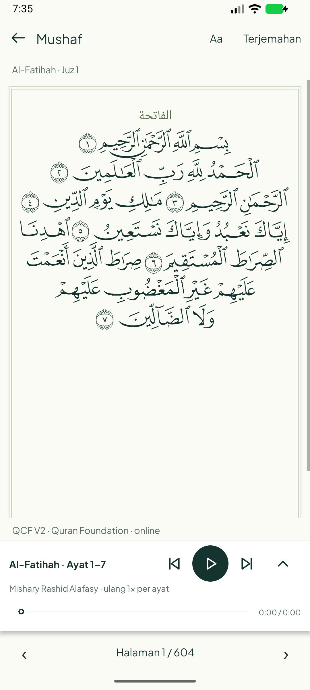
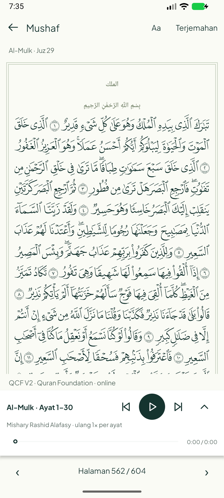

# Mushaf QCF V2 online dan audio asli — 21 Oktober 2026 (WIB)

Baseline `ee2662c65e24b8f9bdf6ce0835d69280d6017006`. Source Android Java/XML,
compile/target SDK 35, minimum aplikasi tetap 26. **Mode Mushaf sementara Android
12/API 31 ke atas**, karena menggambar glyph QCF langsung memakai Canvas.drawGlyphs.
Entry disembunyikan pada API 26–30; reader ayat/terjemahan tetap tersedia.

## Hasil aplikasi

Di reader Quran, buka Aa → **Baca Mushaf · halaman**. Ayat yang terlihat diteruskan
ke halaman QCF V2. Kembali lewat Terjemahan/Back mempertahankan ayat yang dipilih.
Halaman Arab berbingkai tipis, glyph asli, nomor ayat inline, baris mengikuti
metadata mushaf 1. Ayat tidak dibuat menjadi kartu dan terjemahan tidak sekadar
disembunyikan. Satu baris dapat memuat beberapa ayat; satu ayat bisa lintas baris.

- Navigasi RTL 1–604, lompat halaman/surah/juz memakai metadata, validasi rentang,
  simpan posisi terakhir, dan tindakan ayat lewat tekan lama atau Aa → Pilih ayat.
- Zoom halaman 100/125/150/200% dengan pan horizontal/scroll vertikal; mode malam.
  Header disusun dua baris pada teks sistem besar agar kontrol tidak terpotong.
- Ketuk halaman untuk menyembunyikan header/navigasi; mini-player tetap terjangkau.
  Player/background/rentang/repeat/unduhan memakai service lama. Sentuhan halaman
  menghentikan gulir/follow otomatis. Preferensi, Hifz, tugas dan SQLite tidak direset.
- Penanda yang terhubung tetap **ayat aktif dengan latar sage**, bukan karaoke
  kata emas. WordTimeline belum dihubungkan ke renderer/player.

## Sumber, lisensi dan penyimpanan

Edisi teknis tahap ini: **QCF V2 / mushaf ID 1**, Madani 1421H, 604 halaman.
[Panduan layout Foundation](https://api-docs.quran.com/docs/tutorials/fonts/page-layout/)
dan [pasangan edisi QUL layout 10](https://qul.tarteel.ai/resources/mushaf-layout/10).
Baris ayat berasal dari page_number/line_number/code_v2; judul surah memakai metadata
bawaan dan basmalah memakai teks Al-Fatihah 1:1 bawaan, ditempatkan pada celah
sebelum awal surah (tanpa basmalah tambahan untuk At-Taubah). Spasi horizontal dan
ornamen judul adalah rendering aplikasi, bukan klaim gambar cetak identik piksel.

Halaman diminta online dari **public v4 yang sudah dipakai reader**:
`https://api.quran.com/api/v4/verses/by_page/{page}?mushaf=1&words=true&word_fields=code_v2,text_uthmani&per_page=50`.
Pemetaan ayat memakai by_key/words; Juz memakai by_juz. Legacy pages/lookup memberi
404 saat audit, sehingga tidak dipakai. Kredensial Production hanya digunakan di
alat server lokal, **tidak berada di APK**. Migrasi ke gateway terautentikasi tetap
memerlukan backend; tidak membuka proxy publik atau memasukkan secret ke mobile.

Font asli, tanpa modifikasi/subset, diunduh per halaman dari URL yang didokumentasi:
`https://verses.quran.foundation/fonts/quran/hafs/v2/ttf/p{page}.ttf`.
[Izin font resmi](https://api-docs.quran.com/docs/tutorials/fonts/font-rendering/)
mensyaratkan akun Developer Console aktif dan atribusi; pengguna kini memiliki akun,
dan atribusi Quran Foundation terlihat di reader. Pemilik aplikasi harus menjaga
akun aktif. Font cache maksimal delapan file, refresh setelah tujuh hari, ditulis
atomik. Tidak membundel/mendistribusikan font terpisah melalui Git.

JSON halaman hanya di memori saat runtime, **tidak disimpan sebagai korpus offline**.
Mushaf memerlukan jaringan meski font pernah dimuat. Offline penuh/Content Sync
belum diintegrasikan. Cache/unduhan teks reader lama tidak dimigrasikan di tahap ini.
Data mentah audit hanya di .local yang ignored; laporan Git berisi ringkasan/screenshot
aplikasi, bukan database atau paket font.

## Pengujian dan preview

Build aplikasi/APK tes, JVM dan lint lulus. [Ringkasan](summary.json).
**78 tes JVM lulus, nol failure/error/skip** dalam run dengan snapshot host tersedia.
Lint akhir: nol error, 589 warning nonfatal; [build terverifikasi](build-verified-release.txt).
Dua tes font/snapshot bersifat opsional pada checkout tanpa ZIKRA_MUSHAF_AUDIT_DIR;
jangan menyebutnya lulus bila sebenarnya skipped. JSON-java hanya dependensi tes JVM.

**Lima metode Android unik lulus** pada AVD uji khusus API 37:

- Tiga MushafReaderTest: font/glyph asli halaman 300/562/604, preview Al-Fatihah,
  batas halaman/RTL, zoom nyata 200%, malam, chrome; perpindahan mode kembali ke
  Al-Mulk ayat 5; halaman 605 ditolak, 604 diterima, Juz 29 → halaman 562 dan posisi.
- Dua LiveQariPlaybackTest dijalankan terpisah: streaming tiga qari, jeda/lanjut,
  seek, berikutnya/sebelumnya, background/layar mati dan ganti surah; unduh tujuh
  MP3 Al-Fatihah/Alafasy lewat service asli, decoder, repair berkas rusak/parsial,
  jaringan dimatikan, repeat/range offline dan error saat audio tidak tersedia.

Ini **playback/decoder asli Android**, bukan WAV sintetis. Identitas qari mengikuti
URL provider; tidak ada pemeriksaan pelafalan dengan mendengarkan oleh manusia.
Tidak menguji headset/Bluetooth/telepon, baterai vendor, HP fisik, runtime API 31/35,
seluruh 604 halaman secara visual, atau interupsi di tengah transfer jaringan.

Screenshot APK aktual API 37, 1080×2400 / 420dpi:

| Al-Fatihah | Al-Mulk |
| --- | --- |
|  |  |

[Halaman 604](screens/Page604.png) · [Malam/zoom halaman 200%](screens/NightZoom200.png) ·
[Teks sistem 200%](screens/SystemFont200.png). Tidak ada mockup atau teks generatif
yang dipakai sebagai bukti hasil Android. Log akhir perangkat ditautkan pada summary.
[Pemutaran MP3 asli saat jaringan mati](screens/AudioOffline.png).

## Kegagalan awal dan perbaikan

Log awal disimpan. Tes pertama menemukan: Files.readString tidak tersedia pada
classpath tes Android, JSONException checked, dan respons API dengan field duplikat
bila meminta metadata default lagi. Deklarasi/IO tes dan query diperbaiki.

Preview awal menemukan glyph bertumpuk: kode QCF di rentang Arabic presentation
forms diperlakukan sebagai combining marks oleh shaping teks biasa. Renderer kini
membaca cmap/hmtx font asli dan menggambar glyph langsung; file font tidak diubah.
Paint.hasGlyph untuk string beberapa glyph juga bukan pemeriksaan yang tepat;
tes kini memeriksa glyph ID setiap code point dari cmap yang benar.

Zoom awal baru mengubah nilai opsi; pengukuran HorizontalScrollView diperbaiki dan
tes kini menuntut lebar viewport benar-benar sekitar dua kali. Preview teks sistem
200% menemukan Aa/panah terpotong; header dan tinggi tombol diperbaiki. Kontras thumb
seek malam diperbaiki. Dua percobaan tes streaming dihentikan saat helper membuka
Activity dari background tanpa batas waktu. Helper kini memakai izin instrumentasi
yang sesuai dan monitor 15 detik; kedua metode live kemudian lulus sendiri-sendiri.
Run yang dihentikan berlabel Process crashed tidak dihitung sebagai run lulus.
Lint terakhir sempat menolak indentasi callback sentuh. Format diperbaiki dan lint
dijalankan ulang tanpa menonaktifkan aturan; build dan tiga tes Mushaf terakhir lulus.

## Pekerjaan berikutnya

Sinkron kata emas: buktikan pasangan recording/timing persis, bedakan end-marker
dari kata bersuara, hubungkan posisi MediaPlayer serta pause/seek/buffering/repeat.
Lanjut backend/Content Sync, audit korpus lengkap/penyelarasan halaman, lifecycle
recreation dan uji HP. Jangan mengklaim seluruh backlog selesai dari checkpoint ini.
