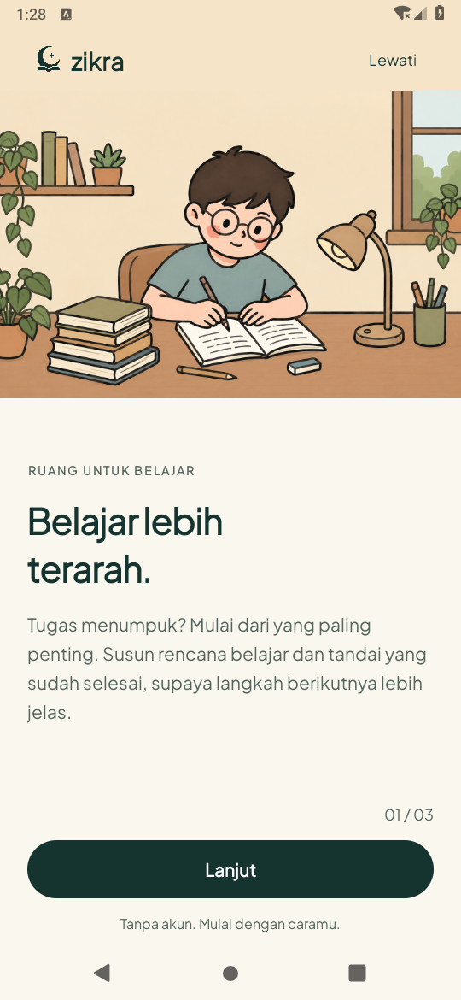
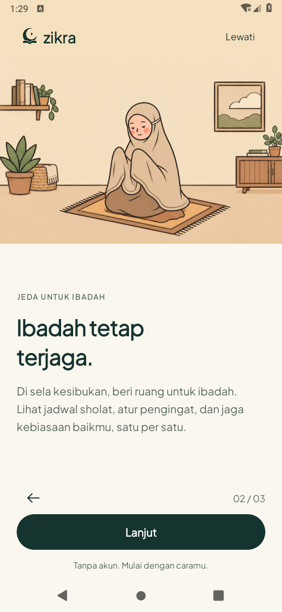
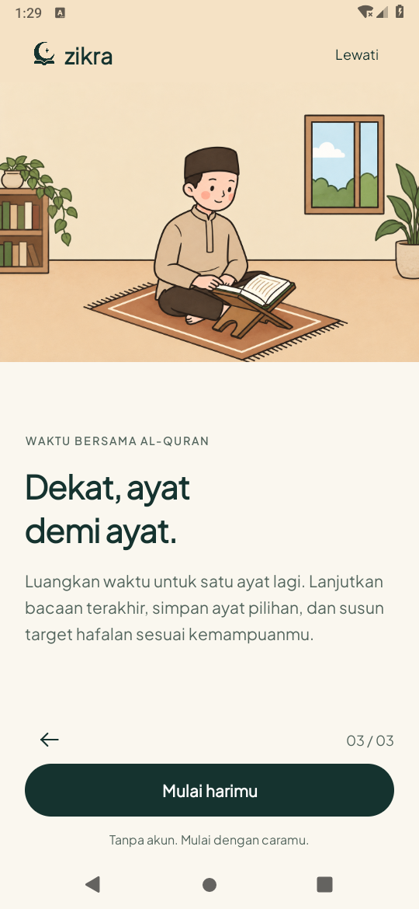

# Onboarding — komposisi dan tipografi, 19 Oktober 2026

Tahap pertama [rencana pengembangan](../../../design/IMPROVEMENT_PLAN.md).
Perubahan hanya pada presentasi tiga cerita dan resource teks, tanpa menghubungkan
layanan lokasi, Maps, murottal atau AI baru.

## Hasil

- Ilustrasi 2D tetap statis dan tidak diubah. Master logo bulan/buku/spark tetap sama.
- Pengantar 11sp, judul 32sp dan paragraf 16sp menjelaskan manfaat yang sudah tersedia.
  Blok teks menggunakan sisa ruang di bawah ilustrasi; pada layar pendek/font besar
  cerita bisa digulir, dengan navigasi tetap di bawah.
- Kembali di kiri dan langkah di kanan. Catatan tanpa akun konsisten pada tiga cerita.
  Progres selesai, alur Lewati, pembukaan melalui Profil dan preferensi lama dipertahankan.

## Pemeriksaan terarah

JDK 17, Gradle 8.9, AGP 8.7.3, compile/target SDK 35; emulator Android API 28,
display fisik 540×1170 dan font normal 100% untuk screenshot.

`assembleDebug assembleDebugAndroidTest lintDebug`: **lulus**, nol error lint,
481 peringatan nonfatal. [Log build](build.txt).

**Lima metode instrumentasi unik lulus:**

- `StaticOnboardingTest#testArtworkRemainsStaticAndStoriesAreDistinct` — gambar diam,
  tiga ilustrasi berbeda dan kembali ke cerita sebelumnya.
- `StaticOnboardingTest#testCompactLayoutAtLargeFontKeepsNavigationReachable` — layout
  scoped 320×560dp/font 200%; Lewati utuh, CTA terjangkau, caption dapat digulir penuh.
- `StaticOnboardingTest#testSwipeOnWideContinueAdvancesOnlyOneStep` — geser tidak
  melewati dua langkah sekaligus.
- `RebuiltOnboardingTest#testThreeStoriesRecreateAndPreserveLegacyPreferences` —
  tiga cerita, recreate, selesai menuju Home dan preferensi lama tetap tersimpan.
- `RebuiltOnboardingTest#testSkipHomeBrandAndActualAppIcon` — Lewati menuju Home,
  komponen branding dan ikon aplikasi tetap tersedia.

Putaran pertama: empat lulus, satu gagal menunggu fokus karena dialog **System UI
isn't responding** pada emulator menutupi Activity. `dumpsys window` menunjukkan
fokus pada `Application Not Responding: com.android.systemui`, bukan crash Zikra.
Sesudah memilih Wait pada dialog tersebut, metode yang terhambat diulang dan lulus.
Tidak ada perubahan source/test untuk melewati kegagalan itu.
[Log awal](tests-initial.txt) · [Uji ulang terarah](tests-retest.txt).

Tidak menjalankan ulang seluruh suite aplikasi untuk perubahan ini. Hasil 33 JVM/
47 metode pada [ronde sebelumnya](../quality-2026-10-19/README.md) tetap historis.
Ini bukan bukti performa HP fisik, runtime API 35, atau seluruh konfigurasi display.

## Screenshot APK aktual

PNG ditarik dari hasil tes tiga cerita setelah instalasi APK baru, tanpa crop/edit.
Hash dicatat dalam [screens-sha256.json](screens-sha256.json).

| Belajar | Ibadah | Al-Quran |
| --- | --- | --- |
|  |  |  |
