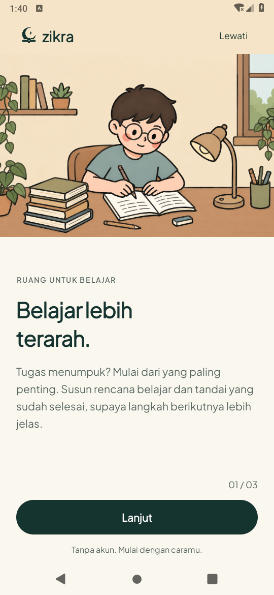
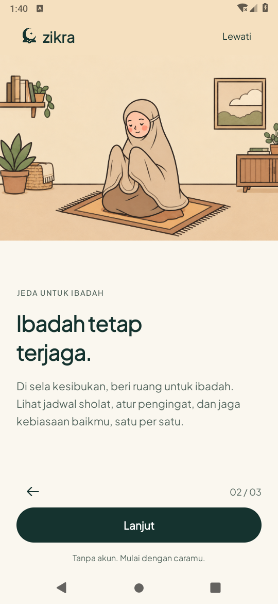
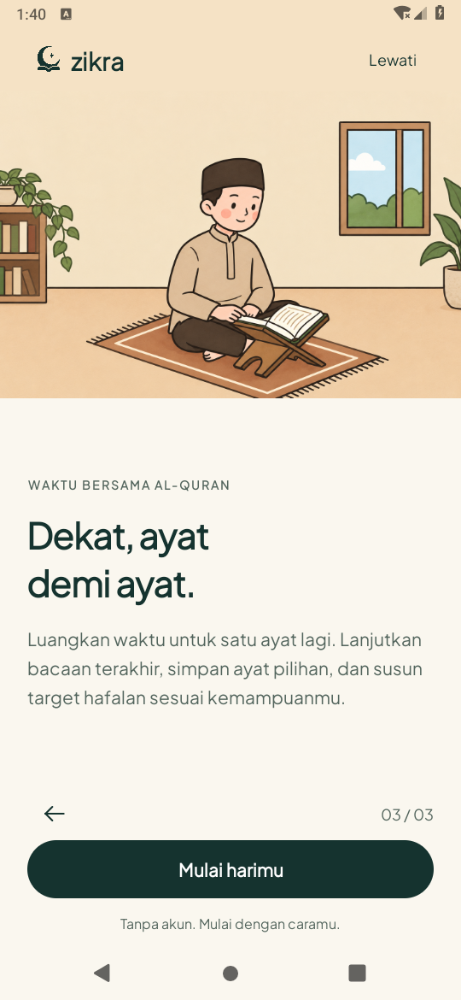

# Parallax onboarding — 19 Oktober 2026

Pengguna menyetujui komposisi tiga cerita, kemudian meminta parallax. Tahap ini
mempertahankan ilustrasi dan logo master yang sama; tidak menggambar ulang aset.

## Efek yang tersedia

- Saat jari menggeser ilustrasi, gambar utuh dan teks bergerak dengan kecepatan/arah
  berbeda. Setelah dilepas, offset sentuh kembali dalam 320ms. Gulir panjang memberi
  pergeseran tambahan terbatas pada gambar.
- Karakter, buku dan perabot bukan layer terpisah dan tidak beranimasi sendiri.
  Tidak ada gerak otomatis saat diam, sensor, izin baru atau dependensi tambahan.
- ImageView memakai pembesaran 4% sebagai ruang gerak; pinggir panel terpotong sedikit
  agar pergeseran tidak memperlihatkan tepi kosong. Teks bergerak maksimal 2dp.
- Efek direset saat ganti cerita, kehilangan fokus atau meninggalkan Activity.
  Animasi sistem nonaktif atau penghemat daya menonaktifkan efek melalui kebijakan
  gerak bersama; gambar kembali ke ukuran pas penuh dan teks tidak bergeser.

## Pemeriksaan

JDK 17, AGP 8.7.3, Gradle 8.9, compile/target SDK 35. Runtime emulator API 28,
software rendering, display 540×1170. Tidak mengukur FPS, baterai atau kenyamanan HP.

- **Build APK, APK tes dan lint lulus**; nol error lint, 481 peringatan nonfatal.
  [Log](build.txt).
- **Dua tes gerak lulus**: drag pendek menghasilkan kedalaman tanpa pindah cerita,
  gambar menutup viewport, offset kembali; mematikan animasi saat halaman terbuka
  menghentikan gerak. Pengaturan animasi asli dipulihkan setelah tes. [Log](motion-tests.txt).
- **Lima tes regresi onboarding lulus**: tidak ada animasi idle, ilustrasi berbeda,
  kembali, geser tombol tidak melompat dua langkah, layout scoped 320×560dp/font200%,
  recreate pada langkah kedua, selesai/Lewati menuju Home dan preferensi lama tetap
  tersimpan. [Log](regression-tests.txt).

Total **tujuh metode unik lulus**, tanpa kegagalan pada ronde ini. Tidak menjalankan
ulang seluruh fitur atau suite JVM karena perubahan hanya pada gerak onboarding.
Penonaktifan animasi diperiksa langsung; penghemat daya memakai kebijakan bersama,
belum uji tersendiri pada HP fisik. Runtime API 35 dan performa perangkat belum diuji.

## Preview aktual

[Video gerak dari APK](OnboardingParallax.mp4) direkam dengan screenrecord saat tes
menjalankan drag sintetis pada layar native. Bukan animasi mockup atau bukti FPS HP.
Screenshot di bawah berasal dari tes tiga cerita setelah instalasi APK yang sama,
tanpa crop/edit. Hash media terdapat di [media-sha256.json](media-sha256.json).

| Belajar | Ibadah | Al-Quran |
| --- | --- | --- |
|  |  |  |

Komposisi/copy sebelumnya: [laporan](../onboarding-copy-2026-10-19/README.md).
Lokasi pengguna, Maps, murottal dan asisten tetap tahap terpisah dalam
[rencana pengembangan](../../../design/IMPROVEMENT_PLAN.md).
