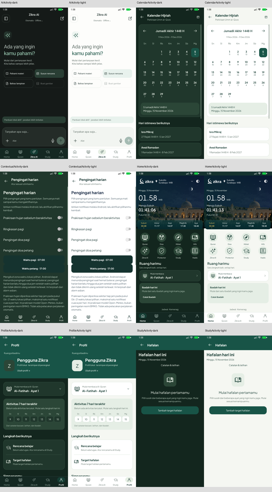
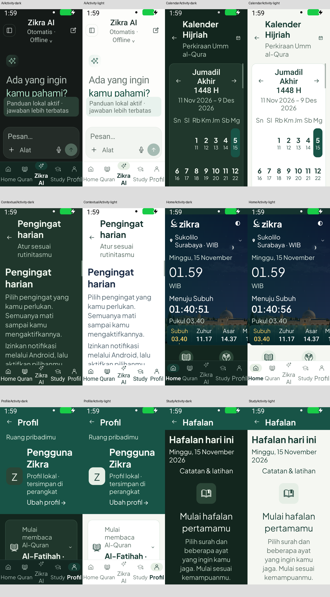
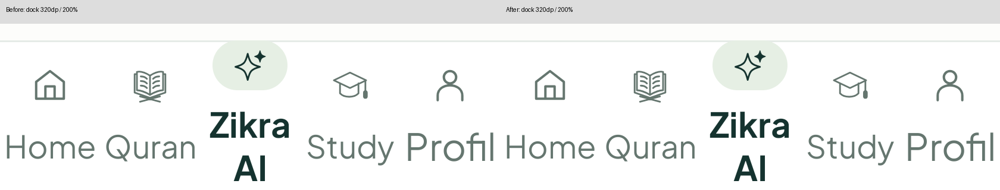

# Audit produk, PDF sementara dan dock —15November2026

**Kandidat internal1.9.52/code79, debug/HOLD.** HP tidak dipakai, terakhir terbukti
1.9.48. Tidak deploy, mengubah provider/kuota/paket, menandatangani paket final,
menghapus data produksi, mengirim email atau mempublikasikan APK/website.

APK lokal: `D:/Download/Zikra-App-main/Zikra-Privacy-v1.9.52-beta-debug.apk`.
49.820.578byte;SHA256
`4c35b8617af581609ee70e439d5c1ec94624466056561762d7a756988d624035`.
Paket internal diperiksa;0entri konfigurasi privat/credential dikenal, tanda
tangan valid/debug sama, backup/cleartext nonaktif. Bukan penetration test atau
bukti tidak ada rahasia yang tidak dikenal. Auditor menolak distribusi/debug
sebagaimana mestinya; bukan kegagalan yang boleh diabaikan untuk publikasi.

## Lingkup dan perbaikan

[Audit putaran pertama A–K](../../../docs/beta/PRODUCT_AUDIT.md) menjadi laporan
tunggal: inventaris fungsi, temuan, batas UI, rencana QA, gerbangPlay, asumsi
bisnis dan prioritas. PA03API36/PA04pelaporanAI merupakan gap baru terkonfirmasi.
Hak/B01/audio, usia/wali/lokasi remaja, retensi akun, signer/migrasiHP/J13/J14
masih terbuka. Tidak menyebut A–D/E/F/G selesai atau beta publik siap.

PA06: `AssistantTempFiles` mengelola copy rawPDF untuk renderer; tutup normal
menghapus salinan. Worker startup membersihkan file renderer numerik >24jam,
langsung di cache, maksimal256entri, file aktif dilindungi. Bukan symlink,
direktori, PDF asli, kamera pending atau lampiran tersimpan. Tidak ada janji
hapus tepat24jam, physical secure erase, atau cleanup seluruh cache.

PA11: screenshot320dp/teks200% menunjukkan label dock rapat; autosize khusus
navigasi disesuaikan8–12sp dengan ellipsize penjaga. Skala isi halaman tidak
diubah. Tes memastikan label yang tampil utuh/tanpaellipsis dan tetap dalam
tab pada ukuran teruji; dock sengaja tersembunyi pada halaman scoped tidak dinilai.

PA08: handoff menjadi satu status aktif52, backup50 tidak diminta dibangun ulang,
runtimePython Redis dibetulkan. WIPPROJECT_HANDOFF tidak disentuh.

## Verifikasi dan batas

235JVM/0gagal/0skip; build debug/testAPK dan lint0error/894warning.
Hasil native final dan detail lingkungan ada di [receipt](receipt.json).
Backend tidak berubah;134tes14November adalah bukti historis, tidak dijumlahkan.

Unit cleanup memeriksa penutupan normal, batas waktu/recent/future/nama asing,
file aktif, direktori berisi file, cache hilang dan jam tidak valid.
Native menggunakan PDF sintetis2halaman dan4halaman ditolak; jumlah rawcopy
kembali sama. Symlink asli diuji di filesystem Android, bukan skip Windows.

Probe startup memakai file sintetis abandoned yang diberi tanggal lama dan
file pembanding asing. Setelah force-stop/buka ulang, copy renderer hilang dan
pembanding utuh. **Ini simulasi orphan saat restart, bukan bukti kill persis
di tengah native PdfRenderer atau powerloss/secure erase.**

Screenshot aktual meliputi Home/AI/Hifz/Profil/Kalender/pengingat pada dua tema,
normal dan320dp/teks200%. KeyboardAI diuji terpisah. Hasil ini tidak mencakup
seluruh halaman/semua keadaan, TalkBack atau semua rasio kontras. Snapshot
Home malam menunjukkan lampu interior; tema terang tidak mengubah jam langit.
Tangkapan layar kosong belum mengesahkan semua kondisi terisi/gagal/loading.

Tidak ada pengukuran baterai/ANR/crashrate/latensi provider/kapasitas publik.
Angka startup `am start -W` satu sampel emulator bukan benchmarkHP atau SLO.
Ukuran APK berbeda dari51 terutama kompresi ZIP; inventaris entri sama dan
hash dua audio sesuai, tidak mengklaim fitur dipangkas demi ukuran.

## Percobaan yang gagal, tetap dicatat

- Helper native awal gagal compile: PdfDocument bukan AutoCloseable; finally
  diperbaiki, tidak mengubah runtime produksi.
- Emulator awal tertahan; percobaan software ditolak karena RAM3,6GB <4GB.
  Pekerja build yang sudah selesai dihentikan; emulator berikutnya berhasil.
  Image memaksa RAM4096MB meskipun argumen1536MB, bukan klaim VM1,5GB.
- Build koreksi dock saat VM aktif gagal alokasi memori. VM milik audit saja
  dihentikan selama build; build berikutnya sukses. Game/aplikasi pengguna tetap.
- Uji label tambahan pertama gagal pada layout/dock tersembunyi, belum dinilai
  sebagai kegagalan produk. Helper diperbaiki menunggu frame dan menghormati
  ancestorvisibility; assertion label tidak dihapus/dilonggarkan pada dock tampil.
- Pemanggilan ulang auditor sempat menolak output yang sudah ada; final audit
  memakai output baru setelah build selesai. Tidak menganggap audit gagal lulus.

Rawlog/screenshot lengkap privat di `.local/product-audit-20261115`, bukti publik
tersanitasi pada folder ini. Konfigurasi/key/MP3/APK tidak masuk Git.

## Akun dan regulasi

GETmetadata tim/proyek Vercel:403/403; dashboard meminta login. Paket akun dan
retensi/drain/backup **belum terverifikasi**, tidak membuat token atau mengubah
akses. [Hasil tersanitasi](retention-account.json),
[retensi](../../../docs/beta/RETENTION_REVIEW.md),
[sumber remaja dan ambiguitas PDF final](../../../docs/beta/TEEN_PRIVACY_REVIEW.md).

## Preservasi dan penutupan

Tujuh konfigurasi privat, WIP handoff, stash/arsip audio, logo dan foreground
Home cocok baseline; dua audio APK cocok hash. Tidak mengubah dataHP.
Penutupan VM dan penghapusan direktori sementara diperiksa pada receipt;
jangan menyatakan selesai sebelum proses/data task benar-benar dibersihkan.

## Screenshot final dan before/after

Before adalah percobaan awal52 sebelum koreksi dock, bukan build publik lain.
[Keyboard200%](ai-keyboard-200.png) memuat banner pembaruan ukuran font Gboard;
itu UI keyboard Android, bukan dialog Zikra. Composer/send/lampiran tetap terjangkau.
[Output native final](native-results.txt), [startup sintetis](startup-proof.txt).

VM milik audit telah dihentikan, direktori E:/Zikra-ProductAuditQA-20261115
dihapus dan keberadaannya diperiksaFalse. Ukuran/font emulator dipulihkan sebelum
penutupan. Tidak ada game/aplikasi pengguna ditutup atau HP diakses.
