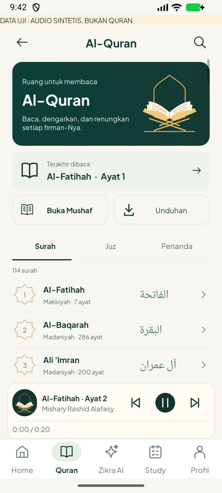
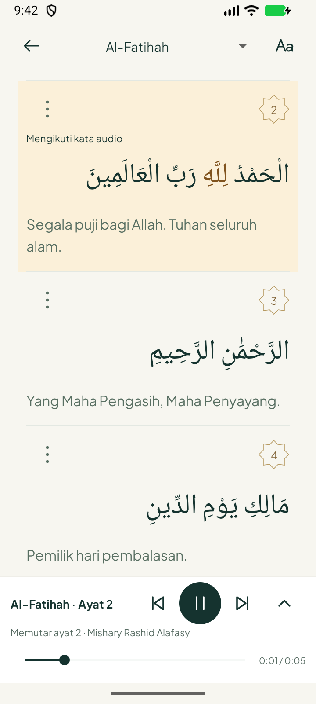
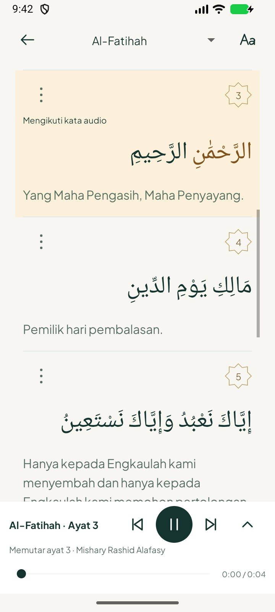

# Quran: mini-player katalog dan lanjut ikuti ayat — 22 Oktober 2026

**1.4.1 / code 9**, berdasarkan `3fe4a85`. Native Java/XML; memakai satu service/antrean audio yang sudah ada. Eksperimen prefetch lokal tidak disertakan.

| Mini-player katalog (audio sintetis berlabel) | Sorotan kata rekaman asli | Ayat berikutnya otomatis |
|---|---|---|
|  |  |  |

## Perubahan

- Katalog menampilkan mini-player di atas navigasi setelah ada antrean: judul surah/ayat yang benar-benar diputar, qari, sebelumnya/putar-jeda/berikutnya, progres dan waktu decoder. Antrean kosong menyembunyikan player. Tidak memulai suara otomatis saat membuka katalog.
- Tombol katalog mengirim perintah pada antrean aktif; berpindah pilihan surah tidak mengganti rekaman. Ketuk judul/gambar membuka surah dan ayat yang sedang terdengar. Tidak membuat MediaPlayer atau service baru.
- Setelah sentuhan manual menghentikan follow, tombol **Lanjut ikuti ayat** mengembalikan viewport ke ayat audio. Gulir baca mandiri tetap terpisah dari follow audio.
- Pencocokan kata kini mengizinkan padanan alif penuh dengan superscript alif yang benar-benar ada pada sumber Utsmani. Contoh `الْعَالَمِينَ` dan `ٱلْعَـٰلَمِينَ` cocok tanpa mengubah teks tampilan atau offset. Urutan seluruh kata tetap diperiksa; huruf berbeda atau alif yang hilang tanpa tanda eksplisit tetap ditolak. Saat mismatch/timing tidak tersedia, tetap sorotan satu ayat.
- Tema malam dan font sistem 200%: informasi mini-player membungkus dan kontrol turun ke baris sendiri. Target putar tetap 48dp, kartu berada di atas navigasi.

## Pengujian

[Build/lint/JVM](build.txt): sukses **34 detik**, 1 worker, heap 512 MiB. Lint 0 error/fatal, 680 warning; bukan klaim semua warning sudah dituntaskan.

[JVM XML](jvm/): 96 ditemukan, **93 lulus, 3 dilewati**, 0 failure/error. Tiga metode opsional membutuhkan snapshot/font host yang tidak dipasang pada runner Gradle: MushafDocumentTest.actualHostSnapshotsParseWithoutBundlingContentInTests dan dua QcfGlyphMetricsTest; daftar tepat di [result.json](result.json). Enam tes ArabicWordMap termasuk padanan alif dan penolakan kata keliru benar-benar berjalan.

[Instrumentasi final](native-tests.txt): **5/5 lulus**, 22.44 detik di satu emulator 720x1600, density320:
1. Mini-player mengontrol pause/resume/next/previous pada rentang aktif, kembali ke ayat terdengar, tidak mengubah sumber saat memilih surah lain, hilang saat Stop.
2. Sentuhan menjeda follow, tombol lanjut mengikuti ayat memulihkan gulir dan warna ayat.
3. Font 200%/malam: kontrol penuh terlihat dan kartu tidak tertutup dock.
4. Gulir mandiri bergerak tanpa audio, berhenti karena sentuhan; rentang invalid mempertahankan dialog.
5. **Rekaman Alafasy asli** dari Quran.com, Al-Fatihah 2–3: minimal dua offset kata berbeda diwarnai berdasarkan decoder, pindah ke ayat 3 berikut gulir dan span kata, pause menghentikan posisi, seek memperbarui posisi. Bukan klaim audit semua qari/ayat.

[Percobaan awal](initial-tests.txt) mencatat tiga failure. Satu menemukan padanan ejaan Utsmani yang belum didukung; dua terkait isolasi antrean antar tes dan menunggu pembukaan surah sebelum Back. Semua diperbaiki sebelum lima tes final lulus. Screenshot kontrol bertanda AUDIO SINTETIS memakai WAV uji, bukan rekaman Quran; screenshot Live memakai rekaman asli. Fixture/pengaturan dikembalikan teardown. [Crash buffer](crash-log.txt).

Emulator ditutup setelah pemeriksaan. HP fisik, baterai, semua surah/qari, mode offline timing dan reliabilitas jaringan jangka panjang belum diuji pada ronde ini. Protector/Hadis/Doa belum didesain ulang. APK debug berada pada folder luar checkout; hash dan kesamaan sumber disimpan di result.json.
