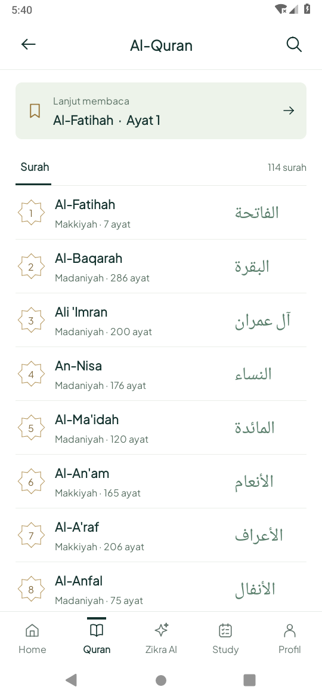
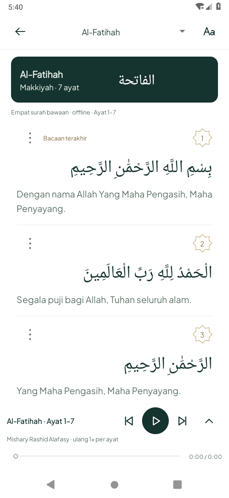
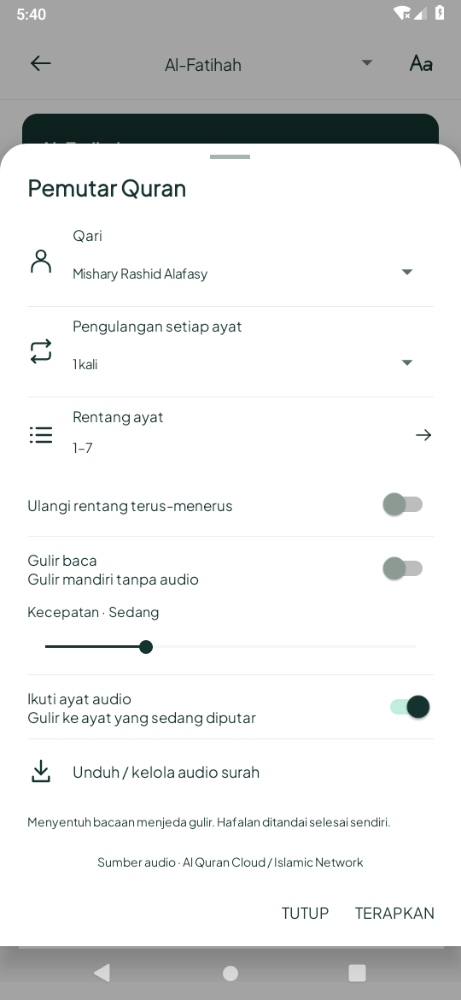

# Katalog, reader dan panel Quran native — 21 Oktober 2026 (WIB)

Berdasarkan `486a35d`. Tahap ini menerapkan arah visual katalog/reader/panel yang
disukai pengguna di [acuan desain](../../../design/QURAN_READER_DESIGN.md), pada
Android Java/XML. Konsep tidak dipakai sebagai sumber teks atau layout Mushaf.

## Hasil implementasi

- Katalog tetap 114 surah, medali nomor emas, nama Latin/Arab dan metadata. Baris
  diringkas, heading Al-Quran, pencarian dan kartu Lanjut membaca tetap tersedia.
- Reader memakai header Pine ringkas dua baris, ikon Aa, teks Arab dominan dan
  terjemahan proporsional. Nomor ayat berornamen di kanan; menu vertikal/tekan lama
  menyediakan putar, tandai terakhir dibaca, salin dan bagikan. Bacaan terakhir
  tetap satu penanda/resume yang sudah ada, bukan klaim koleksi bookmark baru.
- Pemutar tetap berada di ruang tersendiri di bawah viewport, dengan sebelumnya,
  putar/jeda, berikutnya, seek dan perluas. Tindakan unduhan dipindahkan ke panel.
  Panel mini menampilkan qari, buffering/kegagalan/rentang dan status unduhan.
- Panel Pemutar Quran muncul dari bawah: qari, repeat per ayat, edit rentang,
  ulang rentang, gulir mandiri/kecepatannya, ikuti ayat audio dan kelola unduhan.
  Pengaturan disimpan saat Terapkan; Tutup membatalkan perubahan yang belum dipakai.
  Menekan kelola unduhan menerapkan pilihan tervalidasi agar qari unduhan sesuai.
- Dua mode penggerak viewport saling menonaktifkan: gulir mandiri tanpa audio dan
  mengikuti ayat. Range invalid tetap di panel dengan editor/error terlihat.
- Panel bisa digulir pada teks besar/keyboard dan mode malam memiliki kontras slider,
  teks, ikon serta divider tersendiri. Buka/tutup mengikuti animasi sistem dan
  penghemat daya. Tutup/Back tersedia; tidak mengklaim gesture drag/swipe panel.
- Service audio, parser Quran, unduhan atomik, SQLite, target Hifz, cache, unduhan,
  bookmark/resume, preferensi ukuran dan tema yang ada dipertahankan. Default Arab
  32sp berlaku bila belum ada pilihan ukuran; pilihan lama tidak ditimpa.

Tab Juz/Bookmark ganda dari gambar konsep tetap usulan; tidak dibuat sebagai kontrol
kosong. Mushaf halaman dan sorotan kata belum ditambahkan: [audit sumber](SOURCE_AUDIT.md).

## Preview Android aktual

Screenshot/rekaman berasal dari APK emulator Android 9/API 28, 540×1170px, 210dpi.
Katalog/reader/panel memakai teks bawaan Al-Fatihah dan metadata bawaan, tanpa
rekaman qari atau data/progres belajar demo. Preview audio sintetis diberi label
terpisah. Gambar generatif konsep tidak menjadi bukti hasil implementasi.

| Katalog | Reader | Panel pemutar |
| --- | --- | --- |
|  |  |  |

[Rekaman panel native](quran-panel-native-preview.mp4) · [GIF](quran-panel-native-preview.gif).

[Mode malam/teks 200%](screens/panel-malam-font-200.png) ·
[Reader malam/teks 200%](screens/reader-malam-font-200.png) ·
[Kelola unduhan](screens/kelola-unduhan.png) · [Bookmark](screens/bookmark.png).

## Validasi dan batas

Pemeriksaan meliputi teks Quran bawaan tetap identik, posisi mini-player tidak
menutup reader, panel bawah, transaksi Tutup/Terapkan, qari yang benar pada unduhan,
menu bookmark lewat aksesibilitas native dan recreation, lompat ayat tervalidasi,
font 200%, mode malam, search Arab/ukuran tersimpan, Hifz range/repeat, MediaSession,
layar mati, kerusakan audio, transfer lokal/parsial dan gulir saat disentuh.
Preferensi/font serta audio fixture disimpan/dipulihkan, tidak menghapus data pengguna.

Provider teks/audio dan dokumentasi API live masih ditolak proxy 403. Audio qari asli,
full download jaringan, Mushaf, timing kata, API 35 runtime dan HP fisik belum terbukti.
[Audiens/sumber pengujian dan pekerjaan berikutnya](SOURCE_AUDIT.md).

## Hasil akhir pemeriksaan

- `assembleDebug`, APK tes, `testDebugUnitTest` dan `lintDebug` lulus.
  **52 tes JVM lulus, nol failure/error/skip; lint nol error**
  (576 warning nonfatal). [Build rilis](build-release.txt) · [Ringkasan](summary.json).
- **18 metode Android 9 unik lulus**: lima `QuranDesignTest`, tujuh `QuranAudioTest`,
  empat transfer lokal dan dua regresi reader/search/tema/ukuran.
  [Ronde UI/audio akhir: 14 lulus](device-ui-final-api28.txt). Empat kasus transfer
  yang source-nya tidak berubah lulus pada [ronde awal](device-initial-api28.txt).
- Perbaikan terakhir mempertahankan kontras panel saat tema berubah selagi terbuka.
  Pada APK rilis, dua metode preview dan malam/font 200% dijalankan ulang dan lulus:
  [log](device-theme-release-api28.txt). Snapshot normal/panel/malam dan rekaman
  diperbarui dari putaran APK rilis; bukti bookmark/manager/audio berasal dari
  putaran UI/audio sebelumnya pada tahap yang sama.
- Ronde awal menemukan helper tes bookmark mengevaluasi ulang predicate yang
  melakukan klik; helper kini mengevaluasi sekali dan memilih ancestor native yang
  clickable. Ada selector metode salah nama; diganti tes lompat ayat bawaan dari
  Aa, dengan kasus di luar batas dan ayat valid. Dua kegagalan awal tersimpan di log,
  dan tidak disajikan sebagai tes lulus. Kontras slider/divider mode malam turut
  diperbaiki berdasarkan preview Android.
- [Pemutar dengan audio sintetis berlabel](screens/pemutar-audio-sintetis.png)
  memverifikasi alur decoder/player, bukan kualitas rekaman qari atau sync kata.
- Rekaman panel native berdurasi 8.52 detik. GIF
  memakai rekaman yang sama pada kecepatan asli. APK debug disediakan sebagai
  artefak chat, bukan biner APK di Git; SHA-256 ada di summary.json.
