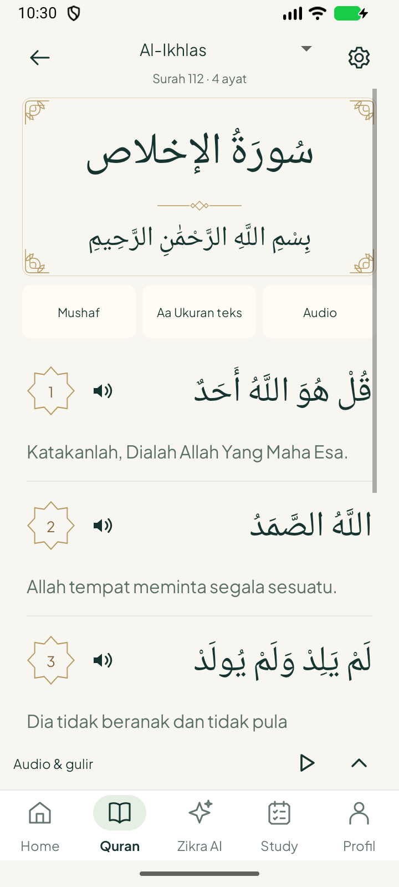
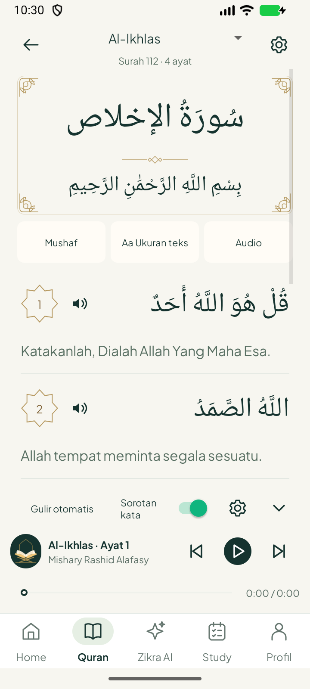

# Reader: panel lipat dan ornamen judul — 22 Oktober 2026

**Versi 1.4.3 / code 11**, berdasarkan `b49b7dc`. Pengguna meminta panel audio/gulir yang menghabiskan ruang bisa disembunyikan dan hiasan pada bagian judul.

| Panel terlipat (awal) | Panel dibuka |
|---|---|
|  |  |

[Audio dan sorotan asli saat terlipat](QuranReaderLiveWordColor.png) · [Kontrol malam/font 200%](ComfortableReaderLargeNight.png).

## Hasil

- Reader awal memakai baris ringkas Audio & gulir, putar/jeda dan panah atas. Tekan label/panah atau tombol Audio di bagian atas untuk membuka seluruh panel. Panah bawah melipatnya kembali. Pilihan dilipat/disembunyikan disimpan lokal dan pulih saat Activity dibuat ulang.
- Melipat tidak mengubah antrean, posisi audio, sorotan kata, mode follow atau gulir mandiri. Tombol ringkas mengontrol antrean aktif; tanpa antrean memulai bacaan yang dipilih hanya setelah diketuk. Pengaturan qari/rentang tetap lewat gear di panel terbuka; pilihan sorotan/gulir tetap tersedia di dalamnya.
- Reader mendapat ruang baca setidaknya 80 dp lebih tinggi ketika panel dilipat, terverifikasi pada emulator 360 dp. Navigasi bawah tetap terlihat. Font 200% memindahkan gear/panah ke baris sendiri agar label mode tidak terjepit.
- Nama surat dan bismillah berada dalam bingkai emas transparan, motif sudut dan pembatas berlian tipis. Ornamen adalah vector/layer drawable native baru, bukan raster/gambar teks. Ukuran bingkai mengikuti teks; warna teks ayat tidak berubah. Bismillah tetap disembunyikan untuk Al-Fatihah/At-Tawbah sesuai perilaku reader sebelumnya.

## Validasi

[Build APK, test APK dan lint](build.txt): lulus 30 detik, satu worker, heap 512 MiB; 0 error/fatal. Jumlah warning tercatat di [result.json](result.json), bukan seluruh warning telah diselesaikan. JVM tidak diulang pada ronde UI ini.

[Lima metode Android](five-native-tests.txt) lulus dalam 32.012 detik: geometri reader/aksi/font/menu, mode malam dan font 200%, panel lipat (tambahan ruang, gulir/audio tetap berjalan, play/pause ringkas, preferensi pulih setelah recreation, gear dapat dibuka), sorotan rekaman Alafasy asli pada Al-Fatihah 2–3 dan mini-player katalog. Setelah merapikan dua baris kontrol untuk teks besar, [satu tes terkait](final-large-test.txt) diulang dan lulus 2.553 detik. Lima metode unik, bukan enam.

Tes panel lipat memakai WAV 440 Hz sintetis yang dikembalikan setelah tes. Capture bernama ReaderFoldedPlayingSynthetic mengalami timeout karena viewport sedang bergulir terus; log mempertahankan catatan itu dan screenshot tersebut tidak disediakan/diklaim. Assertion posisi decoder, gulir berjalan, pause/resume dan pilihan tersimpan tetap lulus. Screenshot LiveWordColor/NextAyah memakai rekaman Quran asli; bukan WAV. Tidak mengklaim audit semua qari/surah.

Screenshot awal dan live berasal dari lima tes sebelum penyesuaian khusus font besar terakhir. Screenshot malam/font 200% diambil ulang pada APK final. [Crash buffer](crash-log.txt). Satu emulator digunakan lalu ditutup; tidak memakai HP pengguna. Pengujian fisik HP/baterai belum dilakukan.

APK debug berada di folder luar checkout. Sumber build terisolasi tidak menyertakan eksperimen prefetch audio lokal yang masih WIP. Hash APK, sertifikat dan kesamaan file sumber index/build dicatat pada result.json. Home/Study/Protector tidak diubah dalam ronde ini.
