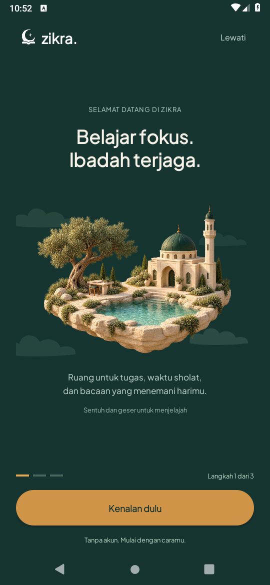
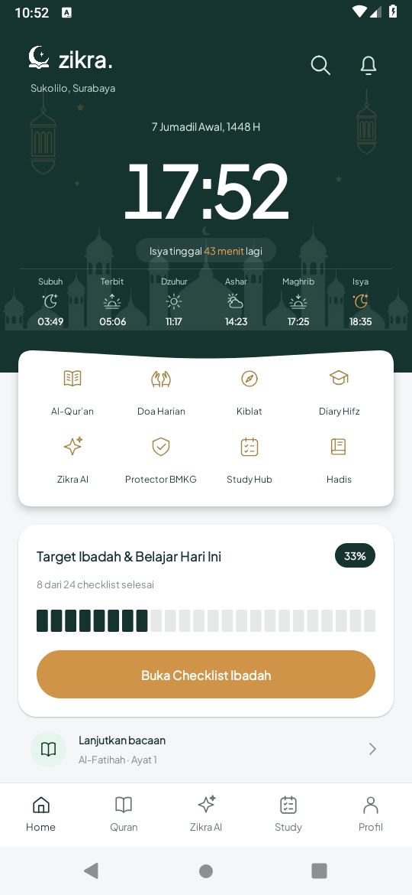
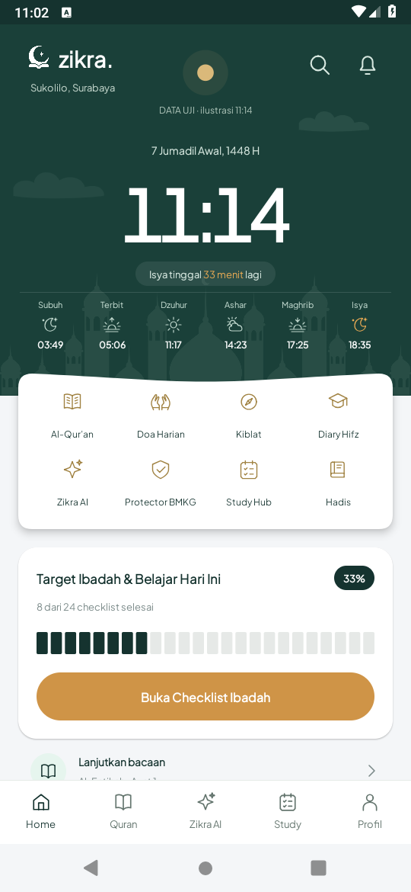
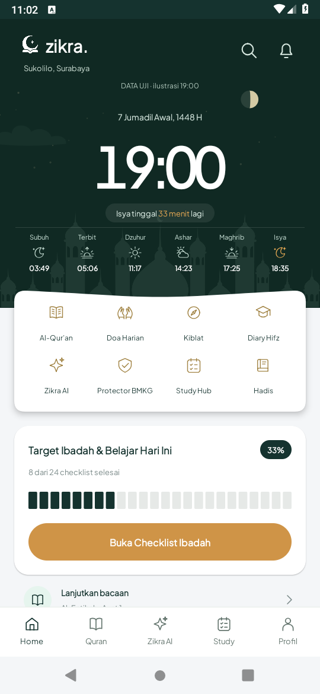
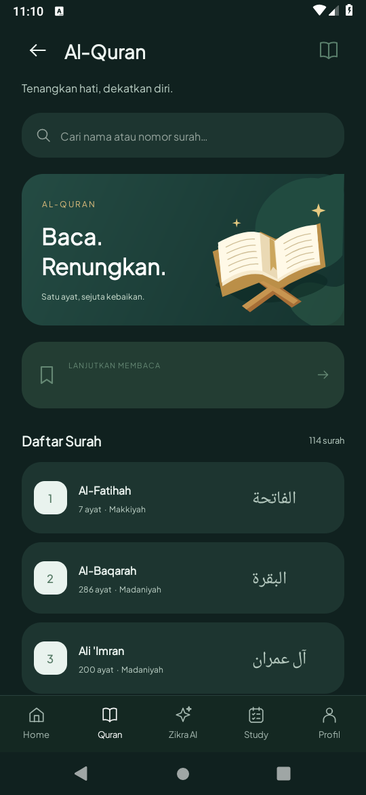
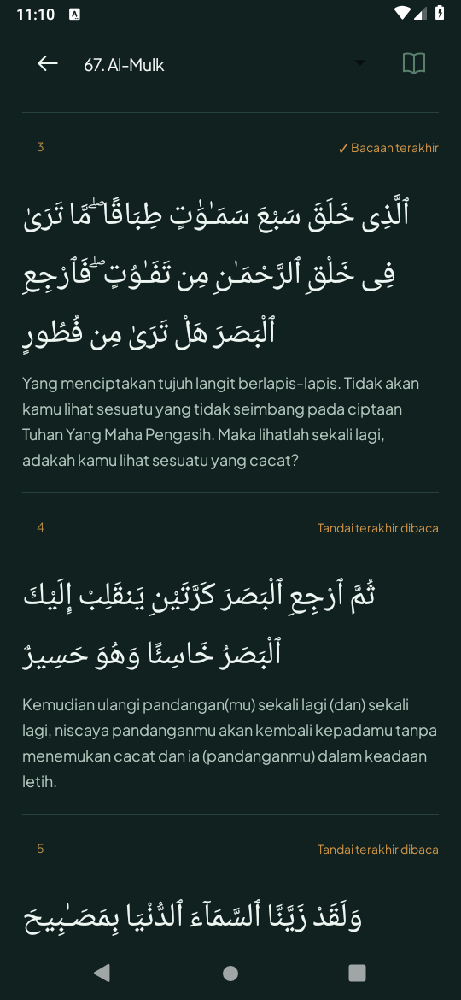
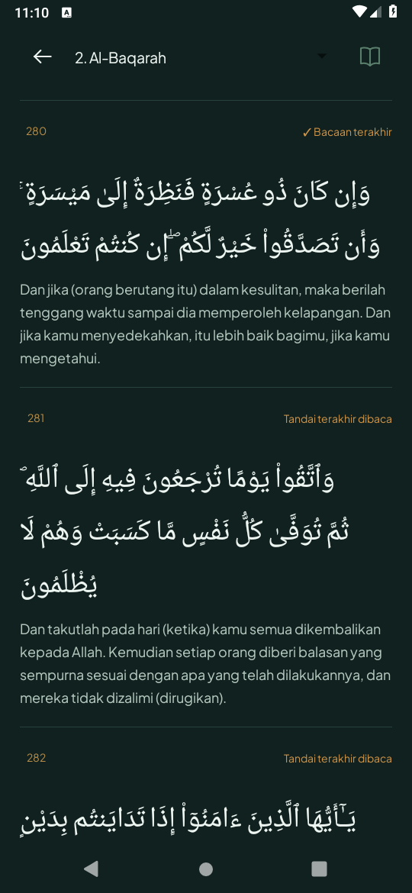

# Pembangunan ulang dari referensi chat

## Checkpoint 1: branding dan taman onboarding

Implementasi baru berdasarkan arahan dan screenshot pengguna; sumber asli versi taman belum ditemukan. Tetap Java/XML native.

- Master `design/branding/zikra-logo-primary.jpg` tidak berubah. Varian Pine/putih memakai alpha, kanvas dan geometri identik melalui skrip deterministik yang diizinkan pengguna. Spark dipertahankan.
- Komponen XML logo bersama dipakai splash/onboarding, header Home dan Tentang. Adaptive launcher memakai simbol dari master.
- Tiga cerita menggantikan jenjang/minat. Status langkah bertahan saat recreation, preferensi lama tidak dihapus.
- Ilustrasi taman baru dibuat dari brief referensi: pohon/meja belajar, masjid dan kolam. Tidak diklaim sebagai aset asli video. Canvas menambahkan awan bertingkat, float, parallax sentuh/tilt, dibatasi 30fps; berhenti di background, animator scale 0 atau hemat daya.
- Header Home baru hanya branding/lokasi; langit Home masih tahap berikutnya.

## Pemeriksaan satu putaran

JDK 17, SDK 35, emulator API 28 software rendering. `assembleDebug assembleDebugAndroidTest lintDebug` lulus; tiga tes perangkat lulus: gerak vs pause, skip/Home/ikon aktual, tiga cerita/recreation/preservasi preferensi. Log [build](branding-onboarding-final-build.txt) dan [tes](branding-onboarding-tests.txt). Sensor tilt, kelancaran dan baterai HP fisik belum diuji.

Screenshot berasal dari APK yang dijalankan, bukan mockup:

| Onboarding | Home branding | Ikon aktual |
| --- | --- | --- |
|  |  |  |

[Cerita 2](screens/RebuiltOnboarding2.png) · [Cerita 3](screens/RebuiltOnboarding3.png).

## Checkpoint 2: Home dan langit astronomi

- Logo/lokasi kiri atas dari komponen master. Lentera diganti langit siang/malam yang mengikuti waktu Sukolilo/WIB. Matahari bergerak pada busur terbit–transit–terbenam harian; transit lokal bukan jam 13:00 yang diasumsikan.
- USNO `api/rstt/oneday` menyediakan waktu matahari dan fraksi terang/fase bulan harian. Tanggal, zona dan koordinat diverifikasi; cache berlaku pada tanggal lokal yang sama. Jika gagal, kalkulasi matahari lokal dan pendekatan periode sinodik diberi label **perkiraan lokal**. Ketuk label Langit untuk sumber dan pembaruan.
- Bentuk bulan mengikuti fraksi terang, bukan nomor hari Hijriah. Posisi/orientasi bulan dan awan ilustratif, bukan peta langit atau data cuaca/rukyat.
- Awan/bintang berlapis dan parallax sentuh/tilt native, maksimum 30fps. Animasi masuk enam kelompok selesai sekitar 625ms; tidak diputar kembali saat kembali dari fitur lain. Lifecycle, animator scale dan hemat daya menghentikan animasi.
- Build/lint/unit test lulus; tiga unit test astronomi dan dua tes perangkat terkait lulus. Satu kegagalan awal menemukan penutupan TLS di main thread saat Activity dihancurkan; diperbaiki dengan pool HTTP bersama dan pembatalan request milik halaman. Tes ulang lulus, termasuk menutup Activity. [Build akhir](home-final-build.txt), [tes perangkat](home-device-tests.txt), [kegagalan awal](home-initial-crash.txt).
- [Home live](screens/RebuiltHomeLive.png) benar-benar menampilkan sumber USNO dari APK. Dua preview di bawah memakai jam/fraksi terang skenario uji dan diberi label DATA UJI; countdown/jadwal tetap aplikasi asli. FPS/baterai/akurasi tilt HP fisik belum diukur.

| Ilustrasi siang | Ilustrasi malam |
| --- | --- |
|  |  |

## Checkpoint 3: reader Quran native 114 surah

- Metadata publik Quran.com 114 surah/6.236 ayat dibundel agar katalog dan pemilihan target Hifz tidak bergantung jaringan. Empat surah bawaan tetap tersedia.
- Ayat Utsmani dan terjemahan Indonesia resource 33 (Indonesian Islamic Affairs Ministry) dimuat sesuai kebutuhan melalui public v4 API. Respons divalidasi terhadap ID surah/ayat, jumlah, urutan dan pagination. Tiap bagian maksimal 50 ayat, tersedia sebelumnya/berikutnya dan lompat langsung dari target Hifz.
- Hingga delapan bagian terakhir disimpan atomik pada penyimpanan privat. Cache halaman tidak sama dengan unduhan offline seluruh Quran. Sumber online/tersimpan/bawaan diberi label; error dapat dicoba ulang; request dibatalkan saat reader ditutup/pause. Tidak memakai secret atau mengklaim akses production Content Sync.
- Bookmark memakai kunci stabil `surah:ayat`; preferensi nama/ayat lama dimigrasi tanpa dihapus. Recreation dan resume memulihkan ayat. Reader memakai baris tenang dengan pemisah, mode malam/sensor dan dock disembunyikan selama membaca. Tidak ada klaim Mushaf halaman, murottal atau penilaian hafalan AI.
- Build/lint lulus. Empat tes perangkat lulus: metadata/validasi halaman/search; Al-Mulk native/bookmark/recreation/cache; Al-Baqarah 280/bagian terakhir/sebelumnya; target Hifz lokal dan routing native. Verifikasi HTTP live juga mengembalikan Al-Baqarah 251–286, total 286, enam bagian. Tes tidak membuka 114 surah satu per satu.
- Tes awal mengalami balapan saat membaca jumlah child sebelum UI selesai mengisi; sinkronisasi pembacaan tes ke main thread memperbaikinya tanpa melonggarkan jumlah ayat. Salah import pada kompilasi awal tes juga diperbaiki; log awal dipertahankan. [Build akhir](quran-final-build.txt), [empat tes](quran-device-tests.txt).

| Katalog | Al-Mulk, ayat 3 | Al-Baqarah, ayat 280 |
| --- | --- | --- |
|  |  |  |
