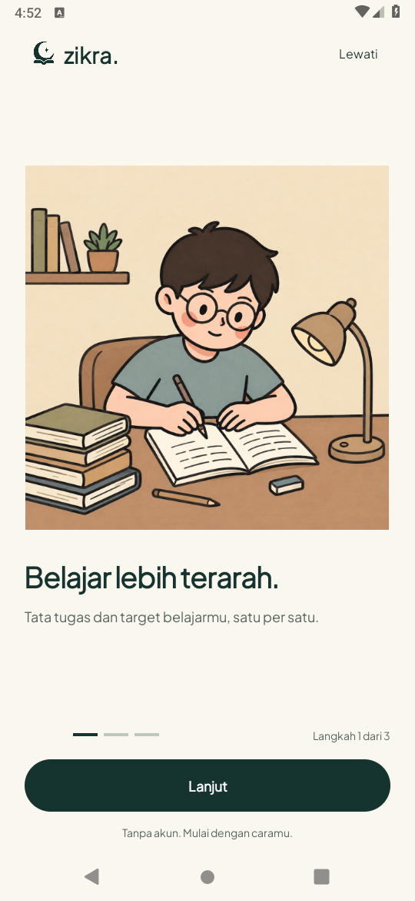
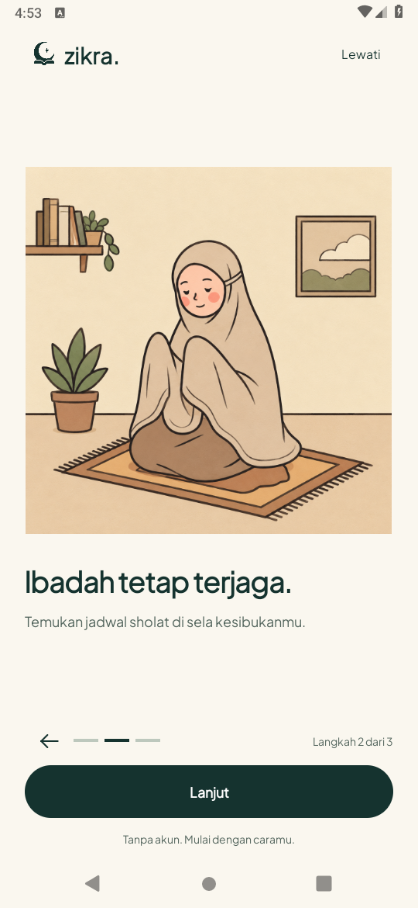
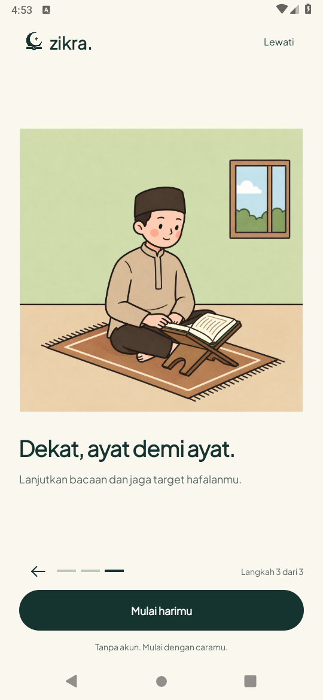

# Onboarding 2D statis — 18 Oktober 2026

Arahan terbaru mengganti karakter 3D bergerak dengan tiga ilustrasi diam dari pilihan referensi:

1. Pelajar berkacamata menulis di meja — **Belajar lebih terarah.**
2. Perempuan bermukena di sajadah — **Ibadah tetap terjaga.**
3. Laki-laki berpeci membaca dengan rehal — **Dekat, ayat demi ayat.**

Logo master Pine kiri atas dan tiga deskripsi singkat tetap ada. Header, latar ivory dan CTA Pine
konsisten. Ilustrasi lebih besar pada viewport tinggi; `fitCenter` menjaga isi gambar utuh. Tinggi
maksimal mengikuti viewport (160/280/360/400dp), bukan ukuran tetap untuk semua layar. Copy dapat
menggulung pada ukuran sempit/font besar; navigasi tetap di luar scroll.

Tidak ada animasi karakter, parallax, tilt, float, sensor atau transisi isi onboarding. Pemutar
`GardenSceneView`, atlas/poster 3D dan aset taman yang tidak lagi digunakan dihapus dari APK.
ImageView hanya memuat ilustrasi aktif, dengan sampling sesuai lebar display. Pada emulator
540px/density210, gambar 1254×1254 disampling 2 menjadi 627×627 (sekitar 1,5 MiB ARGB), tanpa atlas
14,1 MiB. Ini ukuran bitmap, bukan hasil pengukuran baterai atau seluruh heap aplikasi.

Navigasi kembali menyediakan ruang tetap agar indikator tidak berpindah; swipe di tombol lebar
Lanjut hanya berpindah satu langkah. State langkah saat recreation, Lewati, masuk Home dan
preferensi pendidikan/minat lama dipertahankan. Onboarding tidak menanyakan jenjang/minat.
Versi cerita menjadi 4 tanpa mereset status selesai pengguna lama. Buka ulang lewat **Profil →
Kenali Zikra** untuk melihat desain setelah memperbarui instalasi.

## Verifikasi terkait

- [Build/lint awal](build-lint.txt) lulus, 18 detik; [lima tes perangkat](device-tests.txt) lulus.
- Pemeriksaan mencakup tiga cerita/recreation/preservasi preferensi, skip/Home/branding/ikon,
  gambar diam dan berbeda per cerita, navigasi swipe satu langkah, serta layout kompak/font besar.
- Setelah meninjau screenshot, ukuran ilustrasi pada viewport tinggi diperbesar. [Build/lint akhir](final-build-lint.txt)
  lulus, tujuh detik; [dua regresi terkait](final-layout-tests.txt) lulus: alur tiga cerita/recreation
  dan layout kompak. Total lima metode unik, bukan tujuh metode berbeda.
- Layout kompak diukur melalui context konfigurasi **320×560dp dan font 1,3×**, dengan artwork
  terpasang: CTA minimal 48dp, indikator/CTA tidak bertumpuk, caption dapat dijangkau melalui
  scroll. Ini pengukuran layout native dalam instrumentation, bukan klaim layar fisik emulator
  diubah ke 320×560dp atau seluruh perangkat/font telah diuji.
- Screenshot di bawah berasal dari APK pada emulator AOSP API28, 540×1170px/density210; Java17,
  compile/target SDK35. Runtime API35 dan HP fisik belum diverifikasi. Fitur lain tidak diuji ulang
  menyeluruh pada perubahan onboarding ini. Tidak ada perubahan pada database, Study, Quran,
  Home atau prototype web.

## Preview

[PDF tiga halaman](preview.pdf) · [Galeri HTML mandiri](preview.html).
PNG APK asli tertanam, tanpa path cloud relatif atau localhost. Hash: [screenshot](screenshot-hashes.json).

| Belajar | Ibadah | Quran |
| --- | --- | --- |
|  |  |  |

## Aset dan branding

[Aturan ilustrasi/provenance](../../../design/illustrations/onboarding/README.md) ·
[Dimensi/hash dan konversi lossless](asset-verification.json) ·
[Master branding](../../../design/branding/README.md).
Tiga aset terpisah diperjelas melalui alat gambar dari panel pilihan pengguna; bukan crop identik
piksel kolase kecil. Konversi PNG hasil edit ke WebP lossless mempertahankan RGBA persis. Logo
master tidak digambar ulang atau dimasukkan ke ilustrasi.

[Android Studio](../../BUILDING.md) · [Status](../../../RECOVERY.md) ·
[Checkpoint 3D historis](../character-refresh/README.md).
