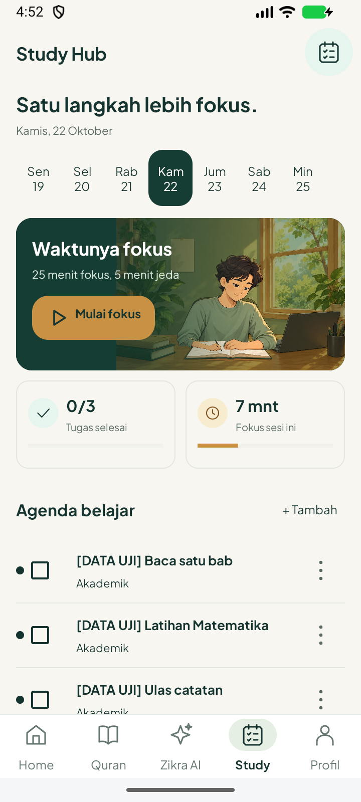
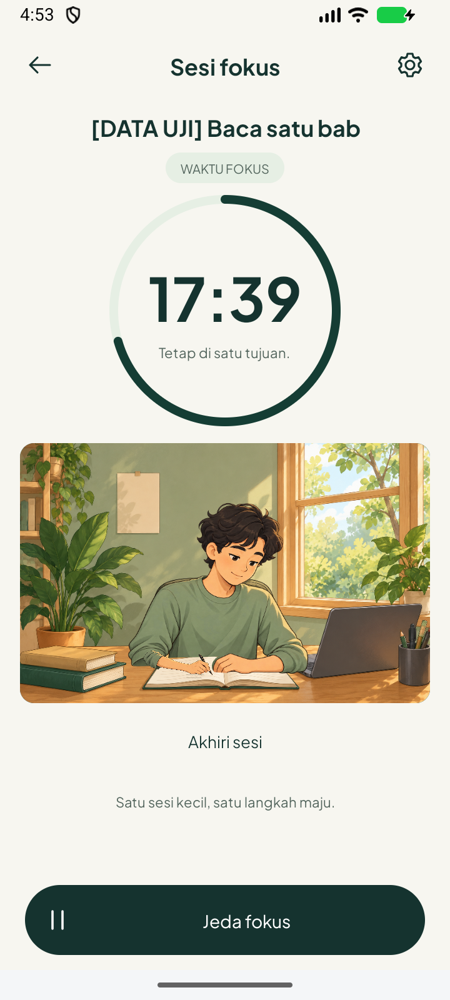
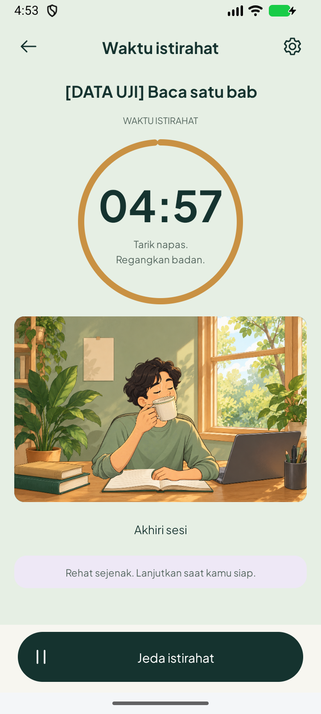

# Study Hub: aset berlapis dan gerak native — 22 Oktober 2026

Versi **1.4.0 / code 8**, berdasarkan `55bd2da`. Aset dibuat dahulu memakai built-in imagegen, lalu diterapkan pada agenda/fokus/istirahat Android Java/XML. [Aset asli dan prompt final](../../../design/study-layered-assets-2026-10-22.md).

## Hasil APK sebenarnya

| Agenda (data uji) | Fokus aktif | Minum saat istirahat |
|---|---|---|
|  |  |  |

[Video menulis aktif, 8 detik](writing-active-preview.mp4) · [Video istirahat aktif, 8 detik](break-active-preview.mp4) · [Ukuran teks 200%](FocusCompanionLargeText.png).

Screenshot/video berasal dari emulator Android, bukan gambar konsep. Nama tugas `[DATA UJI]`, hitungan tugas dan 7 menit adalah fixture tes; teardown menghapus tugas sementara dan mengembalikan pengaturan timer. Metrik aplikasi berlabel **Fokus sesi ini**, bukan total fokus harian.

## Perubahan

- Ruang, dua pose karakter, lengan/pena dan lengan/cangkir menjadi empat PNG asli. Decode sekali dengan inSampleSize2; bitmap dibagi antar scene tanpa menyimpan Activity.
- Ruangan tetap diam. Gerak siku/pergelangan membuat pena menggores buku. Istirahat menjalankan siklus 8 detik: tahan rendah, angkat ke bibir, minum, turunkan. Pause, latar belakang dan pengaturan gerak menghentikan pembaruan gambar.
- Agenda: hero ilustrasi, kalender aktif, dua metrik aktual, tambah tugas inline dan baris tugas ringkas. Menu tugas tetap dapat memulai fokus. Hifz/Ibadah memakai alur editor yang ada.
- Timer: ring dan ilustrasi terpisah, pengaturan durasi melalui gear, tombol jeda tetap di bawah; akhiri sesi mereset timer tanpa menyelesaikan tugas. Pada font 200%, keterangan pindah ke bawah ring agar tidak bertabrakan.

## Validasi

- [Build APK/test APK dan lint](build-lint.txt): lulus 29 detik, satu worker, heap 512 MiB. [Paket final setelah merapikan spasi XML](package-build.txt): lulus 8 detik; tidak ada perubahan perilaku sesudah tes.
- [7 tes instrumentasi](native-tests.txt): **7/7 lulus**, 33.963 detik: aset hero dan editor tugas; gerak pena dengan area jendela tetap; break hanya mulai setelah tindakan eksplisit; animasi bergerak lalu membeku ketika pause; teks 200%; dialog/latar belakang/recreation; akhir sesi tidak menandai tugas selesai.
- [Kegagalan awal teks besar](initial-large-text-failure.txt) dipertahankan sebagai riwayat. Keterangan kemudian dipindahkan; seluruh tujuh tes final lulus.
- Satu emulator 720×1600 / 360dp digunakan, lalu ditutup. Tidak menyentuh HP pengguna. Pemeriksaan crash buffer tidak menghasilkan entri; proses emulator/qemu sudah tidak ada.
- Hash APK, jumlah lint dan kesamaan sumber APK terhadap index ada di [result.json](result.json). Peringatan lint lama belum seluruhnya dituntaskan.

## Batas

Rig ilustrasi 2D, bukan animasi 3D/frame-by-frame atau salinan piksel persis konsep. Kerapian dan gerak diverifikasi di emulator; performa/baterai HP fisik belum diukur. Audio Quran, auto-scroll dan Featherless tidak diuji ulang dalam perubahan Study ini. Home/Quran tetap memuat versi 1.3.2; mini-player katalog Quran masih belum diterapkan. Eksperimen prefetch audio lokal tidak disertakan dalam APK ini. APK debug disalin ke folder luar proyek, bukan dilacak sebagai binary Git.
