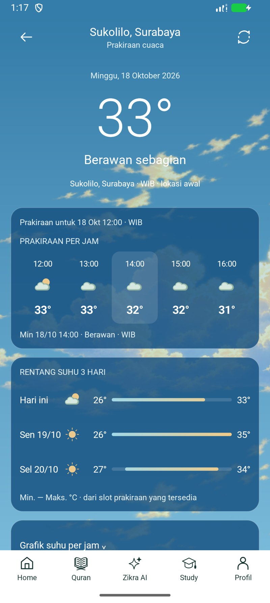
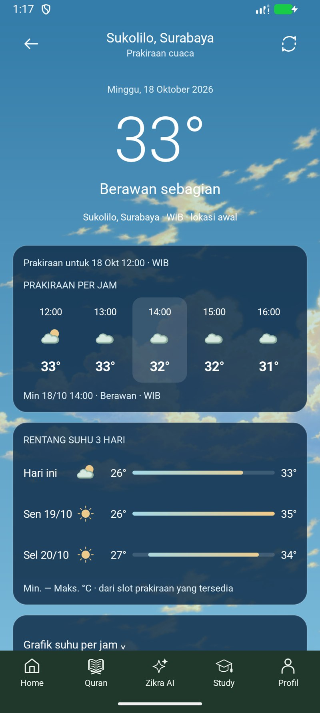
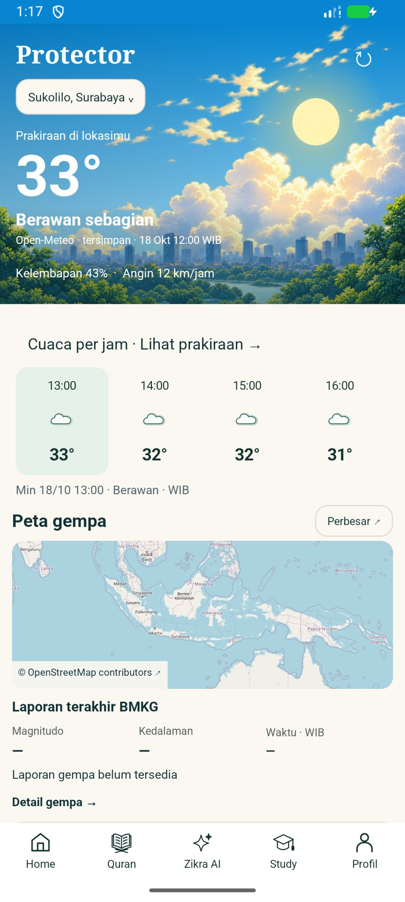

# UI11 — prakiraan cuaca native, beta 1.9.35

8 November 2026. Pengguna mengizinkan implementasi desain langit/kartu transparan
dan meminta navigasi konsisten: permukaan putih saat terang, hijau gelap saat
gelap. **Selesai teknis beta terarah; bukan seluruh E03 atau rilis publik.**
APK belum dipasang/diuji di HP pengguna.

## Perubahan

- Protector mempertahankan hero/artwork, peta dan tiga metrik laporan gempa.
  Ditambahkan empat prakiraan berikutnya, pilihan jam dan akses detail.
- Detail cuaca memakai langit penuh, suhu besar, slot prakiraan terpilih dan
  empat jam berikutnya, rentang suhu hingga tiga hari, grafik lipat, kelembapan,
  arah/kecepatan angin serta sumber/waktu pengambilan. Konten dapat digulir;
  slot dapat digeser horizontal bila teks membesar.
- Satu bentuk dock dari ikon Zikra yang ada dipakai pada kedua halaman; permukaan
  dan teks mengikuti AppAppearance. Langit memakai jam lokasi, terpisah dari tema
  aplikasi. Jam malam dekoratif 18.00–05.59, bukan perhitungan matahari terbit.
- Vektor cuaca berasal dari paket desain proyek. Varian kontras tetap pada langit;
  slot Protector mengikuti tema. Logo, ikon fitur dan bitmap master tidak diganti.
- `WeatherOutlook` memisahkan pemilihan/agregasi data dari renderer native dan
  Activity. Gambar awan disampling, tanpa loop animasi atau polling baru.

## Data dan privasi

Sumber tetap **Open-Meteo**, melalui client yang sudah ada: tiga hari per jam,
lokasi/zona waktu pilihan, HTTPS/validasi unit dan respons berbatas. Tidak ada
angka contoh yang dibundel ke alur produksi. Jam utama adalah **slot prakiraan**,
bukan pengukuran langsung atau otomatis dianggap waktu sekarang.

Rentang harian dihitung dari suhu pada slot valid yang tersedia, dikelompokkan
menurut tanggal lokasi; maksimal tiga hari dimulai dari tanggal slot utama.
Hari tidak lengkap diberi label sebagian hari. Ikon harian mewakili slot paling
dekat tengah hari, bukan prediksi kondisi terburuk atau jaminan sepanjang hari.
Tidak menambahkan persentase peluang hujan/UV yang belum tersedia. Waktu/angka
pada screenshot berasal dari fixture publik 18 Oktober, **bukan cuaca terkini**.

Cache tetap batas enam jam dengan label waktu pengambilan sebenarnya. Data
kedaluwarsa/lokasi berganti dibersihkan, keadaan gagal tidak mengisi prakiraan
palsu, dan Coba lagi memakai jalur client yang sama. Tidak ada izin Android,
layanan latar, notifikasi cuaca, login, backend atau biaya baru. Koordinat tetap
hanya digunakan oleh jalur prakiraan yang sudah tersedia; tidak ada akses GPS
baru atau unggahan chat/berkas pengguna pada pengujian ini.

## Bukti dan batas

| Pemeriksaan | Hasil |
| --- | --- |
| Unit seluruh modul | 173 lulus, 4 skip lama, 0 gagal; termasuk 4 tes agregasi/jam lokal baru |
| Native akhir | 4 metode unik / 6 eksekusi lulus: default 4, ulang dua tema font 200% di sekitar 320 dp |
| Lint | 0 error, 883 warning proyek yang tidak semuanya ditangani checkpoint ini |
| Tampilan/interaksi | Lima slot detail, empat overview, tiga hari, pilihan jam, grafik buka/tutup, warna dock, CTA detail dan keadaan tanpa data |
| APK | 1.9.35/code62, 45.924.363 byte, di bawah 100 MB; signer debug sama; 0 nilai credential dikenal ditemukan |
| Preservasi | 32 berkas asli emulator pulih cocok hash, pengaturan/viewport pulih, helper dan screenshot sendiri dibersihkan, emulator ditutup; HP tidak diakses |

[Hitungan](checks.json), [hasil native](native-final.txt),
[font besar](native-font200-final.txt), [APK/hash](apk.json),
[preservasi](preservation.json), [WIP/aset/rahasia](protected-state.json).
Log build/percobaan awal dan cadangan data tetap privat pada folder lokal.

Inspeksi awal menemukan warna pilihan jam overview terlalu gelap serta alpha
track ikut meredupkan gradient rentang suhu. Keduanya diperbaiki lalu enam uji
diulang pada APK akhir. Enam eksekusi awal bukan bukti APK akhir. Sambungan ADB
emulator awal sempat belum terotorisasi; kunci lokal emulator proyek dipakai
kembali setelah memastikan tidak ada perangkat lain. Tidak meminta izin HP.

Tes native menggunakan fixture dan jaringan dimatikan, sehingga tidak membuktikan
ketersediaan API pada jaringan/operator pengguna atau prakiraan aktual 8 November.
Client/provider/schema tidak diganti; tidak ada probe API/deploy baru. Screenshot
font besar menunjukkan reflow dan posisi gulir contoh, bukan sertifikasi setiap
ukuran/font/perangkat atau seluruh alur aksesibilitas. UI11 ditutup sebatas
implementasi dan pengujian beta di atas; E03 alert/doa kontekstual tetap terbuka.
Gerbang B01/C02/C07/D02/D02a/E02–E04/F/G/publik tidak otomatis selesai.

