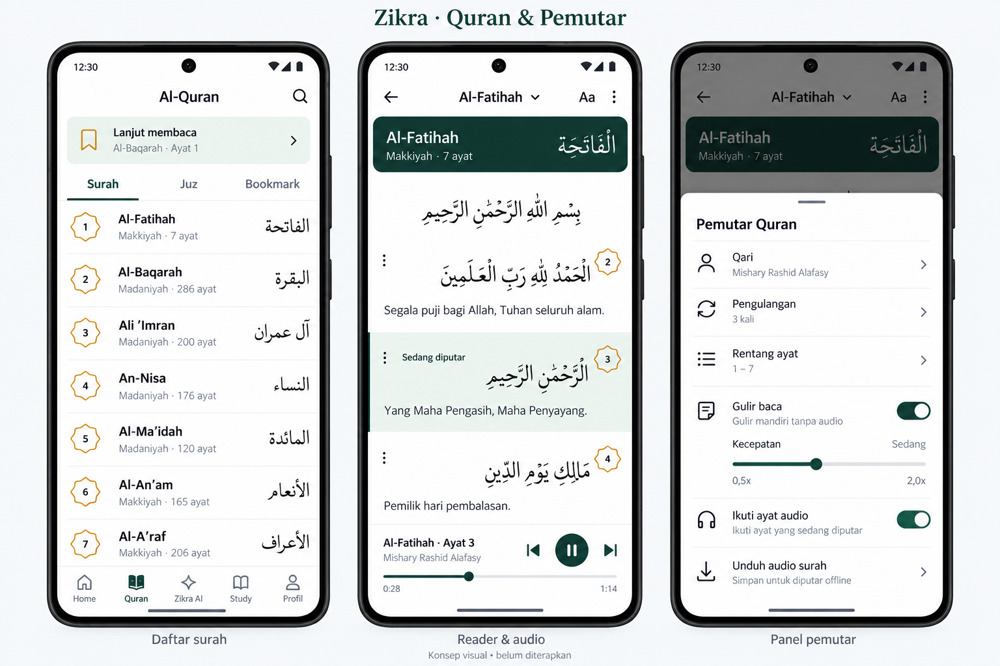
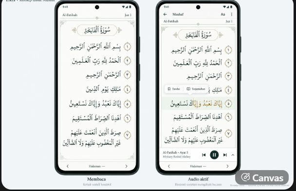

# Arah desain Quran, audio dan Mushaf — 20 Oktober 2026 (WIB)

Status 21 Oktober: **katalog, reader ayat-terjemahan dan panel audio sudah diterapkan**;
Mushaf halaman dan sorotan kata masih rencana dengan prasyarat data.
[Bukti native dan batas](../android/validation/quran-reader-panel-2026-10-21/README.md).
Parser, source teks dan pemutar Quran lama dipertahankan. Gambar adalah konsep hasil generasi visual, bukan
screenshot aplikasi atau sumber teks Al-Quran. Jangan mengambil teks Arab, nomor,
waktu audio atau layout halaman produksi dari gambar konsep.

## Konsep katalog, reader dan panel audio

Pengguna menyukai komposisi katalog/reader revisi dan meminta panel pemutar dari
konsep sebelumnya ikut dipakai. Acuan gabungan tersimpan di repository:

- Daftar surah ringkas, nama Latin/Arab dan metadata jelas, medali nomor emas tipis,
  baris Lanjut membaca dan pencarian mudah dijangkau.
- Reader Ayat & Terjemahan: header surah Pine ringkas, tulisan Arab dominan,
  terjemahan lebih kecil dan ruang proporsional, indikator ayat aktif sage.
- Pemutar kecil di bawah reader dengan sebelumnya/putar-jeda/berikutnya dan seek.
  Kontrol tidak menutup teks atau memaksa pengguna membuka panel untuk jeda.
- Panel Pemutar Quran muncul dari bawah: qari, pengulangan, rentang ayat,
  gulir mandiri dengan kecepatan, Ikuti ayat audio, unduh per surah.
  Gulir mandiri tanpa audio berbeda dari mengikuti posisi ayat pada rekaman.
- Warna Pine #15332F, netral #F4F6F8/putih, sage dan emas. Ikon vektor konsisten.
  Transisi ringan mengikuti pengaturan animasi/penghemat daya perangkat.
- Tab Juz pada konsep adalah **usulan navigasi**, bukan fitur source yang sudah ada
  atau persetujuan implementasi fitur tersebut. Bookmark/resume dan data pengguna
  yang telah tersedia harus dipertahankan.

## Permintaan sorotan mengikuti kata

Pengguna menjelaskan efek seperti karaoke: warna emas perlahan mengisi teks Arab
mengikuti bunyi bacaan dari kanan ke kiri. Bukan seluruh ayat berubah warna sekaligus.

Ini membutuhkan timing kata yang cocok dengan qari dan versi rekaman persis yang
sedang diputar. Pemutar sekarang memakai berkas audio per ayat; belum ada data
sinkronisasi kata terverifikasi. Jangan mensimulasikan sinkronisasi dengan membagi
lama ayat secara rata, menghitung panjang karakter atau menganggap kecepatan slider
sebagai timestamp. Verifikasi sumber, izin pemakaian dan kecocokan rekaman terlebih
dahulu; saat timing tidak tersedia, status dukungan harus jelas dan source audio
per ayat tetap berfungsi. Seek, pause/resume dan buffering harus mengikuti posisi
player aktual. Warna emas harus terbaca di mode terang/malam dan tersedia opsi
menonaktifkan sorotan/gulir otomatis.

## Koreksi acuan Mushaf oleh pengguna

### Acuan visual tambahan — 21 Oktober 2026

Pengguna mengonfirmasi gambar berikut sebagai arah tampilan: "seperti itu kurang
lebih". Ini acuan komposisi UI, bukan sumber teks Quran atau layout edisi cetak.

- Halaman bernuansa kertas terang, bingkai/ornamen tipis, Arab dominan dan nomor
  ayat inline. Info surah/juz kecil, judul surah berornamen ringkas.
- Mode membaca tenang; ketuk untuk menampilkan kontrol. Navigasi halaman di bawah.
- Saat audio aktif, pemutar kecil berada di bawah halaman; sorotan kata emas
  mengikuti recording/timing terverifikasi. Menu tindakan ayat bersifat kontekstual.
- Jangan menyalin susunan per-ayat, teks Arab, nomor, atau posisi kata dari gambar
  konsep. Baris/halaman tetap mengikuti satu edisi terverifikasi, menyambung dan
  dapat memuat beberapa ayat per baris sesuai edisi. Gambar tidak menetapkan edisi.

Pengguna memberi foto halaman Al-Mulk sebagai koreksi terhadap mockup Mushaf yang
terlalu memisahkan setiap ayat. **Mockup Mushaf generasi sebelumnya tidak menjadi
acuan layout.** Foto koreksi belum tersimpan sebagai file di repository ini.

Mushaf harus memakai teks menyambung dalam baris halaman dengan nomor ayat inline,
batas baris dan halaman mengikuti satu edisi terverifikasi. Urutan ayat sesuai
Al-Quran. Mode ini terpisah dari Ayat & Terjemahan; menyembunyikan terjemahan saja
belum menghasilkan Mushaf.

- Pilih/verifikasi edisi dan sumber layout/font/data yang boleh dipakai. Madinah
  604 halaman adalah contoh usulan yang dibahas, **belum keputusan sumber final**.
- Navigasi halaman mengikuti arah mushaf, dengan lompat surah/juz/halaman dan
  penyimpanan halaman terakhir. Pemindahan mode tetap pada ayat yang sama.
- Tampilkan halaman Arab dominan; informasi surah/juz/halaman dan ornamen ringkas.
  Kontrol baca bisa disembunyikan, player ringkas, tekan lama ayat membuka tindakan.
- Sorotan kata pada Mushaf membutuhkan posisi kata/baris pada halaman, selain
  timing rekaman. Sorotan harus mengikuti pergantian baris dan halaman secara tepat.
  Gunakan layout/koordinat asli sumber yang dipilih; jangan menggeser kata untuk
  menyesuaikan mockup generatif atau melukis overlay pada perkiraan posisi teks.

## Tambahan yang baru diusulkan, belum disetujui sebagai pekerjaan

Timer berhenti audio (15/30/60 menit/akhir surah), jeda antar pengulangan untuk
menirukan bacaan, serta peningkatan keterlihatan status/ukuran/progres unduhan telah
diusulkan di chat. Tentukan lingkupnya bersama pengguna sebelum menambah fitur.
Ukuran tulisan, mode malam dan preferensi reader yang sudah ada dipertahankan.

## Langkah pelaksanaan berikutnya

Audit provider/timing dan sumber Mushaf dahulu; cek batas jaringan/autentikasi aktual,
jangan menganggap akses CDN atau API sudah pulih. Kerjakan desain reader/panel dengan
source Android Java/XML, lalu preview APK aktual dan pemeriksaan terkait. Bedakan
fungsi yang benar-benar bekerja dari konsep, fixture audio sintetis atau API yang
belum dapat diuji. Pertahankan tugas, bookmark, unduhan dan data pengguna.
