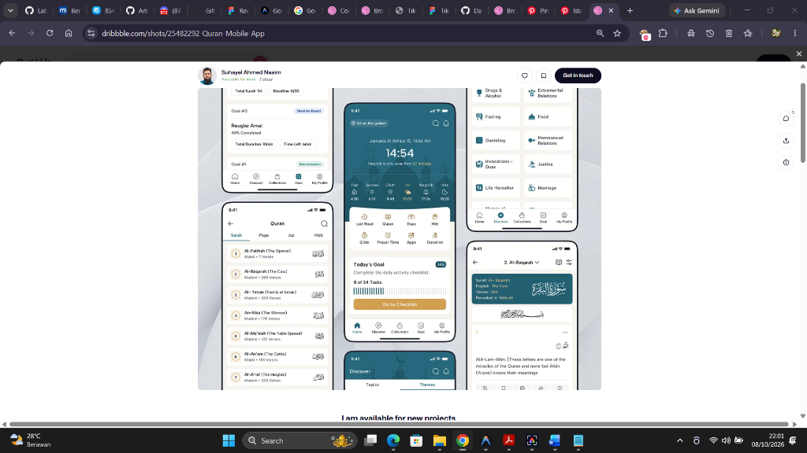
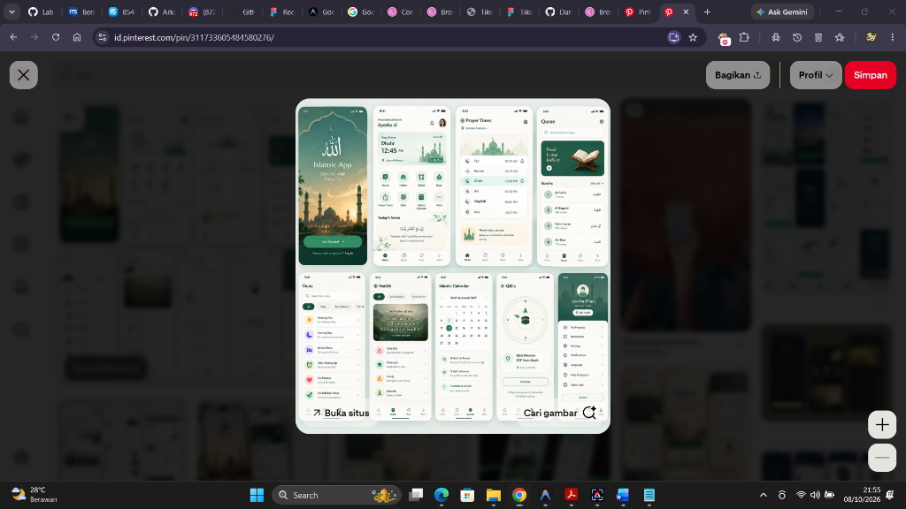
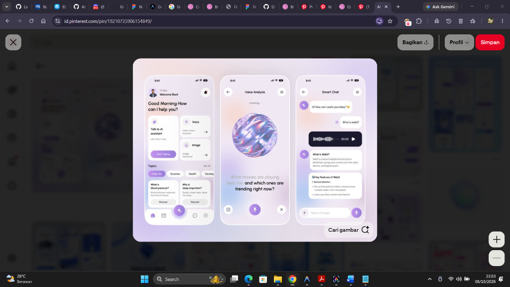
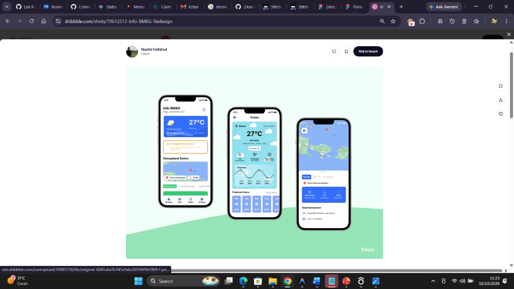

> **Arah terbaru (19 Oktober 2026):** onboarding menggunakan tiga ilustrasi 2D **statis**, dipilih dari kolase terbaru pengguna: pelajar berkacamata di meja, perempuan bermukena di sajadah, serta laki-laki berpeci membaca dengan rehal. Logo master tetap kiri atas; pengantar kecil, judul kuat dan paragraf manfaat menggantikan caption yang terlalu singkat. Warna ivory/Pine; tanpa animasi karakter atau parallax onboarding. [Aturan/aset ilustrasi](illustrations/onboarding/README.md) · [Rencana pengembangan bertahap](IMPROVEMENT_PLAN.md). Referensi 3D sebelumnya bukan arah aktif.

# Referensi desain dari pengguna

Folder ini sekarang hanya memuat **gambar acuan yang cocok dengan gambar yang diberikan pengguna dalam percakapan**. Mockup Zikra lama, alternatif logo lama, prompt desain lama, duplikat dan acuan tambahan yang tidak terkonfirmasi sudah dikeluarkan dari versi aktif repositori. Jangan mengembalikannya dari riwayat Git atau menjadikannya target desain.

**Prioritas: komposisi dan keterbacaan onboarding.** Lokasi bersama dan pencarian masjid menyusul, lalu murottal/hafalan dan integrasi asisten. Baca [rencana terbaru](IMPROVEMENT_PLAN.md) serta [aturan proyek](../README.md#mulai-di-sini-untuk-sesi-chat-baru).

## Referensi onboarding lama — bukan arahan aktif

Gambar karya **Blend wrk** berikut merupakan referensi awal pengguna untuk orbit, kartu pilihan dan chip minat. Arahan ini kemudian diganti dengan ilustrasi 2D statis. Gunakan gambar aktual tiga cerita dan [aturan ilustrasi](illustrations/onboarding/README.md) sebagai acuan aktif; jangan mengembalikan form jenjang/minat atau parallax onboarding.

Implementasi tetap Java/XML native. Pertahankan Lewati, kembali, progres tiga langkah dan pembukaan ulang melalui Profil. Preferensi jenjang/minat lama tetap disimpan tanpa menanyakan ulang.

## Home dan Quran — Suhayel Ahmed Nasim

Hero teal, jam besar, strip waktu, kartu target, katalog surah serta reader Arab/terjemahan. Screenshot acuan ini sesuai gambar yang dibagikan pengguna.

Detail Home dari acuan yang sama:

**Mode Mushaf merupakan kebutuhan fungsi tambahan**, dengan susunan halaman yang benar; bukan bergantung pada mockup reader elite lama yang sudah dihapus. Lihat [persyaratan mode Mushaf](../README.md#persyaratan-mode-mushaf).

## Doa, Hadis, Kalender dan Profil — Isha Manzoor

## Zikra AI — voice, orb holografik dan chat

## Protector BMKG

Acuan tiga layar biru/cyan yang diperlihatkan pengguna: dashboard cuaca, detail cuaca dan peta/detail gempa. Screenshot sumber menampilkan karya Naufal Fathkhul pada Dribbble; gunakan tampilan gambar yang diberikan pengguna sebagai acuan utama, bukan mockup Protector lama.

## Kiblat — Rayhan Raju

## Referensi berbentuk nama/link tanpa file baru

- Study/Habit Tracker — Thao Lee; timeline [Structured](https://structured.app). Pengguna menyebutkannya sebagai inspirasi; screenshot lama dari repo sudah dihapus dan tidak boleh diasumsikan sebagai gambar pilihan terbaru.
- [Pillars](https://pillars.app) untuk pengalaman ibadah dan [Tarteel](https://tarteel.ai) untuk arah interaksi Quran. Ini benchmark yang disebut pengguna, bukan permintaan menyalin seluruh fiturnya.
- [Pinterest pin 1110911433096315275](https://id.pinterest.com/pin/1110911433096315275/) adalah referensi video tambahan. File MP4/GIF/rekaman layar dari pin tersebut **belum tersedia di repo ini dan belum dilihat pada sesi ini**. Jangan menebak isi atau gerakannya. Tambahkan file beserta sumbernya ketika pengguna menyediakannya.

## Logo utama dipertahankan

Desain logo utama dipulihkan dan disimpan terpisah di [branding/](branding/README.md). Logo ini adalah identitas Zikra; mockup halaman dan alternatif logo lama tetap dihapus.

## Hasil aplikasi bukan referensi target

Screenshot dan rekaman implementasi tetap ada di [`android/validation/screens/`](../android/validation/screens/) sebagai bukti hasil pekerjaan. Itu tidak berarti seluruh desainnya sudah disetujui. Khusus onboarding, pengguna sudah meminta redesign; gambar implementasi lama tidak boleh dijadikan standar visual baru.

Gambar referensi tetap dikreditkan kepada pembuatnya. Pemindahan file ke `references/` tidak mengubah piksel gambar.
