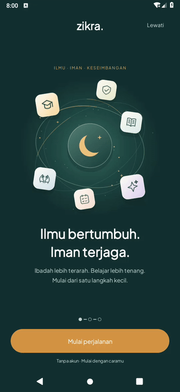
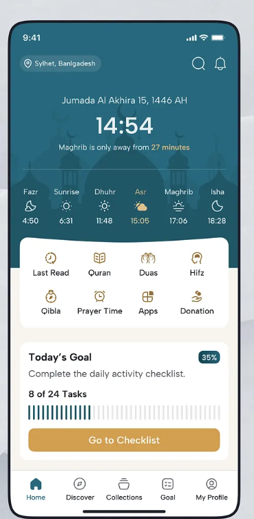
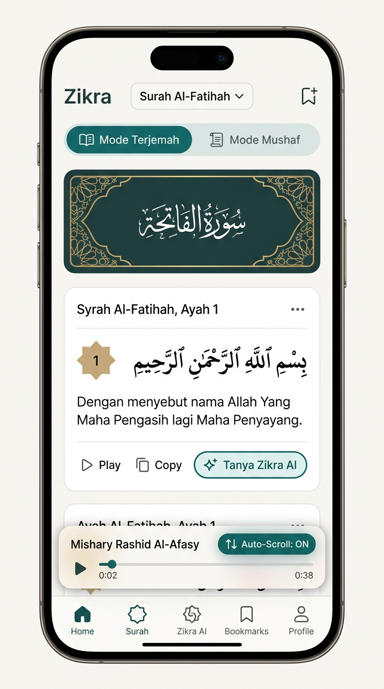
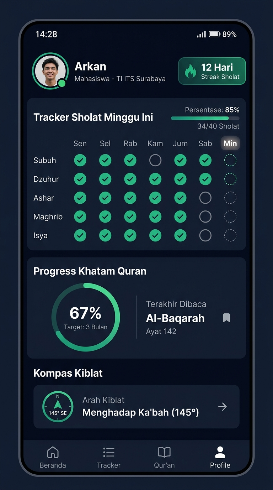
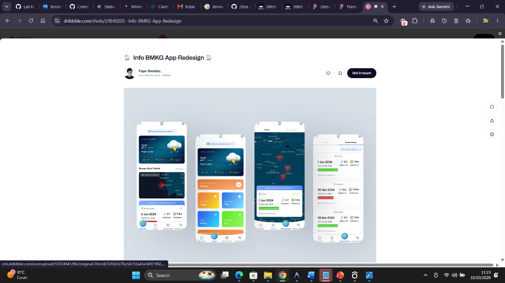
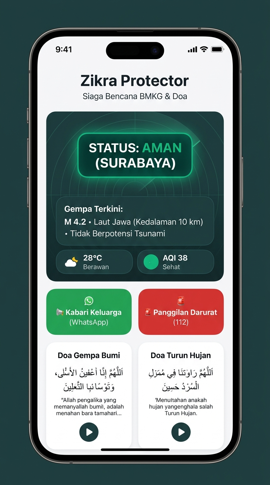
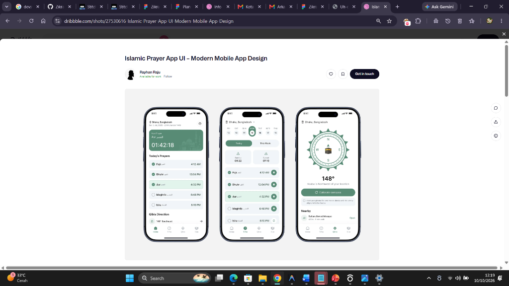

# Galeri referensi desain Zikra

Gambar referensi **sudah disimpan sebagai file gambar di repositori ini**, sehingga sesi baru tidak harus membuka Pinterest atau Figma untuk acuan yang ada di bawah. Klik gambar untuk ukuran asli. Referensi pihak ketiga tetap mengikuti kredit pembuatnya; gambar adalah acuan desain, bukan screenshot hasil aplikasi.

**Prioritas terbaru pengguna: redesign onboarding dahulu.** Versi orbit/parallax yang sudah dibuat masih dianggap kurang bagus; Quran dilanjutkan setelah tahap ini. Baca juga [roadmap dan aturan proyek](../README.md#mulai-di-sini-untuk-sesi-chat-baru).

## Wajib dilihat sebelum mengubah onboarding

Buka file gambarnya dengan alat penampil gambar, bukan hanya membaca nama file atau teks README. Bandingkan komposisi, ukuran ilustrasi, hierarki teks, kartu pilihan dan chip. Tetap implementasikan dengan Java/XML dan komponen native.

### Referensi utama — Blend wrk

Struktur tiga layar: ilustrasi orbit → pilihan pengguna → minat. Untuk Zikra, pilihan pengguna menjadi **SMP, SMA/SMK, Mahasiswa**. Gunakan ini sebagai dasar komposisi; pengguna meminta hasil yang lebih modern dengan kedalaman parallax, ilustrasi kuat dan ruang kosong yang seimbang.

### Tampilan referensi dalam moodboard awal

### Mockup identitas Zikra

Ini mockup arah visual, bukan bukti bahwa semua fungsi pada gambar sudah tersedia.

### Implementasi sekarang — perlu redesign

GIF berikut adalah hasil aplikasi native saat ini, **bukan target akhir yang sudah disetujui pengguna**. Parallax dan alur sudah ada; pengguna masih meminta peningkatan kualitas desain. Jangan menganggap tugas selesai hanya dengan mempertahankan tampilan ini.

Screenshot langkah saat ini: [Welcome](../android/validation/screens/OnboardingWelcome.png), [Jenjang](../android/validation/screens/OnboardingEducation.png), [Minat](../android/validation/screens/OnboardingInterests.png). Screenshot Jenjang/Minat berasal dari tahap sebelum pembaruan parallax; bukan satu rekaman baru untuk semua layar.

## Referensi halaman lain

Home dan katalog Quran — Suhayel Ahmed Nasim

Hero teal, jam besar, strip sholat, kartu target dan katalog surah.

Reader Quran dan pilihan Mushaf / Terjemahan

Header Arab, ayat/terjemahan, bookmark dan kontrol audio. Mode Mushaf harus menggunakan susunan halaman yang benar; lihat [persyaratannya](../README.md#persyaratan-mode-mushaf).

Doa, Hadis, Kalender dan Profil — referensi Isha Manzoor

Study Hub, habit tracker dan fokus — referensi Thao Lee

Kalender pekanan, streak, timer melingkar, kartu pastel dan checklist.

Zikra AI — orb, voice dan chat

Protector BMKG — referensi Naufal / Fajar

Kiblat — Rayhan Raju

## Referensi Pinterest terbaru yang belum tersimpan

[Pin 1110911433096315275](https://id.pinterest.com/pin/1110911433096315275/) adalah referensi video tambahan. File video maupun gambar dari pin ini **belum tersedia di repositori ini dan isinya belum diverifikasi pada sesi ini**. Gambar di atas bukan hasil unduhan pin tersebut. Jangan menebak gerakan atau mengaku sudah menontonnya. Jika pengguna menyediakan MP4/GIF/rekaman layar, tambahkan file dan atribusinya ke galeri ini.
