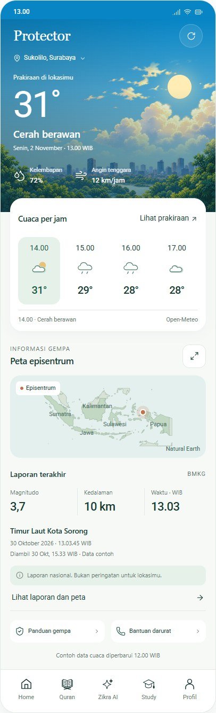
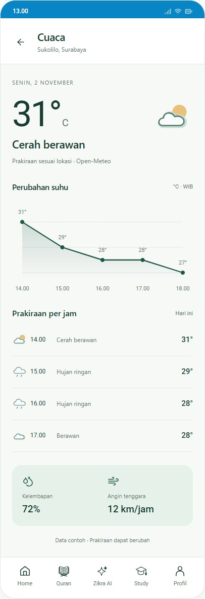

# Protector — susunan final dan aset prakiraan cuaca

2 November 2026. **Desain dan aset siap ditinjau; belum diterapkan ke APK.**
Arahan pengguna: pertahankan Protector sekarang yang sudah disukai, tambahkan
prakiraan cuaca dengan rapi. Tidak merombak logo, ikon fitur atau artwork kota.

## Susunan yang dipilih

1. **Hero lama dipertahankan.** Judul Protector, lokasi, ilustrasi langit/kota,
   suhu, kondisi, waktu prakiraan, kelembapan dan angin. Siang/malam/hujan adalah
   suasana cuaca; pilihan tema aplikasi tidak menentukan siang atau malam.
2. **Satu panel baru “Cuaca per jam”.** Empat jam berikutnya dalam satu baris:
   jam, simbol dan suhu. Satu pilihan diberi latar mint. Tidak ada empat kartu
   besar dengan border berbeda. “Lihat prakiraan” adalah tombol teks yang jelas
   dan memiliki area sentuh minimal 44 px pada referensi.
3. **Peta dan laporan dipertahankan.** Peta episentrum, tiga kolom magnitudo /
   kedalaman / waktu, wilayah, tanggal kejadian dan waktu pengambilan. Data cuaca
   tidak mengubah kejadian gempa yang dipilih. Warna titik menandai posisi,
   bukan jangkauan dampak atau tingkat bahaya.
4. **Detail cuaca.** Suhu/kondisi utama, grafik suhu yang terukur, daftar jam
   berikutnya, kelembapan/angin dan sumber. Tidak menambahkan angka peluang
   hujan, UV, kualitas udara atau prakiraan tujuh hari yang belum dipetakan dari
   data yang tersedia.
5. **Navigasi memakai bentuk ikon Zikra asli.** Berkas SVG navigasi diekspor
   dari resource yang benar-benar dipakai Protector, termasuk alias ikon fitur.
   Tidak mengganti bentuk Quran, AI, Study, Home atau Profil.

## Lihat hasil

- [Preview lengkap](preview.html): tombol prakiraan, pilihan jam, kembali dan
  detail peta bekerja sebagai demonstrasi lokal.
- [Papan desain](design-board.png): susunan siang, detail dan malam.
- [Galeri aset](screens/weather-assets.jpg): sepuluh kondisi, terang dan gelap.
- [Pemeriksaan](checks.json), [inventaris ukuran/hash/aset](asset-manifest.json).





## Aset yang disiapkan

| Isi | Lokasi | Keterangan |
| --- | --- | --- |
| 20 SVG cuaca | `assets/icons/light`, `assets/icons/dark` | 10 kondisi × 2 tema |
| 20 VectorDrawable | `assets/android/res/drawable`, `drawable-night` | Nama resource sama pada dua qualifier; belum disalin ke aplikasi |
| 10 SVG navigasi | `assets/navigation/light`, `dark` | Bentuk dari lima ikon asli; warna mengikuti tema |
| Kota, awan dan awan hujan | `assets/backgrounds` | WebP untuk authoring dari artwork yang sudah ada; master asli tidak diubah |
| Font preview | `assets/fonts` | Subset Latin Roboto dari font Protector yang ada; bukan font Quran |
| Lisensi/asal | `assets/licenses` | OFL, artwork proyek, batas wilayah Natural Earth |

Kondisi ikon: cerah siang/malam, cerah berawan siang/malam, berawan, hujan
ringan, hujan, petir, kabut dan belum tersedia. Siluet awan memperluas keluarga
`weather_symbol_fair/rain` yang sudah ada. Isi mint/putih, garis hijau dan aksen
matahari hangat menjaga identitas Zikra; garis bulan diperjelas setelah inspeksi.
Ukuran kerja 64×64, disarankan tampil 28–34 dp untuk slot dan sekitar 64 dp untuk
detail, dengan teks kondisi sebagai pendamping.

## Aturan integrasi native berikutnya

- Ini bukan izin untuk menandai E03 atau UI11 implementasi selesai. Jangan
  menyalin berkas HTML ke alur APK. Implementasi tetap Android Java/XML yang ada.
- Tambahkan komponen prakiraan di bawah hero tanpa mengganti mekanisme data
  E01, ikon fitur, bitmap master atau navigasi yang sudah disetujui. Nama resource
  baru memakai awalan `protector_weather_`.
- Pilih empat slot valid berikutnya dari sumber/lokasi/zona waktu yang sama;
  urutkan menurut timestamp. Label per jam tetap tepat saat melintasi tengah malam.
- Tema terang/gelap mengatur permukaan/teks/ikon. Ilustrasi mengikuti kondisi dan
  waktu lokasi. Jangan membuat malam semata-mata karena tema gelap.
- Tampilkan sumber Open-Meteo dan waktu pengambilan yang sebenarnya. Cache
  memakai batas umur client yang ada; jangan mengubah tanggal cache menjadi baru.
- Tanpa data valid, tampilkan keadaan belum tersedia, bukan angka prakiraan
  contoh. Tombol Coba lagi pada preview hanya mengganti contoh lokal.
- Semua CTA minimum 44 dp; gunakan 48 dp bila ruang native memungkinkan.
  Teks mengikuti fontScale, bukan dikunci menjadi screenshot. Header dan panel
  harus dapat bertambah tinggi; grafik menggambar ulang menurut lebar aktual.
- Batas wilayah preview berasal dari GeoJSON Natural Earth yang dibundel proyek,
  diproyeksikan dengan d3-geo. Bukan tile jalan, foto lokasi atau peta live.
  Integrasi native tetap memakai jalur peta/fallback/atribusi yang sudah diuji E01.
- Cuaca adalah prakiraan. Preview tidak menambahkan notifikasi otomatis,
  peringatan sebelum gempa atau penilaian keselamatan baru.

## Pembuatan ulang

Pasang dependensi authoring pada lingkungan terpisah dari aplikasi:

```text
python -m pip install -r requirements-design.txt
python build_assets.py
python assemble_preview.py
```

`layout.fragment.html`, `preview.css` dan `preview.js` adalah sumber yang dapat
diedit. `preview.fragment.html` merupakan hasil rakitan. `preview.html` dibungkus
dengan renderer visualize untuk tinjauan standalone, bukan deployment aplikasi.
Opsi tema/suasana/status pada percakapan adalah kontrol tinjauan desain.
Dependensi authoring dan hasil compile pemeriksaan tidak dibundel ke APK.

## Status dan batas bukti

Pemeriksaan browser mencakup CTA/kembali/peta, ikon dan font, pilihan jam,
tema/suasana, label cache, keadaan tanpa data serta lebar 320. Semua 20 XML
vektor melewati compile resource Android. Ada pemeriksaan visual pada screenshot
final. Ini tidak menggantikan build/native layout/HP atau uji layanan cuaca E03.
Data pada referensi adalah contoh; gempa historis Sorong 30 Oktober ditampilkan
dengan tanggalnya, bukan diklaim sebagai feed terkini 2 November.

APK tetap 1.9.34; tidak ada build/install/deploy/key/model/paket/email baru.
HP tidak diakses. PROJECT_HANDOFF WIP, stash audio, env, logo dan artwork asli
dipertahankan. E02–E04, UI11 native, sisa B01/C02/C07/D02/D02a/F/G serta publik
tetap mengikuti gerbangnya. Persetujuan desain akhir belum diasumsikan.
