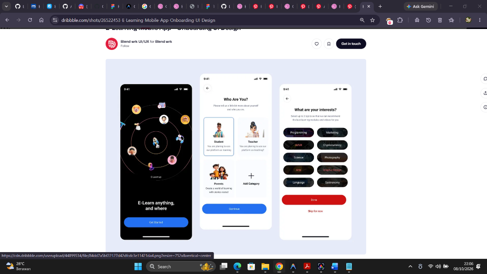
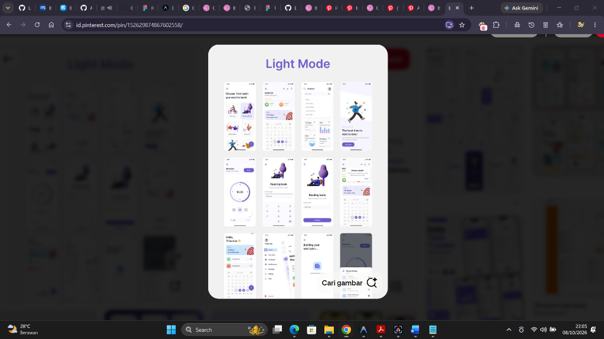

# 🎨 Panduan Lengkap Desain Zikra App untuk Figma AI
> **Versi Diperbarui:** 100% Berdasarkan **5 Foto Referensi Desain Asli** (Dribbble & Pinterest) yang telah kamu berikan.

---

## 🖼️ 1. Galeri 5 Foto Referensi Desain Asli (Moodboard Utama)

Berikut adalah 5 foto referensi desain resmi yang menjadi acuan langsung arsitektur UI, layout, dan komponen Zikra App:

| No | Foto Referensi Asli | Sumber Asli | Bagian & Fitur Zikra yang Mengadopsi |
|:---:|:---|:---|:---|
| **1** | <br>*Foto 1: Onboarding 3 Layar* | **Dribbble:** [Blend wrk E-Learning Onboarding](https://dribbble.com/shots/26522453-E-Learning-Mobile-App-Onboarding-UI-Design) | **Screen 1 (Onboarding Flow 3 Layar):**<br>• Layar 1: Hero Splash kosmik/orbit dengan ilustrasi berputar.<br>• Layar 2: *"Who Are You?"* — Pemilihan peran pelajar (SMP/SMA/Kuliah/Umum).<br>• Layar 3: *"What are your interests?"* — Multi-select chip tags (Target ibadah & belajar). |
| **2** | <br>*Foto 2: Quran & Prayer Hub* | **Dribbble:** [Suhayel Ahmed Nasim Quran App](https://dribbble.com/shots/25482292-Quran-Mobile-App) | **Screen 2 (Home Screen) & Screen 3 (Quran):**<br>• Hero card waktu sholat jam besar (`14:54`), hitung mundur Maghrib, dan horizontal strip 5 waktu sholat.<br>• Kartu *"Today's Goal"* (Checklist harian 8 dari 24 tugas, progress bar 38%).<br>• Grid 2x4 Quick Action.<br>• Tab navigasi Al-Quran: *Surah \| Page \| Juz \| Hizb*.<br>• Header Surah elegan bernuansa deep teal dengan kaligrafi Arab. |
| **3** | <br>*Foto 3: Islamic App UI* | **Pinterest:** [Islamic App by Isha Manzoor](https://id.pinterest.com/pin/311733605484580276/) | **Komponen Ibadah & Navigasi:**<br>• Layar Jadwal Sholat vertikal lengkap dengan icon bell notifikasi.<br>• Kartu *"Today's Verse"* berbingkai daun lembut.<br>• Katalog Doa Harian & Hadits (Bukhari/Muslim).<br>• Kompas Arah Kiblat minimalis & Kalender Hijriah.<br>• Profil pengguna dengan statistik progress ibadah. |
| **4** | <br>*Foto 4: Habit & Task Tracker* | **Pinterest:** [Habit Tracker Light Mode by Thao Lee](https://id.pinterest.com/pin/152629874867602558/) | **Screen 4 (Study & Tasks / Tracker):**<br>• Horizontal weekly calendar strip dengan indikator streak (🔥).<br>• Circular Focus Timer ring (`15:25`) untuk Tilawah/Pomodoro belajar.<br>• Checklist tugas harian dengan checkbox lingkaran & target kuota harian.<br>• Kartu jadwal pelajaran pastel modern. |
| **5** | <br>*Foto 5: 3D Orb AI & Smart Chat* | **Pinterest:** [Smart Voice & AI Chat Assistant](https://id.pinterest.com/pin/192107359061514849/) | **Screen 5 (Zikra AI Assistant):**<br>• **3D Iridescent Holographic Chrome Orb** (bola cairan hologram menyala di tengah) untuk Voice Analysis.<br>• Kartu menu utama: *"Talk to AI assistant"*, *"Voice to text"*, *"Scan PR / Image Generator"*.<br>• Chat stream bersih dengan bubble suara/waveform (`00:05`) dan kartu solusi berbobot. |

---

## 📐 2. Design System Tokens (Diambil Langsung dari 5 Foto Referensi)

* **Platform & Ukuran Frame:** Mobile iOS / Android (`393 × 852 px` — iPhone 15 / 16 Pro).
* **Font Family:** `Plus Jakarta Sans` atau `Inter` (Font modern geometric sans-serif dengan legibilitas tinggi).
* **Corner Radius (Border Radius):**
  * Kartu Container Utama: `24px` (Sangat rounded dan elegan, persis Ref 2 & Ref 4).
  * Tombol CTA & Chip Filters: `9999px` (Full Pill Shape).
  * Sub-kartu & List Item: `16px`.
* **Palet Warna Utama (Color Palette):**
  * **Deep Slate Teal (Primary Hero):** `#1E3A3A` / `#132E2E` (Warna hero card sholat dari Ref 2).
  * **Emerald Glow (Active Accent):** `#10B981` / `#059669` (Aksen sholat aktif, badge selesai, tombol primary).
  * **Sand Gold / Warm Beige (Spiritual Accent):** `#C5A880` / `#D4AF37` (Aksen Al-Quran, bintang nomor ayat).
  * **Futuristic Holographic Lilac & Violet:** `#7C3AED` / `#A78BFA` / `#8B5CF6` (Aksen AI Orb & Sparkle dari Ref 3).
  * **Clean Light Background:** `#F8F9FA` / `#F4F6F8` (Off-white sejuk, persis Ref 1, 2, 4, 5).
  * **Card Surface:** `#FFFFFF` murni dengan shadow sangat lembut (`box-shadow: 0 4px 20px rgba(0,0,0,0.04)`).
  * **Pastel Categorization (Mata Pelajaran & Urgensi PR):**
    * Ungu Pastel: `#EDE9FE` / Text `#6D28D9` (Mata Kuliah / Pelajaran)
    * Biru Langit: `#E0F2FE` / Text `#0369A1` (Praktikum / Ekskul)
    * Oranye / Coral: `#FFEDD5` / Text `#C2410C` (Deadline PR Mendesak)
    * Hijau Mint: `#D1FAE5` / Text `#065F46` (Ibadah Sholat)

---

## 📋 3. Kumpulan Prompt Figma AI Siap Pakai (Presisi Sesuai Referensi)

---

### 🚀 Prompt 1: Onboarding Flow (3 Layar Berurutan)
> 📌 **Mengadopsi Penuh Foto Referensi 4 (Dribbble Blend wrk):**  
> Alur 3 layar yang memukau: Layar orbit kosmik ➔ Layar kartu profil *"Who Are You?"* ➔ Layar multi-select chip target.

```text
Create a modern mobile onboarding flow with 3 sequential screens for an Islamic student companion app named "Zikra", 393x852px per screen, ultra-clean aesthetic inspired by top Dribbble onboarding UI:

Screen 1 (Welcome Splash - Dark Cosmic Emerald):
- Dark slate/emerald gradient background (#0B1A1A to #0F172A).
- Center graphic: Modern stylized concentric orbit rings with 3D floating avatar stickers, open glowing Quran, graduation cap, and a center rocket launching with emerald trail.
- Typography: Bold white header "Harmoni Ibadah, Belajar & AI", subtitle in muted light teal "Asisten pintar harian untuk menjaga sholatmu tepat waktu dan tugasmu tuntas tepat jadwal."
- Bottom: Full-width rounded pill button in vibrant emerald green (#10B981) labeled "Mulai Sekarang", white bold text.

Screen 2 (Role Selection - "Siapa Kamu?"):
- Clean white background (#FFFFFF) with subtle top status bar and back button arrow.
- Header: Bold black title "Siapa Kamu?", subtitle "Pilih jenjangmu agar Zikra menyesuaikan waktu sholat dan jadwal belajar untukmu."
- 2x2 grid of prominent rounded-2xl cards with soft gray borders:
  - Card 1 (Active/Selected with emerald highlight): 3D Student illustration, title "Mahasiswa", subtitle "Kuliah dinamis, SKS & tugas kampus".
  - Card 2: 3D illustration, title "Siswa SMA", subtitle "Pelajaran harian & persiapan ujian".
  - Card 3: 3D illustration, title "Siswa SMP", subtitle "Target ibadah & PR sekolah".
  - Card 4: 3D illustration, title "Santri / Umum", subtitle "Ibadah harian & agenda pribadi".
- Bottom: Full-width rounded pill button (#10B981) labeled "Lanjutkan".

Screen 3 (Interest & Habit Goals - "Apa Target Fokusmu?"):
- Clean white background (#FFFFFF), back button, step indicator "Langkah 3 dari 3".
- Header: Bold title "Apa Target Fokusmu?", subtitle "Pilih 2-4 target utama yang ingin kamu capai bersama Zikra."
- Flow layout of rounded pill chips with dark slate background (#1E293B) and white text when selected:
  - [🕌 Sholat Tepat Waktu]
  - [📖 Rutin Tilawah Quran]
  - [📚 Tugas Nggak Numpuk]
  - [🤖 Solusi PR Cepat (AI)]
  - [⏰ Bangun Subuh Konsisten]
  - [🚗 Doa & Keselamatan Harian]
  - [🎯 Fokus Pomodoro Belajar]
- Bottom: Prominent button "Selesai & Masuk Beranda" and subtle text link "Lewati dulu".
```

---

### 🏠 Prompt 2: Home Screen (The Fusion Prayer & Daily Checklist Hub)
> 📌 **Mengadopsi Penuh Foto Referensi 2 (Dribbble Suhayel Ahmed Nasim) & Foto Referensi 1 (Pinterest Isha Manzoor):**  
> Hero card jam besar (`14:54`), hitung mundur sholat, horizontal prayer strip, checklist target harian (8/24 tasks), dan 2x4 action grid.

```text
Create a modern mobile Home Screen for an Islamic student lifestyle app named "Zikra", 393x852px, clean light theme (#F8F9FA) with deep teal accents, inspired by Quran Mobile App by Suhayel Ahmed Nasim:

Top Bar:
- Left: User avatar with greeting "Assalamualaikum, Arkan 👋" and subtitle "Siswa SMA / Mahasiswa".
- Right: Search icon, green shield badge icon (🛡️ Zikra Protector status: Aman), and notification bell with unread dot.

Hero Prayer Card (Deep Slate Teal Container, rounded-3xl #1E3A3A):
- Top sub-row: Hijri date "Jumada Al-Akhira 15, 1447 H" and location "📍 Sukolilo, Surabaya".
- Center: Giant elegant digital clock display "14:54", with countdown pill "Maghrib tinggal 27 menit lagi" featuring soft emerald badge.
- Subtle mosque silhouette vector watermark in background.
- Bottom horizontal strip inside card showing all 5 prayer times:
  - Subuh 04:12 | Dzuhur 11:38 | Ashar 14:58 (Highlighted with glowing emerald border) | Maghrib 17:42 | Isya 18:52.

Quick Action Grid (2x4 icons with rounded square light containers):
- Icons with clean labels: [Quran], [Hadits], [Tugas PR], [Zikra AI], [Arah Kiblat], [Doa & Dzikir], [Kalender], [Protector].

Today's Goal Card (Task & Habit Checklist):
- Rounded-2xl white card with subtle border and shadow:
- Header: "Today's Goal" with progress percentage badge "38% Selesai".
- Subtitle: "Selesaikan checklist aktivitas harian: 8 dari 24 target selesai".
- Horizontal progress bar in warm amber/gold (#F59E0B).
- Prominent secondary pill button "Buka Checklist Tugas & Ibadah".

Upcoming Agenda Timeline (Student & Sholat Fusion):
- Section title: "Agenda Terdekat".
- Card 1 (Pastel Purple #EDE9FE): 13:00 - 14:30 "Matematika Peminatan (Lab 2)" with checkbox.
- Card 2 (Mint Green #D1FAE5): 14:58 "🕌 Sholat Ashar Berjamaah" with alarm toggle.
- Card 3 (Pastel Orange #FFEDD5): 16:00 "PR Fisika Bab 4 (Deadline 23:59)".

Bottom Navigation Bar:
- Modern floating white dock with rounded-3xl shape:
- 5 items: [Home (Active emerald)], [Quran], [Center Floating AI Button with 3D Holographic Sparkle], [Tugas/Study], [Profil].
```

---

### 📖 Prompt 3: Quran Reader & Surah Feed
> 📌 **Mengadopsi Penuh Foto Referensi 2 (Dribbble Quran App Reader) & Foto Referensi 1:**  
> Segmented tab (Surah, Page, Juz, Hizb), Surah header card dengan kaligrafi Arab, dan feed ayat dengan action bar (termasuk tombol Tanya AI).

```text
Create a modern mobile Quran Reader and Surah Screen for "Zikra App", 393x852px, peaceful spiritual design with deep teal (#1E3A3A) and gold (#C5A880) accents:

Top Bar:
- Left: Back arrow button.
- Center: Surah selector dropdown "2. Al-Baqarah (Sapi Betina)".
- Right: Search icon, bookmark icon, and font size adjuster icon (Aa).

Surah Information Header Banner (Deep Teal rounded-2xl card #1E3A3A):
- Centered ornate Arabic calligraphy of "سُورَةُ البَقَرَة".
- Metadata row: "Surah ke-2 • 286 Ayat • Madaniyah • Juz 1".
- Decorative calligraphic "Bismillahir Rahmanir Rahim" in gold foil aesthetic (#D4AF37).

Ayah Feed Cards (Clean white card list on #F8F9FA background):
- Ayah 1 Card:
  - Header row: 8-pointed Islamic star badge with gold border containing verse number "1", bookmark toggle icon.
  - Arabic text: Large, high-resolution Uthmani typography with optimal line spacing (line-height 2.2), right-to-left alignment.
  - Transliteration (Latin): "Alif-Lām-Mīm."
  - Indonesian translation below: "Alif Lam Mim."
  - Verse Action Bar: Row of subtle icon buttons: [▶ Putar Murottal], [📋 Salin], [🔗 Bagikan], and special prominent pill button "✨ Tanya Zikra AI (Tafsir & Makna)" with soft emerald border.

- Ayah 2 Card:
  - Verse number "2".
  - Arabic: "ذَٰلِكَ ٱلْكِتَٰبُ لَا رَيْبَ ۛ فِيهِ ۛ هُدًۭى لِّلْمُتَّقِينَ".
  - Translation: "Kitab (Al-Qur'an) ini tidak ada keraguan padanya; petunjuk bagi mereka yang bertakwa."
  - Same action bar below.

Sticky Bottom Audio Player:
- Floating bar above bottom edge:
- Qari photo avatar "Mishary Rashid Al-Afasy", Surah & verse indicator, audio waveform scrubber, previous, play/pause (emerald circular button), next, and repeat loop button.
```

---

### 📚 Prompt 4: Study, Tasks & Habit Tracker (Jadwal Pelajaran & Target)
> 📌 **Mengadopsi Penuh Foto Referensi 5 (Pinterest Habit Tracker Light Mode by Thao Lee):**  
> Weekly horizontal calendar strip, streak badge (🎯/🔥), Pomodoro focus timer ring (`15:25`), dan checklist PR berdasar deadline.

```text
Create a modern mobile Student Schedule & Habit Tracker screen for "Zikra App", 393x852px, clean light mode productivity UI (#FAFAFF) with soft pastel indigo, emerald, and coral accents:

Top Header:
- Title "Jadwal & Target Harian", date "Rabu, 8 Oktober".
- Streak Counter Badge: "🔥 7 Hari Beruntun Konsisten" with golden flame icon.

Horizontal Weekly Calendar Strip:
- Row of 7 day cards (Sen, Sel, Rab, Kam, Jum, Sab, Min).
- Today (Rab 8) highlighted in active filled emerald green circle (#10B981) with white date number and green dot indicator below.

Section 1: Quick Focus / Tilawah Timer Widget:
- Card with soft lavender background (#F3F0FF):
- Left side: Circular countdown progress ring displaying "15:25" with play/pause icons.
- Right side: Title "Fokus Belajar & Tilawah", subtitle "Sesi 25 menit Pomodoro", button "Mulai Fokus".

Section 2: Filter Tabs (Segmented control pills):
- [Semua Tugas] | [Pelajaran] | [PR Mendesak (3)] | [Target Ibadah].

Section 3: Priority Task & Homework List (Sorted by Urgency):
- Task 1:
  - Checkbox circle on left (uncompleted).
  - Title: "Laporan Praktikum Fisika Dasar", subtitle: "Modul 3 - Gerak Harmonik".
  - Right tag: Urgent Coral badge (#FEE2E2 / text #DC2626) "🔴 H-1 Deadline (Besok 07:00)".
- Task 2:
  - Checkbox circle.
  - Title: "Latihan Soal Matematika Bab Integral", subtitle: "Halaman 42 no 1-10".
  - Right tag: Pastel Orange badge "🟡 Jumat, 23:59".
- Task 3:
  - Checkbox circle (Checked with green checkmark).
  - Title: "Tilawah 1 Ruku' Al-Baqarah", subtitle: "Ayat 1-20".
  - Strikethrough text with completed green tag "🟢 Selesai".

Bottom Floating Action Button (FAB):
- Floating emerald green circle with plus (+) icon in bottom right corner to quickly add new task or class schedule.
```

---

### 🤖 Prompt 5: Zikra AI Assistant (3D Orb Voice & Smart Chat)
> 📌 **Mengadopsi Penuh Foto Referensi 3 (Pinterest Smart Voice & AI Assistant):**  
> Layar Voice Analysis dengan **3D Iridescent Glowing Metallic Chrome Orb** di tengah, quick AI action cards, dan Smart Chat dengan audio waves.

```text
Create a futuristic yet clean mobile AI Assistant interface for an Islamic student app named "Zikra AI", 393x852px, ethereal modern aesthetic inspired by Smart Voice & AI Assistant UI:

Layout: Split or 2-state screen showing Voice Mode and Smart Chat:

State A (Voice Analysis & AI Central Hub):
- Ethereal off-white to soft lilac-tinted background (#F8F7FF to #EDE9FE).
- Top Bar: Back arrow, Title "Zikra AI Assistant", settings hamburger menu.
- Status text: "Mendengarkan suaramu... (Listening)".
- Center Hero Visual:
  - STUNNING 3D IRIDESCENT LIQUID METALLIC CHROME ORB (a floating sphere with fluid holographic reflections combining violet, teal, silver, and pearlescent glow).
- Transcribed Voice Query (Animated bold typography below orb):
  - "Zik, tolong jelaskan hukum bacaan Idgham Bighunnah dan bantu kerjakan rumus integral substitusi ini."
- Bottom Controls Dock:
  - Audio waveform toggle button, large glowing circular violet/emerald microphone button in center, and cancel/close button.

State B (Smart Chat & Homework Solution Stream):
- Clean chat conversation stream:
  - AI Bubble 1: "Assalamualaikum Arkan! Ada soal pelajaran atau fiqih yang mau kamu bahas sekarang? 😊"
  - User Bubble (Dark slate #1E293B, white text): "Gimana cara ngerjain soal ini ya?" with an attached preview photo card of a textbook math equation.
  - Voice Note Message Bubble: Sleek dark rounded pill with audio waveform visualizer, timestamp "00:05", and mini play button.
  - AI Solution Card (Crisp white container with emerald left border):
    - Title: "Solusi Cepat (Integral Substitusi):"
    - Formatted math step 1, step 2, and final answer.
    - Gentle pro-active companion tip at bottom of card: "💡 Waktu Dzuhur tinggal 20 menit lagi. Kerjakan soal ini dulu, lalu siap-siap ke masjid ya!"

Bottom Input Dock:
- Pill-shaped container: Camera button (📷 Scan PR), Mic button (🎤), Text field placeholder "Ketik pertanyaan atau scan soal...", and emerald Send arrow button.
```

---

### 🛡️ Prompt 6: Zikra Protector (Layar Siaga Bencana & Doa Keselamatan)
> 📌 **Mengadopsi Penuh Nilai Keselamatan & Integrasi BMKG:**  
> Status wilayah aman (hijau), data gempa BMKG real-time, katalog doa keselamatan harian dengan tombol audio, dan tombol 1-klik "Kabari Orang Tua via WA".

```text
Create a modern mobile emergency and weather safety companion screen named "Zikra Protector", 393x852px, calm yet reassuring safety interface:

Top Header:
- Title "Zikra Protector", subtitle "Siaga Bencana BMKG & Doa Keselamatan", Settings gear icon.

Hero Status Card (Vibrant Soft Emerald Container #ECFDF5 with green border #10B981):
- Top row: Glowing shield icon (🛡️) and status pill "STATUS WILAYAH: AMAN".
- Location: "📍 Sukolilo, Surabaya • Terhubung ke Server BMKG".
- Realtime telemetry data row:
  - "Gempa Terkini: M 4.2 (Kedalaman 10 km - Laut Jawa, Tidak Berpotensi Tsunami)".
  - "Cuaca: Hujan Ringan 28°C".
  - "Kualitas Udara: AQI 38 (Bagus)".

Emergency Fast Action Buttons (2 Prominent Big Cards):
- Card 1 (Emerald Green Theme): 📢 "Kabari Orang Tua / Keluarga" -> 1-klik kirim pesan WhatsApp otomatis: "Alhamdulillah aku aman di kampus/sekolah".
- Card 2 (Red Accent Theme): 🚨 "Panggilan Darurat (112)" -> Tombol langsung telepon layanan tanggap bencana.

Katalog Doa Keselamatan & Musibah (Card list with audio buttons):
- Card 1: 🌧️ "Doa Turun Hujan" (Allahumma shoyyiban nafi'an) with audio play button.
- Card 2: ⚡ "Doa Saat Mendengar Petir & Kilat" with Arabic script, Latin transliteration, and Indonesian meaning.
- Card 3: 🌋 "Doa Gempa Bumi & Musibah" (Inna lillahi wa inna ilaihi raji'un...).
- Card 4: 🚗 "Doa Naik Kendaraan & Safar" (Doa berangkat kuliah/sekolah).

Bottom Accordion:
- "Panduan Evakuasi Cepat saat di Gedung Sekolah / Kampus".
```

---

## 🛠️ 4. Langkah Praktis Eksekusi di Figma

1. **Buka Figma**, buat file baru (*New Design File*).
2. Tekan `F` di keyboard, pilih frame **iPhone 16 Pro** (`393 × 852 px`).
3. Buka folder `e:\SEMESTER 5\Zikra_App\design\`:
   - Drag ke-5 file referensi asli:
     - `ref1_pinterest_islamic_app.png`
     - `ref2_dribbble_quran_app.png`
     - `ref3_pinterest_ai_voice_assistant.png`
     - `ref4_dribbble_elearning_onboarding.png`
     - `ref5_pinterest_habit_tracker_lightmode.png`
   - Letakkan di kanvas Figma di samping frame sebagai **Visual Moodboard**.
4. Buka tool **Figma AI (Make Designs / First Draft)** atau plugin seperti **Galileo AI / UIzard**:
   - Copy teks prompt di bagian 3 sesuai layar yang ingin dibuat (misalnya **Prompt 2: Home Screen**).
   - Paste dan tekan **Generate**.
5. Sesuaikan warna dan font menggunakan token pada **Bagian 2** agar seluruh layar memiliki konsistensi visual yang serasi dan profesional.
