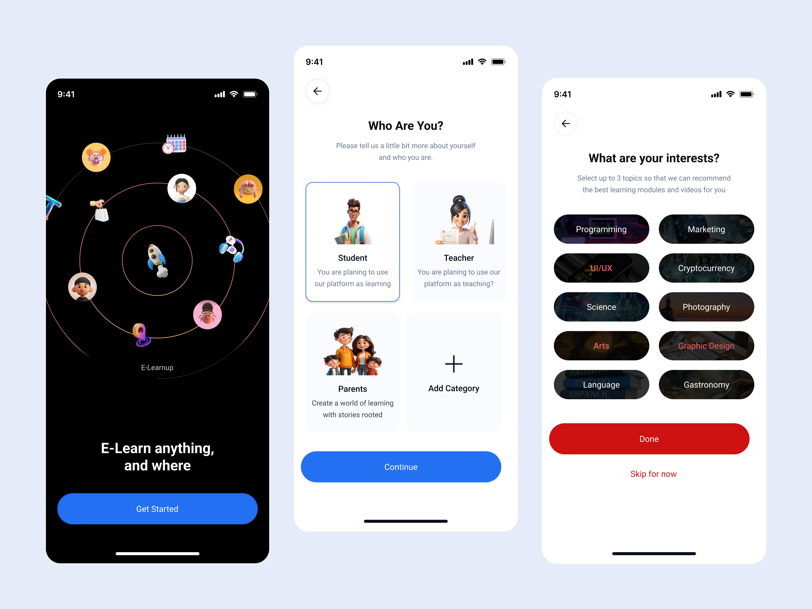
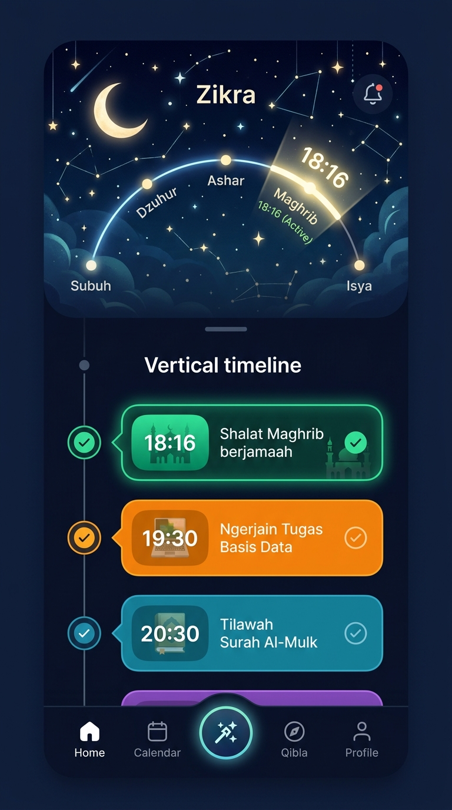
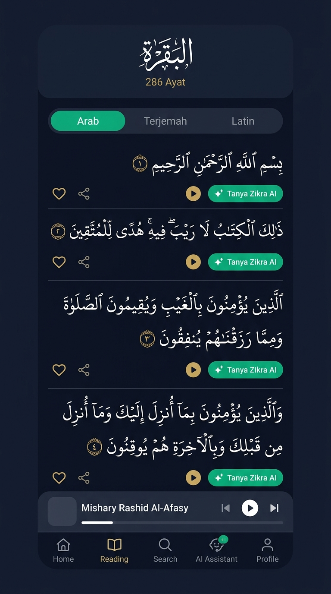
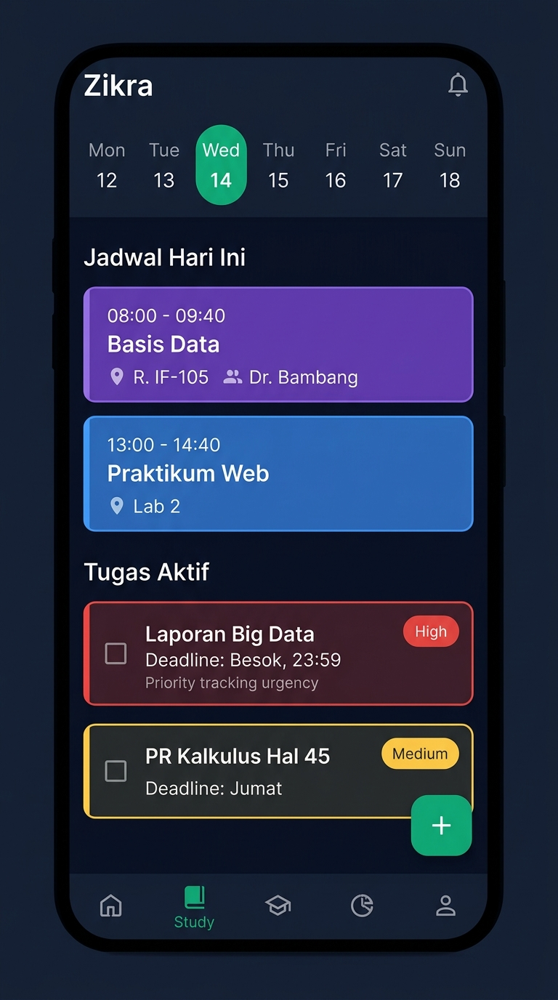
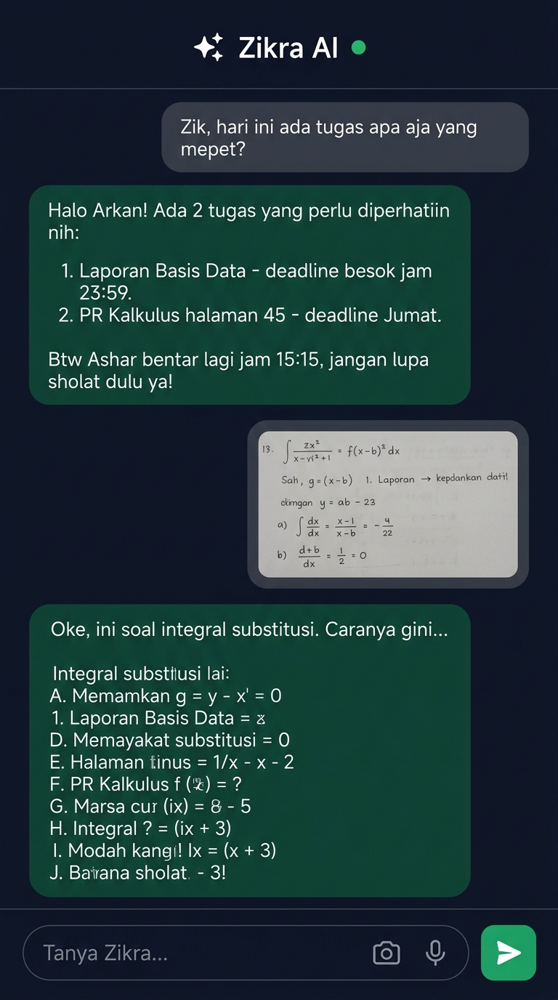
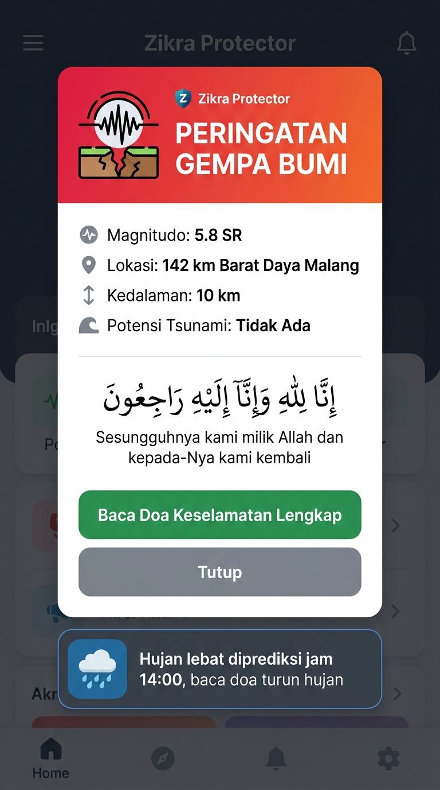
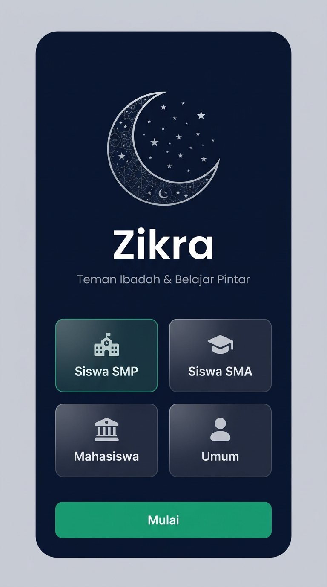

# 🎨 Panduan Lengkap Desain Zikra App untuk Figma AI

Dokumen ini berisi **Design System Tokens**, **Galeri Referensi Visual & Mockup**, serta **Prompt Siap Pakai (Copy-Paste)** untuk fitur **Figma AI** (First Draft), **Galileo AI**, **Uizard**, atau plugin Figma UI Generator lainnya.

---

## 🖼️ 1. Galeri Moodboard & Referensi Visual (Dribbble & Pinterest)

Berikut adalah tautan referensi visual nyata yang menjadi acuan utama setiap layar (bisa kamu buka dan tempel screenshot-nya di kanvas Figma):

| Halaman | Referensi Utama | Preview Gambar | Elemen Kunci yang Ditiru |
|---|---|---|---|
| **1. Onboarding** | [Dribbble: Blend wrk E-Learning Onboarding](https://dribbble.com/shots/26522453-E-Learning-Mobile-App-Onboarding-UI-Design) & [Pinterest Onboarding](https://www.pinterest.com/search/pins/?q=mobile%20app%20onboarding%20role%20selection%20ui) |  | 3 layar alur bertahap: Splash orbit ➔ 2x2 kartu pilihan peran (SMP/SMA/Kuliah/Umum) ➔ Pill chips target ibadah & belajar. |
| **2. Home Screen** | [Dribbble: Daily Planner & Timeline UI](https://dribbble.com/search/shots/popular?q=daily+planner+or+timeline+mobile+app+ui) & [Pinterest: Isha Manzoor Islamic App](https://id.pinterest.com/pin/311733605484580276/) |  | Hero card waktu sholat berikutnya dengan hitung mundur + garis waktu vertikal harian jam per jam yang bisa dicentang. |
| **3. Quran Reader** | [Dribbble: Suhayel Ahmed Nasim Quran App](https://dribbble.com/shots/25482292-Quran-Mobile-App) & [Pinterest Quran Collection](https://www.pinterest.com/search/pins/?q=quran%20app%20ui%20design%20minimalist) |  | Segmented toggle (Arab/Terjemah/Latin), kartu ayat berjarak lega, action bar per ayat (Tanya AI, Audio, Bookmark), sticky audio player. |
| **4. Study & Tasks** | [Dribbble: Student Schedule Timetable](https://dribbble.com/search/shots/popular?q=student+schedule+timetable+mobile+app) & [Pinterest: Habit & Task Tracker](https://id.pinterest.com/pin/152629874867602558/) |  | Horizontal week calendar strip, kartu jadwal pelajaran pastel warna-warni, checklist PR berdasarkan tingkat urgensi deadline. |
| **5. Zikra AI Chat** | [Pinterest: Smart Voice & AI Chat Assistant](https://id.pinterest.com/pin/192107359061514849/) & [Dribbble: AI Homework Helper](https://dribbble.com/search/shots/popular?q=ai+homework+helper) |  | 3D Glowing Orb AI, gelembung pesan bersih dengan dukungan rumus & kode, tombol kamera scan PR dan mic di input bar bawah. |
| **6. Zikra Protector** | [Dribbble: Emergency Alert Mobile UI](https://dribbble.com/search/shots/popular?q=emergency+alert+warning+mobile+app) & [Pinterest: Disaster Alert Sheet](https://www.pinterest.com/search/pins/?q=emergency%20alert%20sheet%20app%20ui) |  | Kartu status wilayah hijau (aman), grid data gempa BMKG, kartu doa musibah, tombol 1-klik "Kabari Orang Tua via WA", tombol SOS 112. |

---

## 📐 2. Design System Tokens (Acuan Gaya)

Gunakan parameter ini sebagai context awal di Figma:

* **Platform / Ukuran Frame:** Mobile iOS / Android (`393 × 852 px` — iPhone 15 / 16)
* **Font Family:** Inter / Plus Jakarta Sans (Modern, bersih, ramah pelajar)
* **Corner Radius:**
  * Kartu / Container: `16px` – `20px` (Rounded modern)
  * Tombol / Chips: `9999px` (Full pill shape)
  * Modal Sheet: `24px` (Top corners)
* **Palet Warna Utama (Color Palette):**
  * **Primary (Islamic Emerald):** `#10B981` (Aksen utama sholat, streak, status aktif)
  * **Secondary / AI Accent (Gold & Violet Glow):** `#F59E0B` (Sparkle emas) & `#8B5CF6` (AI orb / aksen cerdas)
  * **Background Dark Mode:** `#0B132B` (Dark Navy) atau `#0F172A` (Slate Dark)
  * **Background Light Mode:** `#F8FAFC` (Off-white bersih) dengan kartu `#FFFFFF`
  * **Kartu Akademik (Pastel):**
    * Ungu `#EDE9FE` / Text `#6D28D9` (Mata Kuliah / Pelajaran)
    * Biru `#E0F2FE` / Text `#0369A1` (Praktikum / Ekskul)
    * Oranye `#FFEDD5` / Text `#C2410C` (Tugas Deadline)
  * **Protector / Alert:** `#EF4444` (Merah Darurat) & `#F97316` (Oranye Siaga)

---

## 📋 3. Kumpulan Prompt Figma AI per Halaman

---

### 🚀 Screen 1: Onboarding Flow (3 Layar)
> 📌 **Referensi Visual Nyata:**  
> - 🏀 **Dribbble:** [Blend wrk E-Learning Onboarding](https://dribbble.com/shots/26522453-E-Learning-Mobile-App-Onboarding-UI-Design)  
> - 📌 **Pinterest:** [Mobile App Onboarding UI Collection](https://www.pinterest.com/search/pins/?q=mobile%20app%20onboarding%20role%20selection%20ui)

  
*Gambar 1.1: Referensi Alur 3 Layar Onboarding dari Dribbble Blend wrk*

  
*Gambar 1.2: Hasil Visual Mockup Onboarding Zikra App*

```text
Mobile app onboarding flow with 3 sequential screens for an Islamic student app named Zikra, 393x852px, modern clean minimalist aesthetic.

Screen 1 (Welcome Splash):
- Dark slate background (#0F172A).
- Center: Elegant glowing emerald crescent moon icon with an open book and golden 4-point AI sparkle star.
- Typography: Bold title "Harmoni Ibadah, Belajar, dan AI", subtitle "Asisten pintar harian untuk menjaga sholatmu tepat waktu dan tugasmu tuntas tepat jadwal."
- Bottom: Large rounded pill button "Mulai Sekarang" with emerald green fill (#10B981) and white bold text.

Screen 2 (Role Selection):
- Light/Off-white background (#F8FAFC). Top bar with back arrow and step indicator (2 of 3).
- Title: "Siapa Kamu?", subtitle "Pilih jenjangmu agar Zikra bisa menyesuaikan jadwal dan fitur untukmu."
- 2x2 grid of selectable cards with 16px corner radius:
  Card 1: 🎓 Mahasiswa (subtext: Kuliah dinamis, SKS & tugas kampus) - highlighted with emerald border.
  Card 2: 🎒 Siswa SMA (subtext: Pelajaran harian & persiapan ujian).
  Card 3: 📘 Siswa SMP (subtext: Target ibadah & PR sekolah).
  Card 4: 🌙 Umum / Remaja (subtext: Ibadah harian & agenda kerja).
- Bottom: Primary pill button "Lanjutkan".

Screen 3 (Focus & Habit Goals):
- Title: "Apa Target Fokusmu?", subtitle "Pilih 2-3 target utama kamu bersama Zikra."
- Flow layout of selectable chip pills with soft pastel borders:
  "🕌 Sholat Tepat Waktu", "📖 Rutin Tilawah Quran", "📚 Tugas Nggak Numpuk", "🤖 Solusi Soal PR (AI)", "⏰ Bangun Subuh Konsisten", "🚗 Doa & Keselamatan Harian".
- Bottom: Primary button "Selesai" and a subtle text link "Lewati dulu".
```

---

### 🏠 Screen 2: Home Screen (The Fusion Timeline)
> 📌 **Referensi Visual Nyata:**  
> - 🏀 **Dribbble:** [Daily Planner or Timeline Mobile App UI](https://dribbble.com/search/shots/popular?q=daily+planner+or+timeline+mobile+app+ui)  
> - 📌 **Pinterest:** [Islamic App UI/UX Design by Isha Manzoor](https://id.pinterest.com/pin/311733605484580276/)

  
*Gambar 2: Mockup Visual Home Screen — Fusion Orbit Sholat & Timeline Tugas*

```text
Mobile app Home Screen for an Islamic student companion app named Zikra, 393x852px, clean modern hybrid layout combining prayer tracker and student daily planner.

Top Header Bar:
- Left: User avatar with greeting "Halo, Arkan 👋" and subtitle "Siswa SMA / Mahasiswa".
- Right: Search icon, circular Shield Protector badge with green indicator (🛡️ 🟢), and Notification bell.

Hero Prayer Card (The Anchor):
- Sleek gradient card (Emerald Green to Dark Navy, #059669 to #0B132B) with rounded-2xl corners.
- Content: "DZUHUR 11:45" in large bold text, animated countdown pill "Tinggal 22 menit lagi", next prayer indicator, and subtle mosque dome silhouette in background.

Today's Integrated Timeline (The Flow):
- Header: "Jadwal & Agenda Hari Ini", date indicator "Rabu, 8 Oktober".
- Vertical timeline with continuous line and chronological activity cards:
  - 08:00 - 09:40: Purple pastel card (#EDE9FE) "Matematika / Basis Data - Lab 2" with tag "Pelajaran".
  - 11:45 - 12:15: Emerald green card (#D1FAE5) "🕌 Sholat Dzuhur Berjamaah" with checkbox icon.
  - 13:00 - 15:00: Blue pastel card (#E0F2FE) "Nugas Laporan Praktikum" with urgent deadline tag (#EF4444).
  - 15:15 - 15:35: Emerald green card "🕌 Sholat Ashar".
- Each card has a round circular checkbox on the right to mark completion.

Quick Tilawah Widget:
- Slim card at the bottom: Quran icon, text "Lanjut Baca: Al-Baqarah ayat 142", and play/continue button (▶).

Bottom Navigation Bar (Floating Island):
- 5 items: [Home (Active)], [Quran], [Center AI Glowing Orb Button with sparkle icon], [Tugas/Study], [Profil].
- Center button has elevated floating circular shape with emerald-purple gradient glow.
```

---

### 📖 Screen 3: Quran Reader Screen
> 📌 **Referensi Visual Nyata:**  
> - 🏀 **Dribbble:** [Quran Mobile App by Suhayel Ahmed Nasim](https://dribbble.com/shots/25482292-Quran-Mobile-App)  
> - 📌 **Pinterest:** [Modern Quran App UI Collection](https://www.pinterest.com/search/pins/?q=quran%20app%20ui%20design%20minimalist)

  
*Gambar 3: Mockup Visual Quran Reader dengan Floating Audio & Tombol Tanya AI*

```text
Mobile app Quran Reader screen, 393x852px, serene Islamic reading layout with modern typography and audio controls.

Top Bar:
- Back button, Surah title "Al-Baqarah (Sapi Betina)", Ayah counter "286 Ayat • Juz 1", and Bookmark icon.
- Segmented control toggle bar: [Arab (Selected, emerald pill)] | [Terjemahan] | [Latin].

Ayah Feed Cards:
- Card for Ayah 1:
  - Header: 8-pointed golden Islamic star with ayah number "1".
  - Arabic text: Large, elegant Uthmani calligraphy font, centered, high readability.
  - Indonesian translation below in clean sans-serif.
  - Action row per ayah: Heart (Favorite), Audio Play icon, Share icon, and special button "✨ Tanya Zikra AI" with subtle emerald border.
- Card for Ayah 2:
  - Same structured layout with clean divider.

Sticky Bottom Audio Player:
- Floating bar above bottom navigation:
- Qari name "Mishary Rashid Al-Afasy", audio scrubber progress bar, Play/Pause button, Previous, Next, and repeat mode icon.
```

---

### 📚 Screen 4: Study & Tasks (Jadwal & PR)
> 📌 **Referensi Visual Nyata:**  
> - 🏀 **Dribbble:** [Student Schedule & Timetable UI](https://dribbble.com/search/shots/popular?q=student+schedule+timetable+mobile+app)  
> - 📌 **Pinterest:** [Light Mode Habit & Task Tracker UI](https://id.pinterest.com/pin/152629874867602558/)

  
*Gambar 4: Mockup Visual Manajemen Jadwal Pelajaran dan Tugas Deadline*

```text
Mobile app Student Task and Class Schedule planner screen, 393x852px, modern productivity interface.

Top Section:
- Horizontal weekly calendar strip showing Mon-Sun. Today (Wed) highlighted in filled emerald green circle with white text.
- Filter chips: [Semua], [Mata Pelajaran], [Tugas & PR], [Ujian].

Section 1: "Jadwal Hari Ini" (Horizontal scrolling cards):
- Card 1: Purple theme, "Fisika / Basis Data", 08:00 - 09:40, Room IF-105.
- Card 2: Blue theme, "Bahasa Inggris", 10:00 - 11:30, Room 204.

Section 2: "Daftar Tugas & PR" (Sorted by Urgency):
- Task 1: Checkbox, title "Laporan Praktikum Fisika", badge "🔴 H-1 Deadline", subtext "Kumpul via Google Classroom".
- Task 2: Checkbox, title "Latihan Soal Matematika Bab 3", badge "🟡 Jumat, 23:59", subtext "Halaman 45 no 1-10".
- Task 3: Checkbox, title "Review Materi Kimia", badge "🟢 Minggu".

Bottom Floating Action Button (FAB):
- Emerald green circular button with plus (+) icon in bottom right corner to add new task.
```

---

### 🤖 Screen 5: Zikra AI Chat Screen
> 📌 **Referensi Visual Nyata:**  
> - 📌 **Pinterest:** [AI Assistant & Voice Smart Chat UI](https://id.pinterest.com/pin/192107359061514849/)  
> - 🏀 **Dribbble:** [AI Homework Helper Mobile UI](https://dribbble.com/search/shots/popular?q=ai+homework+helper)

  
*Gambar 5: Mockup Visual Zikra AI Chat — Asisten Tugas & Scan Soal PR*

```text
Mobile AI conversational assistant chat screen for a student companion app named Zikra AI, 393x852px.

Top Header:
- Left: Back arrow, Avatar with AI Sparkle badge, name "Zikra AI", green status dot "Online & Siap Bantu".
- Right: Clear chat icon and options menu.

Chat History Area:
- System message: "Halo Arkan! Aku tahu jadwal tugas dan waktu sholatmu hari ini. Butuh bantuan apa?"
- User bubble (Right side, dark gray #334155, white text): "Zik, gimana cara nyelesain integral substitusi ini?" with attached preview photo of a textbook problem.
- AI response bubble (Left side, deep emerald background #064E3B, crisp white text):
  - Step-by-step math solution with formatted formula rendering.
  - Follow-up reminder box inside bubble: "💡 Jangan lupa ya, 15 menit lagi masuk waktu Ashar (15:15). Mau istirahat sholat dulu?"

Bottom Input Dock:
- Elevated pill container:
- Camera button (📷 for scanning homework) + Microphone button (🎤 for voice questions).
- Text input: "Tanya soal pelajaran, fiqih, atau jadwalmu..."
- Send button: Circular emerald green button with paper plane icon.
```

---

### 🛡️ Screen 6 & 7: Zikra Protector (Layar Siaga & Modal Gempa BMKG)
> 📌 **Referensi Visual Nyata:**  
> - 🏀 **Dribbble:** [Emergency Alert & Disaster Warning UI](https://dribbble.com/search/shots/popular?q=emergency+alert+warning+mobile+app)  
> - 📌 **Pinterest:** [Disaster & Weather Alert Sheet UI](https://www.pinterest.com/search/pins/?q=emergency%20alert%20sheet%20app%20ui)

  
*Gambar 6: Mockup Visual Zikra Protector — Alert Gempa BMKG, Doa Musibah, dan Tombol Kabari Orang Tua*

```text
Mobile app emergency and weather safety screen named "Zikra Protector", 393x852px, serious yet calming emergency companion interface.

Top Header:
- Title "Zikra Protector", subtitle "Siaga Bencana BMKG & Doa Keselamatan", Settings gear icon.

Hero Status Card:
- Rounded card with soft emerald background (#ECFDF5) and border (#10B981).
- Icon: Glowing green shield (🛡️).
- Text: "STATUS WILAYAH: AMAN", subtext "📍 Sukolilo, Surabaya • Terhubung ke Server BMKG".
- Realtime stats row: "Gempa Terkini: M 4.1 (Jauh)", "Cuaca: Berawan 29°C", "AQI: 42 (Sehat)".

Emergency Dua & Safety Library (Card List):
- Card 1: 🌧️ "Doa Turun Hujan" with audio play button and "Waktu Mustajab" badge.
- Card 2: ⚡ "Doa Saat Mendengar Petir & Kilat" with Arabic text, transliteration, and meaning.
- Card 3: 🌋 "Doa Gempa Bumi & Musibah" ("Inna lillahi wa inna ilaihi raji'un...").
- Card 4: 🚗 "Doa Naik Kendaraan & Safar" (Doa berangkat sekolah/kampus).

Emergency Fast Action Buttons:
- 2 big prominent action cards at the bottom:
  - Left Card (Green accent): 📢 "Kabari Orang Tua / Keluarga" -> 1-tap WhatsApp broadcast "Alhamdulillah aku aman".
  - Right Card (Red accent): 🚨 "Panggilan Darurat (112)" -> Direct dial emergency contacts.
- Quick mitigation tip accordion: "Panduan Evakuasi saat di Gedung Sekolah/Kampus".
```

---

## 🛠️ 4. Cara Menggunakannya di Figma

1. **Buka Figma**, buat file baru (*New design file*).
2. Jika menggunakan **Figma AI (Make Designs / First Draft)**:
   - Tekan icon AI atau shortcut `Ctrl + K` / `Cmd + K`, pilih **"Generate UI / Make Designs"**.
   - Copy salah satu blok prompt di atas (misal **Screen 2: Home Screen**).
   - Paste dan tekan **Enter**.
3. Jika menggunakan plugin seperti **Galileo AI**, **UIzard**, atau **Wireframe Designer**:
   - Buka plugin tersebut di menu Plugins Figma.
   - Tempel prompt yang diinginkan, pilih mode *Mobile (iOS/Android)*.
4. Setelah frame terbentuk, gunakan **Design System Tokens** di bagian atas untuk menyelaraskan warna `#10B981` (Emerald) dan font *Plus Jakarta Sans*.
